# 01. Концепция

**Назначение.** Что строим, для кого, из каких частей и что не входит в первую версию.

**Связанные документы.** [glossary.md](glossary.md) — термины; [02-scenarios.md](02-scenarios.md) — как этим пользуются; [03-placement.md](03-placement.md) — как устроена единица работы.

**Затронутые записи реестра.** D-01, D-02, D-03, D-04, D-06, D-07, D-08, D-10, D-14, A-01, A-02, A-04, A-05, A-08, A-09, A-13, A-16, A-20, A-21, A-23, A-28, A-29, A-36, Q-01, Q-18, Q-19, Q-20, Q-21, Q-29, Q-32.

## 1. Что это

Биржа рекламы в каналах мессенджера MAX (D-01). Рекламодатель находит каналы в каталоге, собирает из них корзину, один раз готовит пост и оплачивает. Каждый блогер принимает или отклоняет заказ для своего канала. Принятый пост публикуется ботом платформы в назначенное время, висит оговорённый срок и удаляется автоматически. После приёмки блогер получает деньги.

Платформа берёт на себя три вещи, которые участники не могут сделать друг для друга:

1. **Маркировку.** Регистрирует договоры и рекламный материал у оператора рекламных данных, получает erid, вставляет его в пост, сдаёт отчётность (A-02).
2. **Контроль.** Сама публикует и удаляет пост, следит, чтобы он провисел срок и не был перекрыт другими постами.
3. **Расчёты.** Удерживает деньги рекламодателя до исхода размещения и платит блогеру только после приёмки.

## 2. Роли

| Роль | Кто это | Что делает | Что получает |
|---|---|---|---|
| Рекламодатель (`advertiser`) | Юрлицо или ИП (A-05) | Выбирает каналы, готовит пост, пополняет баланс, принимает работу | Размещение с маркировкой, отчёт с просмотрами, закрывающие документы |
| Блогер (`blogger`) | Самозанятый, ИП или юрлицо, владелец канала (D-14) | Подключает канал, ставит цены, принимает заказы и выбирает время | Заказы без поиска клиентов, выплату с чеком, снятую заботу о маркировке |
| Администратор (`admin`) | Сотрудник платформы | Проверяет каналы и посты, разбирает споры, ведёт ручные операции | — |

Один пользователь может выступать и рекламодателем, и блогером (A-13). Сторона договоров и расчётов — всегда организация, а не пользователь.

## 3. Сквозная цепочка

Рекламодатель выбирает каналы в каталоге и складывает их в корзину, указывая для каждого формат и окно дат. Готовит пост и оформляет заказ: с баланса удерживается сумма по каждому каналу. Администратор проверяет пост, платформа регистрирует его в ОРД и получает erid. Каждому блогеру приходит запрос; приняв его, блогер выбирает точное время. В это время бот публикует пост, через срок формата — удаляет. Рекламодатель принимает размещение или система принимает его сама по таймеру. Деньги уходят блогеру, комиссия остаётся платформе.

```mermaid
flowchart LR
    catalog[Каталог] --> cart[Корзина]
    cart --> post[Пост]
    post --> order[Заказ: удержание с баланса]
    order --> moderation[Модерация поста]
    moderation --> erid[Регистрация в ОРД, erid]
    erid --> accept[Принятие блогером, выбор времени]
    accept --> publish[Публикация ботом]
    publish --> remove[Снятие по сроку]
    remove --> acceptance[Приёмка]
    acceptance --> payout[Выплата блогеру]
```

Схема показывает путь без отклонений. Заказ на этой схеме — группа; всё, что правее модерации, происходит с каждым размещением отдельно. Отклонения описаны в 03 §6.

## 4. Принципы

Эти положения определяют устройство системы. Код, который им противоречит, считается ошибочным.

| № | Принцип | Следствие |
|---|---|---|
| 1 | Единица работы — размещение, а не заказ (D-02) | Состояния, таймеры, деньги, приёмка и спор существуют только у размещения. Отказ одного блогера не затрагивает остальные каналы заказа |
| 2 | Маркирует платформа (A-02) | Пост не может быть опубликован без erid в тексте. Реквизиты рекламодателя и блогера обязательны до оформления заказа |
| 3 | erid принадлежит версии поста, а не размещению (D-07) | Один заказ — один erid на все каналы. Статистика в ОРД подаётся по каждому каналу отдельно |
| 4 | Версия поста с erid неизменяема (D-03) | Правка создаёт новую версию и новый erid; уже опубликованные размещения остаются на старой версии |
| 5 | Публикует и удаляет только бот (A-01) | Канал без бота-администратора с правами `write` и `delete` в каталог не попадает. Блогер не публикует рекламный пост вручную |
| 6 | Деньги рекламодателя удерживаются до исхода (A-04) | Блогер получает выплату только после приёмки. Каждое удержание заканчивается выплатой, возвратом или их сочетанием |
| 7 | Оригинал файла не меняется (D-04) | Плашка и превью — отдельные производные файлы |
| 8 | Всё значимое записывается и не стирается | История состояний размещения, проводки и журнал действий — только на добавление |

## 5. Границы первой версии

Первая версия выходит сразу с деньгами и маркировкой (A-29).

### Входит

- Кабинеты рекламодателя, блогера и администратора.
- Подключение каналов MAX через бота, каталог с метриками, ценами и модерацией.
- Медиатека, редактор поста с форматированием MAX, альбом изображений (D-10), кнопка-ссылка, плашка, предпросмотр.
- Корзина, заказ, размещения с четырьмя форматами.
- Автоматическая публикация и удаление, контроль срока и «часов в топе».
- Маркировка через Яндекс ОРД (D-06): договоры, площадки, креативы, erid, статистика, акты.
- Баланс рекламодателя, оплата по счёту, удержание, выплаты через Рокет Ворк (D-08); блогерам-юрлицам — банковским переводом (A-36).
- Приёмка, претензии, споры, возвраты.
- Уведомления и отчёт по кампании.

### Не входит

| Что | Почему | Реестр |
|---|---|---|
| Другие площадки (Telegram, VK) | Не запрошено; абстракция под них не строится | A-28, Q-21 |
| Каналы без бота-администратора, ручная публикация блогером | Нет контроля срока и erid | A-01, Q-19 |
| Блогеры — физлица без статуса | Платформа стала бы налоговым агентом (проверить с юристом) | D-14 |
| Рекламодатели-физлица, оплата картой, онлайн-касса | Только перевод по счёту от юрлиц и ИП | A-05, Q-32 |
| Видео, аудио и файлы в посте | Отложено | A-23 |
| Категории рекламы, требующие документов и предупреждений (лекарства, медуслуги, БАД, финансы) | Нужны загрузка документов и ручная проверка | A-16, Q-20 |
| Запрещённые категории рекламы | Закон (проверить с юристом) | Q-29 |
| ЭДО | Отложено | A-20 |
| Денежные штрафы блогерам | Только рейтинг и блокировка | A-08, Q-18 |
| Сокращатель ссылок, подсчёт переходов | Только UTM-метки | A-21 |
| Несколько участников в организации с разными правами | В первой версии один участник | A-13 |
| Форматы «репост» и «нативный без срока» | Не входят в набор форматов | A-09 |

## 6. Внешние зависимости

| Система | Роль | Что будет, если недоступна | Документ |
|---|---|---|---|
| MAX Bot API | Публикация и удаление постов, события канала, просмотры, уведомления блогерам | Публикации и снятия откладываются и повторяются; при превышении окна повторов размещение срывается | 05 §2 |
| Яндекс ОРД | Регистрация контрагентов, договоров, площадок, креативов; erid; статистика и акты | Новые заказы не доходят до блогеров, пока не получен erid; уже опубликованное не затрагивается | 05 §3 |
| Рокет Ворк | Онбординг блогера как исполнителя, выплаты, чеки, налог самозанятого | Выплаты ждут; на размещения не влияет | 05 §4 |
| Банк ИП | Расчётный счёт: приём оплаты по счетам, пополнение депозита Рокет Ворк | Пополнения баланса зачисляются с задержкой | 05 §5 |
| Почта | Коды входа, уведомления рекламодателю | Вход невозможен | 07 §6 |

Платформа зависит от юридического статуса владельца: бот MAX, кабинет ОРД и договор с Рокет Ворк оформляются на ИП (D-08). Возможность создать бота MAX на ИП не подтверждена (Q-01) — это первая проверка проекта.

## 7. Критерии успеха

Из исследования:

1. Сквозной сценарий на тестовом канале: бот подключён → пост с форматированием и изображением опубликован → через заданный срок удалён автоматически → просмотры считаны.
2. Ограничения трёх внешних зависимостей (MAX, ОРД, выплаты) подтверждены до написания ТЗ этапов — вопросы группы «Проверки и доступы» реестра закрыты.

Для первой версии в целом:

3. Заказ на несколько каналов проходит от корзины до выплаты без ручных действий администратора, кроме модерации поста.
4. Ни один пост не выходит в канал без erid и строки маркировки.
5. Сумма всех счетов учёта в журнале проводок сходится в любой момент времени (06 §2.2).
