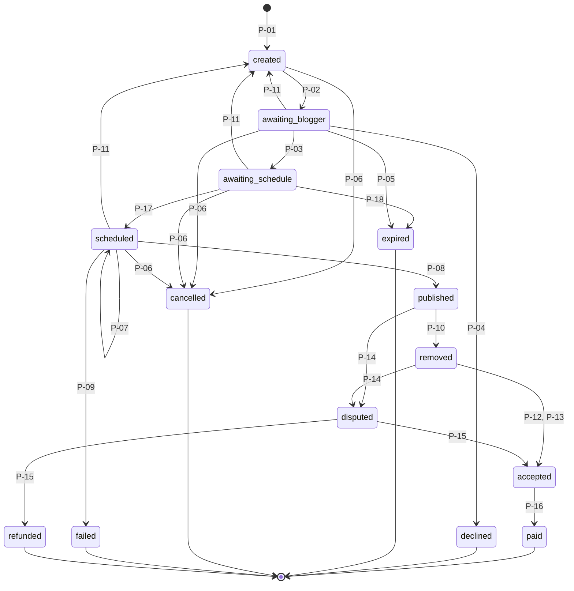

# 03. Размещение

**Назначение.** Точное описание единицы работы: из чего состоит размещение, в каких состояниях бывает, что его переводит из одного состояния в другое и что при этом происходит с деньгами и внешними системами. Центральный документ комплекта.

**Связанные документы.** [02-scenarios.md](02-scenarios.md) — сценарии, которые вызывают переходы; [04-domain-model.md](04-domain-model.md) — поля; [06-finance-legal.md](06-finance-legal.md) — проводки по каждому переходу; [05-integrations.md](05-integrations.md) — внешние вызовы.

**Затронутые записи реестра.** D-02, D-03, D-07, D-11, D-15, D-17, D-19, D-20, D-21, A-01, A-06, A-08, A-10, A-11, A-15, A-17, A-18, A-27, A-36, A-37, A-39, A-40, Q-03, Q-04, Q-17, Q-18.

## 1. Заказ и размещения

Заказ (`order`) — оформленная корзина с одним постом. Размещение (`placement`) — один канал этого заказа (D-02).

| Принадлежит заказу | Принадлежит размещению |
|---|---|
| Рекламодатель | Канал и блогер |
| Пост и его версии | Формат, окно дат, время публикации и снятия |
| Категория рекламы | Версия поста, с которой размещение выйдет |
| — | Цена блогера, комиссия, итог |
| — | Удержание, выплата, возврат |
| — | Состояние, история состояний |
| — | Публикация (сообщение в канале), просмотры |
| — | Претензия, спор, решение |

erid принадлежит версии поста (D-07): все размещения заказа, идущие с одной версией, несут один erid.

### 1.1. Состояние версии поста

Версия поста проходит подготовку один раз на весь заказ.

| Состояние | Название | Смысл |
|---|---|---|
| `pending_moderation` | на модерации | Ждёт решения администратора (A-15) |
| `rejected` | отклонена | Администратор отклонил; рекламодатель может создать новую версию |
| `approved` | одобрена | Идёт регистрация креатива в ОРД |
| `ready` | готова | erid получен, итоговый текст со строкой маркировки собран. Неизменяема (D-03) |

Переходы: `pending_moderation → approved` и `pending_moderation → rejected` — администратор (S-17); `approved → ready` — получен erid от ОРД. В обход маркировки версия становится `ready` только при `ORD_ENABLED=false` (локальная разработка, команда `maxim dev post-version ready`); при включённом ОРД такая команда отклоняется.

### 1.2. Состояние заказа

Состояние заказа — производное. Оно хранится в `order.status` для удобства выборок, но пересчитывается одной функцией после каждого перехода размещения и каждой смены состояния версии. Собственных переходов у заказа нет.

Правило расчёта, по порядку:

1. Все размещения в состоянии `cancelled` → `cancelled`.
2. Все размещения в конечных состояниях → `completed`.
3. Иначе по состоянию текущей версии поста (`order.current_post_version_id`): `pending_moderation` → `moderation`; `rejected` → `rejected`; `approved` → `marking`; `ready` → `in_progress`.

## 2. Форматы

Формат задаёт два числа: сколько часов пост должен оставаться последним в канале и через сколько часов после публикации он удаляется (D-19).

| Идентификатор | Название | `top_hours` | `duration_hours` |
|---|---|---|---|
| `f_1_24` | 1/24 | 1 | 24 |
| `f_2_48` | 2/48 | 2 | 48 |
| `f_3_72` | 3/72 | 3 | 72 |

Форматы — данные справочника `placement_format`, а не код. Набор форматов — D-19.

Нарушения формата:

- **Срок.** Публикация исчезла из канала раньше `remove_at`.
- **Топ.** В интервале от `published_at` до `published_at + top_hours` в канале появилось сообщение, созданное не ботом платформы.
- **Содержание.** Текст или вложения публикации отличаются от версии поста.

## 3. Состояния

| Идентификатор | Название | Смысл | Конечное |
|---|---|---|---|
| `created` | подготовка | Размещение создано, деньги удержаны. Ждёт, пока версия поста станет `ready`. Блогер его не видит | нет |
| `awaiting_blogger` | ожидает блогера | Запрос отправлен блогеру, идёт таймер принятия | нет |
| `awaiting_schedule` | ожидает планирования | Блогер принял запрос в работу, время публикации ещё не выбрано. Идёт таймер планирования (D-15) | нет |
| `scheduled` | запланировано | Блогер выбрал время или нажал «Опубликовать сейчас». Ждёт `publish_at` | нет |
| `published` | опубликовано | Пост в канале, идёт срок | нет |
| `removed` | снято | Пост удалён по сроку. Идёт окно претензий | нет |
| `disputed` | спор | Есть претензия или нарушение. Решает администратор | нет |
| `accepted` | принято | Работа принята. Сумма к выплате определена, выплата в работе | нет |
| `paid` | выплачено | Блогер получил деньги | да |
| `declined` | отклонено блогером | Блогер отказался | да |
| `expired` | истекло | Блогер не ответил или не запланировал публикацию вовремя | да |
| `cancelled` | отменено | Отменено рекламодателем, администратором или системой до публикации | да |
| `failed` | сорвано | Публикация не состоялась | да |
| `refunded` | возвращено | Спор решён полным возвратом | да |

Во всех конечных состояниях, кроме `paid`, удержание снято полностью в пользу рекламодателя.



## 4. Переходы

Переход выполняется только если размещение находится в состоянии «Из» и выполнены условия. Иначе запрос отклоняется (§11). «Деньги» — ссылка на строку таблицы проводок в 06 §2.3.

| № | Из | В | Кто запускает | Условия | Побочные действия | Деньги |
|---|---|---|---|---|---|---|
| P-01 | — | `created` | Рекламодатель: оформление заказа (S-06) | Проверки S-06; баланс ≥ суммы заказа (A-06, Q-17) | Зафиксировать `blogger_amount`, `fee_amount`, `total_amount`; привязать версию поста | Удержание |
| P-02 | `created` | `awaiting_blogger` | Система: версия поста стала `ready` | Канал `active`; до конца окна дат больше 1 часа; есть активное удержание | Запустить T-01; уведомить блогера | — |
| P-03 | `awaiting_blogger` | `awaiting_schedule` | Блогер: «Принять в работу» (S-14) | Исполнитель Рокет Ворк `active` (для блогера-юрлица не проверяется, A-36); канал `active` | Отменить T-01; запустить T-13; уведомить рекламодателя | — |
| P-04 | `awaiting_blogger` | `declined` | Блогер (S-14) | — | Отменить T-01; уведомить рекламодателя | Снятие удержания |
| P-05 | `awaiting_blogger` | `expired` | Таймер T-01 (S-23) | — | Уведомить обоих | Снятие удержания |
| P-06 | `created`, `awaiting_blogger`, `awaiting_schedule`, `scheduled` | `cancelled` | Рекламодатель (только из `created`, `awaiting_blogger`; S-07); администратор (`admin_cancel`, S-19); система (причины `channel_unavailable`, `window_elapsed`) | — | Отменить таймеры и задания; уведомить обоих; записать причину | Снятие удержания |
| P-07 | `scheduled` | `scheduled` | Блогер: перенос времени | До прежнего `publish_at` больше 1 часа; новое время удовлетворяет I-06 и I-07 | Обновить `publish_at`, `remove_at`; пересоздать задания; уведомить рекламодателя | — |
| P-08 | `scheduled` | `published` | Задание `publish_placement` (S-21) | MAX подтвердил создание сообщения | Создать `publication`; записать `published_at` — время сообщения по ответу MAX; пересчитать `remove_at = published_at + duration` и перенести задание снятия; запустить T-08; уведомить обоих | — |
| P-09 | `scheduled` | `failed` | Задание `publish_placement` после T-03 или при невыполненной проверке (S-21) | Причина `precondition_failed` — канал не `active`, версия не `ready`, итоговый текст не прошёл проверку I-01, изображений больше `PUBLISH_MAX_IMAGES`; `publish_error` — отказ MAX `4xx`, повторы до T-03 исчерпаны, задание взято после простоя позже T-03. Уточнение — в `reason_text` истории | Отменить задание снятия; уведомить обоих и администратора; записать причину | Снятие удержания |
| P-10 | `published` | `removed` | Задание `remove_placement` (S-22) | MAX подтвердил удаление, либо `admin_mark_removed` | Записать итоговые просмотры и `removed_at`; запустить T-05 (до этапа приёмки таймер повторяется раз в час, не меняя состояние); уведомить обоих | — |
| P-11 | `awaiting_blogger`, `awaiting_schedule`, `scheduled` | `created` | Рекламодатель: новая версия поста (S-29, причина `new_post_version`); система: ЕРИР отклонил креатив (S-28, причина `erir_rejected`) | — | Отменить таймеры и задания; очистить `publish_at`, `remove_at`; привязать новую версию (при `erir_rejected` версия не меняется — новой ещё нет); уведомить блогера | — (удержание сохраняется) |
| P-12 | `removed` | `accepted` | Рекламодатель (S-08) | — | Отменить T-05; `performance_share = 10000`; создать выплату | Распределение удержания |
| P-13 | `removed` | `accepted` | Таймер T-05 (S-24) | — | `performance_share = 10000`; создать выплату | Распределение удержания |
| P-14 | `published`, `removed` | `disputed` | Рекламодатель: претензия (S-08); система: нарушение (S-25, S-26, S-27); администратор (`admin_open_dispute`) | Для претензии: окно T-05 не истекло, претензий по размещению ещё нет | Создать `dispute` с причиной; отменить T-05; запустить T-06; уведомить обоих и администратора | — |
| P-15 | `disputed` | `accepted` или `refunded` | Администратор: решение (S-18) | Для `accepted`: публикация снята (I-02) | Записать `dispute_resolution` и `performance_share`; при `full_refund` и живой публикации — удалить пост; создать выплату, если `accepted`; уведомить обоих | Распределение удержания или снятие удержания |
| P-16 | `accepted` | `paid` | Система: Рокет Ворк подтвердил выплату (S-15) | Статус выплаты `succeeded` | Уведомить блогера | Выплата |
| P-17 | `awaiting_schedule` | `scheduled` | Блогер: «Запланировать публикацию» или «Опубликовать сейчас» (S-14) | Канал `active`; `publish_at` удовлетворяет I-06 и I-07 и ограничениям §5. Для «Опубликовать сейчас» `publish_at` — текущий момент | Записать `publish_at`, `remove_at`; создать задания `publish_placement`, `remove_placement`; отменить T-13; уведомить рекламодателя | — |
| P-18 | `awaiting_schedule` | `expired` | Таймер T-13 (S-23) | — | Уведомить обоих; причина `schedule_timeout` | Снятие удержания |

Исходы P-15:

| Решение | `performance_share` | Новое состояние |
|---|---|---|
| `full_payout` | 10000 | `accepted` |
| `proportional` | от 1 до 9999 | `accepted` |
| `full_refund` | 0 | `refunded` |

Особые правила:

- Публикует и удаляет только бот платформы (A-01). Задание `remove_placement` выполняется, когда размещение в `published` или `disputed` с живой публикацией. В `disputed` удаление не меняет состояние.
- При отклонении версии поста (`rejected`) размещения остаются в `created`, а их удержания снимаются. При сохранении следующей версии удержания создаются заново одной транзакцией; если баланса не хватает, версия не сохраняется.
- Размещение в `created` или `awaiting_blogger`, у которого до конца окна дат осталось меньше 1 часа, завершается: из `created` — P-06 с причиной `window_elapsed` (таймер T-14), из `awaiting_blogger` — P-05. Размещение в `awaiting_schedule` завершается по T-13, который не выходит за конец окна дат.
- Когда версия поста становится `ready`, размещение в `created` с этой версией вместо P-02 получает P-06: с причиной `channel_unavailable`, если канал не `active`; с причиной `window_elapsed`, если до конца окна дат не больше 1 часа (`PLACEMENT_WINDOW_GUARD`).
- P-02 проверяет активное удержание через порт журнала (`Holds.HasActive`). Размещение без активного удержания — нарушение I-03, то есть ошибка в коде: P-02 не выполняется, размещение остаётся в `created`, ERROR `placement without active hold`.
- Окно размещения: `window_start` — 00:00 МСК дня `date_from`, `window_end` — 00:00 МСК дня после `date_to`. Период времени суток — полуоткрытый `[time_from, time_to)`. Снимок не меняется при правке кампании.

## 5. Таймеры

Все значения — параметры конфигурации (A-10). Таймер — это задание планировщика с временем срабатывания; при срабатывании оно проверяет, что размещение всё ещё в ожидаемом состоянии.

| № | Название | Отсчёт от | Длительность | По истечении |
|---|---|---|---|---|
| T-01 | Принятие блогером | Переход в `awaiting_blogger` | `min(P-02 + 24 ч, window_end − 1 ч)` | P-05. За 3 ч до срока — напоминание блогеру (задание `placement_reminder`, 07 §2), если до срока при P-02 больше 3 ч; P-03, P-04, P-05, P-06 его отменяют |
| T-02 | Публикация | — | Момент `publish_at` | Запуск S-21 |
| T-03 | Окно повторов публикации | `publish_at` | 30 мин (`PUBLISH_RETRY_WINDOW`); попытки каждые 30 с (`PUBLISH_RETRY_INTERVAL`) | P-09 |
| T-04 | Снятие | `published_at` | `duration_hours` формата | Запуск S-22 |
| T-05 | Окно претензий | Переход в `removed` | 24 ч (`PLACEMENT_CLAIM_WINDOW`) | P-13 |
| T-06 | Срок решения по спору | Переход в `disputed` | 72 ч (`DISPUTE_DEADLINE`) | Оповещение старшему администратору; состояние не меняется |
| T-07 | Срок модерации поста | Версия поста стала `pending_moderation` | 24 ч; для срочного поста — 1 ч (A-40) | Оповещение администратору; состояние не меняется |
| T-08 | «Часы в топе» | `published_at` | `top_hours` формата | Контроль топа прекращается |
| T-09 | Сверка публикаций | — | Каждые 5 мин (A-27, `RECONCILE_INTERVAL`); проверки публикаций распределены внутри интервала | Запуск сверки (07 §3) |
| T-10 | Окно повторов снятия | `remove_at` | 24 ч (`REMOVE_RETRY_WINDOW`); задержка `min(30 с × 2^попытка, 1 ч)` | Оповещение администратору; публикация остаётся `removal_overdue` |
| T-11 | Ожидание erid | Версия поста стала `approved` (создан креатив) | 1 ч (`ORD_ERID_WAIT`) | Оповещение администратору (WARN `post_version_erid_overdue`): не таймер, а проверка зависших объектов раз в час (07 §3) |
| T-12 | Ожидание выплаты | Переход в `accepted` | 72 ч | Оповещение администратору |
| T-13 | Планирование публикации | Переход в `awaiting_schedule` | 24 ч, но не позже начала последнего допустимого слота: `time_to − 5 мин` последнего дня окна (D-15) | P-18 |
| T-14 | Окно дат истекло до отправки блогеру | Переход в `created` (P-01, P-11) | До `window_end − 1 ч` | P-06 с причиной `window_elapsed`, только из `created` |

Ограничения на выбор времени:

- Окно размещения задаётся на кампанию (D-17): период дат и период времени суток, общий для всех каналов заказа; правила — A-39; запуск возможен в день оплаты (D-20). Размещение хранит их снимок.
- `publish_at` при «Запланировать публикацию»: выбирает блогер (A-11); внутри периода дат и периода времени `[time_from, time_to)`; не раньше чем через 1 ч от момента планирования (`PLACEMENT_MIN_LEAD`); кратно 5 минутам (`PLACEMENT_SLOT_STEP`); не в интервале недоступности канала.
- `publish_at` при «Опубликовать сейчас»: текущий момент. Действие доступно, только когда текущий момент лежит внутри периода дат и периода времени (D-15, D-17); правило одного часа и кратность 5 минутам не применяются, недоступность канала и I-06 проверяются от текущего момента.
- `remove_at = publish_at + duration_hours`. Интервал топа полуоткрытый: `[publish_at, publish_at + top_hours)`; стык двух топов допустим.
- Причины отказа: `publish_at_required`, `outside_window`, `outside_time`, `too_soon`, `not_aligned`, `channel_unavailable_interval`, `slot_taken`.
- Все значения сроков — параметры конфигурации (07 §8): `PLACEMENT_ACCEPT_TIMEOUT`, `PLACEMENT_SCHEDULE_TIMEOUT`, `PLACEMENT_WINDOW_GUARD`, `PLACEMENT_MIN_LEAD`, `PLACEMENT_SLOT_STEP`, `PLACEMENT_REEDIT_GUARD`, `PUBLISH_RETRY_WINDOW`, `PUBLISH_RETRY_INTERVAL`, `REMOVE_RETRY_WINDOW`, `PLACEMENT_CLAIM_WINDOW`, `DISPUTE_DEADLINE`, `RECONCILE_INTERVAL`.

## 6. Ветки отказа

| Что случилось | Обнаружение | Переход | Исход для денег |
|---|---|---|---|
| Блогер отказался | Действие блогера | P-04 | Полный возврат |
| Блогер не ответил | T-01 | P-05 | Полный возврат |
| Блогер принял в работу, но не запланировал публикацию | T-13 | P-18 | Полный возврат |
| Рекламодатель отменил до принятия | Действие рекламодателя | P-06 | Полный возврат |
| Администратор отменил до публикации | `admin_cancel` | P-06 | Полный возврат |
| Канал стал недоступен до принятия | События MAX (S-25) | P-06, `channel_unavailable` | Полный возврат |
| Окно дат истекло до отправки блогеру | Проверка при P-02 и периодическая | P-06, `window_elapsed` | Полный возврат |
| Пост отклонён модерацией | Действие администратора | Нет перехода; удержания сняты | Деньги свободны до новой версии |
| Ошибка ОРД | Ответ ОРД (S-28) | Нет перехода либо P-11 | Удержание сохраняется |
| Публикация не удалась | T-03 или проверка (S-21) | P-09 | Полный возврат |
| Бот потерял права до публикации | События MAX; проверка в S-21 | P-09, если права не вернулись | Полный возврат |
| Бот потерял права после публикации | События MAX (S-25) | P-14, `bot_access_lost` | По решению |
| Пост удалён раньше срока | Событие или сверка (S-26) | P-14, `removed_early` | По решению; предложение — пропорционально |
| Пост изменён | Событие или сверка (S-26) | P-14, `content_modified` | По решению |
| Нарушены «часы в топе» | Событие или сверка (S-27) | P-14, `top_violated` | По решению; предложение — 50% |
| Претензия рекламодателя | Действие рекламодателя (S-08) | P-14, причина из претензии | По решению |
| Выплата не прошла | Ответ Рокет Ворк (S-15) | Нет перехода; размещение остаётся `accepted` | Повтор выплаты |

Причины спора (`dispute.reason`): `removed_early`, `content_modified`, `top_violated`, `bot_access_lost`, `content_mismatch`, `other`, `admin`. Первые четыре создаёт система, `content_mismatch` и `other` — рекламодатель, `admin` — администратор. Рекламодатель может указать и `removed_early` или `top_violated`, если система нарушения не нашла.

Санкции для блогера денежными не бывают (A-08, Q-18). Решение `full_refund` и `proportional` уменьшает рейтинг канала; повторные нарушения — основание для `block_channel`.

## 7. Пропорциональный возврат

Срок размещения проверяет система, исходов спора три (A-18). Доля исполнения `performance_share` хранится в базисных пунктах: целое от 0 до 10000.

Суммы размещения, зафиксированные при создании:

- `blogger_amount` — цена блогера;
- `fee_amount` — комиссия платформы;
- `total_amount = blogger_amount + fee_amount` — удержано с рекламодателя.

Распределение при переходе в `accepted` или `refunded`:

```
payout_amount  = floor(blogger_amount × performance_share / 10000)
fee_charged    = floor(fee_amount     × performance_share / 10000)
refund_amount  = total_amount − payout_amount − fee_charged
```

Остаток от округления всегда уходит рекламодателю. При `performance_share = 10000` возврат равен нулю; при 0 — всей сумме.

Долю, которую система предлагает администратору:

| Причина спора | Предложение |
|---|---|
| `removed_early` | `floor(10000 × (removed_at − published_at) / (remove_at − published_at))` |
| `top_violated` | 5000 (параметр `dispute.top_violation_share`) |
| остальные | нет предложения; администратор вводит долю сам |

Пример. Формат `f_1_24`, цена блогера 10 000,00 ₽, комиссия 15% — 1 500,00 ₽, удержано 11 500,00 ₽. Пост удалён через 18 часов: доля 7500. Выплата блогеру 7 500,00 ₽, комиссия 1 125,00 ₽, возврат 2 875,00 ₽.

Формула — `placement/domain.Distribute` (проверяет I-12). Распределение проводит журнал: `ledger/app.Settle` через порт `Holds.Settle` — транзакция `settlement` (проводка возврата только при `refund_amount > 0`, нулевые суммы не проводятся), удержание `distributed`, остаток `placement_hold` после неё нулевой. Вызов из P-12, P-13, P-15 — на этапе приёмки.

## 8. Контроль размещения

Пока размещение в `published` или `disputed` с живой публикацией, система следит за тремя вещами.

| Что | Основной способ | Запасной способ | Сценарий |
|---|---|---|---|
| Публикация на месте | Событие `message_removed` | Сверка T-09: `GET /messages/{id}` | S-26 |
| Содержание не изменено | Событие `message_edited` | Сверка T-09: сравнение текста и вложений | S-26 |
| «Часы в топе» | Событие `message_created` в канале до конца T-08 (A-17) | Сверка T-09: `GET /messages` за интервал топа | S-27 |
| Доступ бота | События `bot_removed`, `bot_admin_permissions_changed` | Суточная проверка прав (S-32) | S-25 |

Сообщения, созданные ботом платформы, топ не нарушают — в том числе другие рекламные публикации. Чтобы два размещения не мешали друг другу, действует I-06.

Правила контроля:

- Своё сообщение — автор с `user_id` бота платформы (`GET /me` или `MAX_BOT_USER_ID`). Сообщение без автора (пост от имени канала) — чужое.
- Сообщение, разобранное как код подключения канала, топ не нарушает: бот его удаляет (05 §2.4).
- Время нарушения — время сообщения по MAX, а не время прихода события; для пропажи поста, найденной сверкой, — время проверки.
- Каждое нарушение записывается в `violation`. Если по размещению уже открыт спор (I-11), новое нарушение только записывается; повтор того же события второй записи не создаёт.
- Спор, который открывает система (P-14): причина — вид нарушения, срок — T-06, предложение доли — по §7. При `removed_early` публикация помечается снятой с причиной `external`, задание снятия отменяется.

Приходят ли события о сообщениях людей и видит ли их `GET /messages` — не подтверждено (Q-03, Q-04). Если не подтвердится ни то, ни другое, контроль топа невозможен и из форматов убирается обещание «часов в топе».

Просмотры считываются: при каждой сверке (не чаще раза в час на публикацию) и непосредственно перед удалением (S-22). Последнее значение — итоговое.

## 9. Версии поста

- Пока версия в `pending_moderation` или `rejected`, erid нет. Правка создаёт новую версию; старая остаётся в истории.
- Версия в `ready` неизменяема (D-03). Правка создаёт новую версию, которая заново проходит модерацию и регистрацию в ОРД и получает новый erid.
- При сохранении новой версии: размещения в `created` привязываются к ней; размещения в `awaiting_blogger`, `awaiting_schedule` и `scheduled` выполняют P-11 и тоже привязываются к ней. Блогер принимает заново, потому что содержание изменилось.
- Размещения в `published` и далее остаются на своей версии. В одном заказе могут одновременно существовать размещения с разными версиями и разными erid.
- Креатив прежней версии, по которому не было ни одной публикации, в ОРД не используется и в статистику не попадает.

## 10. Инварианты

Код обязан сохранять эти условия при любом порядке событий. Каждое покрывается тестом.

| № | Инвариант |
|---|---|
| I-01 | Публикация создаётся только если версия поста в `ready`, erid задан, а отправляемый текст равен итоговому тексту, заново собранному из `body` и параметров маркировки этой версии (05 §2.5): строка маркировки с erid над или под постом либо erid в ссылках |
| I-02 | В `accepted` размещение попадает только при снятой публикации (`publication.removed_at` заполнено). Выплата создаётся только для размещения в `accepted` |
| I-03 | У размещения не больше одного активного удержания; сумма удержания равна `total_amount` |
| I-04 | Конечное состояние не покидается |
| I-05 | `blogger_amount`, `fee_amount`, `total_amount` после создания не меняются |
| I-06 | В одном канале интервалы топа не пересекаются: для любых двух размещений канала в `scheduled` или `published` полуоткрытые интервалы `[publish_at, publish_at + top_hours)` не имеют общих точек (стык допустим). Проверка — в транзакции под блокировкой строки канала |
| I-07 | `publish_at` лежит внутри периода дат и периода времени размещения (D-17) |
| I-08 | P-02, P-03, P-17 и P-08 выполняются только для канала в состоянии `active`; канал от 10 000 подписчиков без подтверждённого номера реестра РКН не бывает `active` (D-11) |
| I-09 | Версия поста в `ready` и её изображения не изменяются |
| I-10 | Смена состояния, запись в историю состояний и проводки выполняются в одной транзакции базы данных |
| I-11 | У размещения не больше одной публикации и не больше одного спора |
| I-12 | `payout_amount + fee_charged + refund_amount = total_amount` для каждого размещения в `accepted`, `paid`, `refunded` |
| I-13 | Внешний вызов (MAX, ОРД, Рокет Ворк) не выполняется внутри транзакции перехода: переход создаёт задание, задание делает вызов |

## 11. Идемпотентность

- Переход выполняется запросом вида «обновить, если текущее состояние равно ожидаемому». Если строка не обновилась, переход отклонён: вызывающему возвращается `conflict` с фактическим состоянием.
- Повторное событие или повторное задание, пришедшее после успешного перехода, ничего не меняет и не считается ошибкой.
- Задания `publish_placement` и `remove_placement` имеют ключ уникальности «тип + размещение». Перед отправкой сообщения задание проверяет, нет ли уже публикации; перед удалением — не снята ли она.
- Если отправка сообщения в MAX завершилась неизвестным исходом (таймаут), задание перед повтором ищет сообщение в канале через `GET /messages` за последние минуты по тексту со своим erid. Найдено — считается опубликованным.
- Действия пользователя (оформить заказ, отменить размещение или заказ, отправить изменённый пост, принять, отказаться, запланировать, перенести, подать претензию) принимают ключ идемпотентности от клиента — заголовок `Idempotency-Key` до 64 символов; повтор с тем же ключом возвращает текущее состояние объекта без нового перехода. Ключ хранится в записи истории (`placement_state_history.idempotency_key`, уникален вместе с размещением), у оформления — в `order.idempotency_key`, у правки поста — в `order.post_version_idempotency_key`. Без ключа повтор отклоняется `409 invalid_transition` с фактическим состоянием.
- Входящие события сохраняются с уникальным ключом и обрабатываются один раз (07 §2).

## 12. Журналирование

История состояний (`placement_state_history`) — неизменяемая, только на добавление. Каждый выполненный переход пишет одну запись в той же транзакции (I-10):

| Поле | Содержание |
|---|---|
| Размещение | Идентификатор |
| Переход | Код `P-NN` |
| Из, в | Состояния |
| Кто | Тип (`advertiser`, `blogger`, `admin`, `system`) и идентификатор пользователя, если есть |
| Причина | Код причины и текст, если есть |
| Источник | Идентификатор задания, входящего события или внешнего запроса, вызвавшего переход |
| Время | Момент перехода |

В журнал приложения:

| Событие | Уровень |
|---|---|
| Переход выполнен: размещение, код, из, в, кто, причина | INFO |
| Переход отклонён: размещение, запрошенный код, фактическое состояние, причина отказа | WARN |
| Повторное событие проигнорировано | DEBUG |
| Сработал таймер: номер, размещение, результат | INFO |
| Обнаружено нарушение: размещение, вид, время | WARN |
| Нарушен инвариант (попытка) | ERROR |
| Оповещение по T-06, T-07, T-10, T-11, T-12 | WARN |
