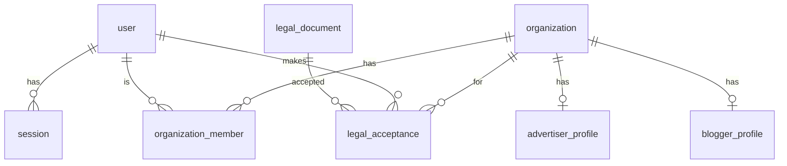
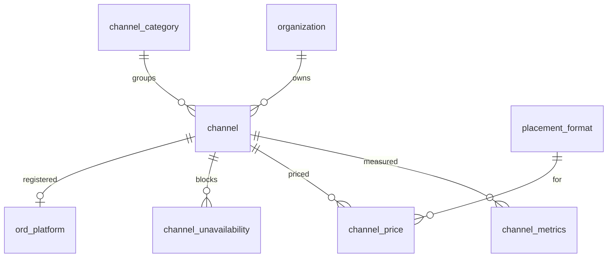
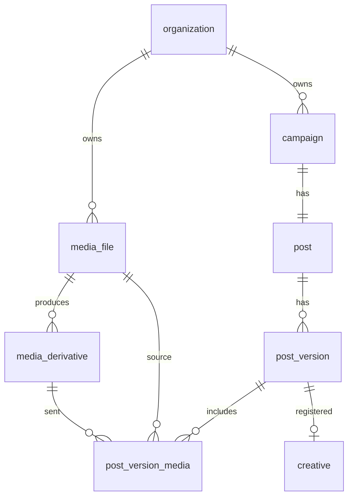
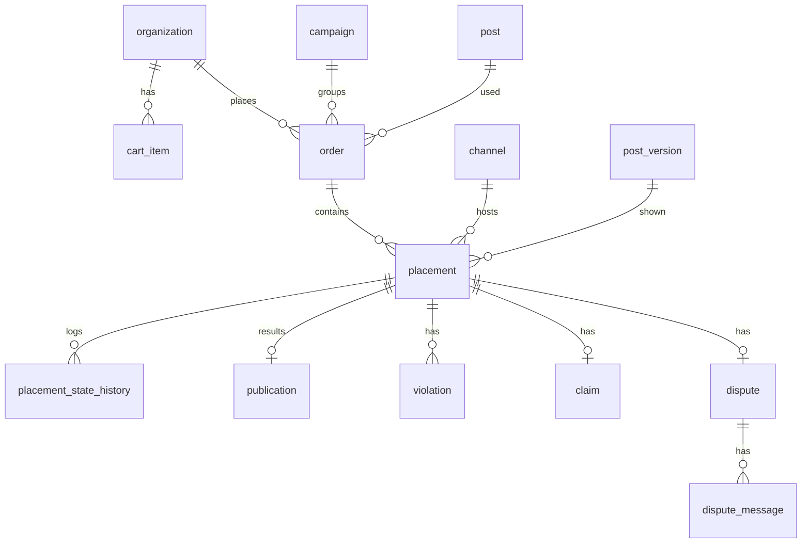
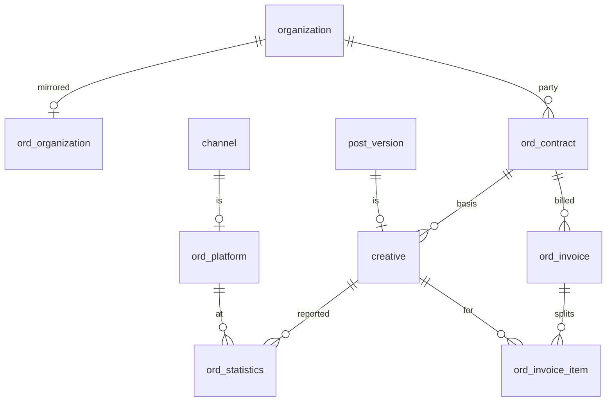
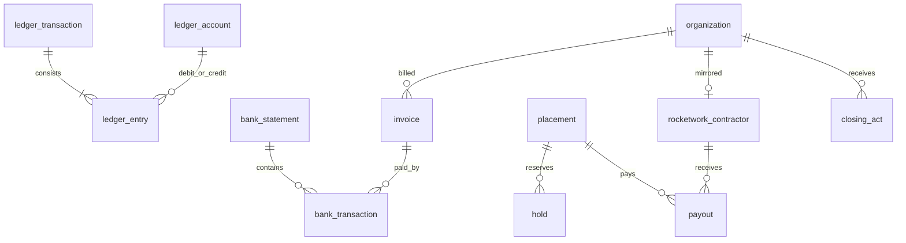

# 04. Модель данных

**Назначение.** Логическая схема данных: сущности, поля, связи, перечисления. По ней пишутся миграции и типы.

**Связанные документы.** [glossary.md](glossary.md) — названия; [03-placement.md](03-placement.md) — состояния и суммы размещения; [05-integrations.md](05-integrations.md) — внешние объекты; [06-finance-legal.md](06-finance-legal.md) — проводки.

**Затронутые записи реестра.** D-02, D-03, D-04, D-07, D-10, D-11, D-14, D-15, D-16, D-17, D-18, D-22, D-23, D-24, D-25, D-26, D-27, D-29, D-30, A-05, A-08, A-13, A-14, A-20, A-23, A-24, A-25, A-26, A-31, A-32, A-33, A-35, A-36, A-38, A-39, A-41, A-42, Q-33, Q-37, Q-38, Q-39.

## 1. Общие правила

- СУБД — PostgreSQL (A-26). Имена таблиц — в единственном числе, как идентификаторы в глоссарии.
- Первичный ключ каждой таблицы — `id uuid` (UUID версии 7, создаётся приложением). Исключения указаны явно.
- Каждая таблица имеет `created_at timestamptz not null`. Изменяемые — ещё и `updated_at timestamptz not null`. В таблицах полей ниже эти столбцы не повторяются.
- Время — `timestamptz` в UTC. Деньги — `bigint`, копейки, с ограничением `>= 0`, если не сказано иное.
- Перечисления хранятся как `text` с ограничением `check`; полный список значений — в §9.
- Внешние ключи объявляются всегда. Каскадного удаления нет.
- Удаление пользовательских данных — мягкое, полем `deleted_at`, и только там, где оно указано. Остальное не удаляется.
- **Неизменяемые таблицы** (только добавление, без `update` и `delete`): `placement_state_history`, `ledger_transaction`, `ledger_entry`, `audit_log`, `legal_acceptance`, `inbound_event` (кроме полей обработки), `outbound_request`. Запрет закрепляется правами роли базы данных.
- **Неизменяемые после фиксации строки**: `post_version` и `post_version_media` после перехода версии в `ready`; суммы `placement` после создания (I-05).
- Оптимистическая блокировка: у `placement`, `channel`, `payout`, `post_version` есть `lock_version integer not null default 0`, увеличивается при каждом обновлении.
- Объекты с отражением во внешней системе имеют поля синхронизации (§6.1).

Обозначения в таблицах: «Об.» — обязательность (`да` — `not null`).

## 2. Аккаунты и организации

### user

| Поле | Тип | Об. | Пояснение |
|---|---|---|---|
| `email` | `citext` | да | Уникально. Единственный идентификатор для входа (A-13) |
| `admin_role` | `text` | нет | `moderator`, `senior`. Пусто — не администратор |
| `status` | `text` | да | `active`, `blocked` |
| `last_login_at` | `timestamptz` | нет | |

Идентификатора пользователя MAX у `user` нет: привязки аккаунта MAX нет (D-25). Бот пишет блогеру по `channel.added_by_max_user_id` (A-41, Q-38).

### auth_code

Одноразовые коды: вход по почте и подключение канала (A-41).

| Поле | Тип | Об. | Пояснение |
|---|---|---|---|
| `purpose` | `text` | да | `login`, `channel_link` |
| `email` | `citext` | нет | Для `login` |
| `organization_id` | `uuid` | нет | Для `channel_link` — организация блогера, к которой привяжется канал |
| `code_hash` | `text` | да | Хеш кода; сам код не хранится |
| `expires_at` | `timestamptz` | да | 10 минут для `login`, 60 для `channel_link` |
| `attempts` | `integer` | да | Не более 5 |
| `consumed_at` | `timestamptz` | нет | Код использован или погашен новым кодом того же адреса |
| `requested_ip` | `inet` | нет | IP-адрес, с которого запрошен код: лимит 20 кодов на IP в час (07 §4) |

### session

| Поле | Тип | Об. | Пояснение |
|---|---|---|---|
| `user_id` | `uuid` | да | |
| `token_hash` | `text` | да | Уникально |
| `expires_at` | `timestamptz` | да | 30 суток от последнего использования |
| `ip`, `user_agent` | `inet`, `text` | нет | |
| `revoked_at` | `timestamptz` | нет | |

### organization

| Поле | Тип | Об. | Пояснение |
|---|---|---|---|
| `legal_type` | `text` | да | `legal_entity`, `sole_proprietor`, `self_employed` |
| `inn` | `text` | да | Уникально. 10 цифр для `legal_entity`, 12 для остальных; проверяется контрольное число |
| `name` | `text` | да | Официальное наименование или ФИО. Для `legal_entity` — сокращённое наименование, например «ООО «Ромашка»». Идёт в плашку, строку маркировки и ОРД |
| `contact_name` | `text` | да | |
| `phone` | `text` | да | |
| `kpp` | `text` | нет | 9 цифр. Только для `legal_entity` |
| `address` | `text` | нет | Юридический адрес для `legal_entity`, адрес регистрации для `sole_proprietor`. У `self_employed` не запрашивается |
| `tax_regime` | `text` | нет | Режим налогообложения (§9). Допустимые значения зависят от `legal_type` — таблица ниже |
| `vat_rate` | `text` | нет | Ставка НДС (§9). Допустимые значения зависят от `tax_regime` — таблица ниже |
| `tax_document_storage_key`, `tax_document_sha256` | `text` | нет | Файл документа, подтверждающего режим налогообложения |
| `signer_position`, `signer_name` | `text` | нет | Подписант: должность и ФИО. Только для `legal_entity` |
| `signer_basis_name`, `signer_basis_number` | `text` | нет | Документ, на основании которого действует подписант: название и номер. Только для `legal_entity` |
| `bank_account`, `bank_name`, `bank_corr_account`, `bank_bik` | `text` | нет | Банковские реквизиты рекламодателя: расчётный счёт, банк, корреспондентский счёт, БИК. Вводятся в разделе «Баланс», печатаются в счёте как реквизиты плательщика (D-26) |
| `is_platform` | `boolean` | да | `true` у единственной строки — самой платформы (ИП-владельца). Нужна как сторона договоров ОРД |
| `status` | `text` | да | `active`, `blocked` |

`address` заполняется при регистрации рекламодателя (S-01, 08 §4.2) и блогера (S-10, 08 §4.3) и обязателен для `sole_proprietor` и `legal_entity`. Поля `kpp`, `tax_regime`, `vat_rate`, файл документа и поля подписанта заполняются только у блогера (D-24) и обязательны в пределах его типа лица: `tax_regime`, `vat_rate` и файл документа — всем; `kpp` и поля подписанта — `legal_entity`. У организации, которая только рекламодатель, они пустые; если такая организация позже становится блогером, кабинет запрашивает их при подключении роли.

Допустимые сочетания — рабочие, проверить с бухгалтером (Q-37).

| `legal_type` | Допустимые `tax_regime` |
|---|---|
| `self_employed` | `npd` |
| `sole_proprietor` | `osno`, `usn`, `ausn`, `eshn`, `psn`, `npd` |
| `legal_entity` | `osno`, `usn`, `ausn`, `eshn` |

| `tax_regime` | Допустимые `vat_rate` |
|---|---|
| `osno` | `vat_22`, `none` (освобождение по ст. 145 НК) |
| `usn` | `none`, `vat_5`, `vat_7`, `vat_22` |
| `eshn` | `vat_22`, `none` (освобождение) |
| `ausn`, `psn`, `npd` | `none` |

### organization_member

| Поле | Тип | Об. | Пояснение |
|---|---|---|---|
| `organization_id`, `user_id` | `uuid` | да | Уникальная пара |
| `role` | `text` | да | `owner`. Других значений в первой версии нет (A-13) |

### advertiser_profile, blogger_profile

Первичный ключ — `organization_id`. Наличие строки означает, что у организации есть эта роль.

| Таблица | Поле | Тип | Об. | Пояснение |
|---|---|---|---|---|
| `advertiser_profile` | — | — | — | Дополнительных полей нет. Баланс берётся из счёта учёта |
| `blogger_profile` | `full_name` | `text` | нет | ФИО для обращения и выплат. Обязательно для `self_employed` и `sole_proprietor`; у `legal_entity` пусто |

Ограничение: `advertiser_profile` и `blogger_profile` допустимы при любом `legal_type` (D-24, D-14). Для блогера с `legal_entity` запись `rocketwork_contractor` не создаётся: выплаты идут вне Рокет Ворк (A-36).

### legal_document, legal_acceptance

| Таблица | Поле | Тип | Об. | Пояснение |
|---|---|---|---|---|
| `legal_document` | `kind` | `text` | да | `advertiser_offer`, `blogger_offer`, `platform_rules`, `privacy_policy` |
| | `version` | `integer` | да | Уникально в паре с `kind` |
| | `published_at` | `timestamptz` | да | |
| | `storage_key`, `sha256` | `text` | да | Файл документа |
| `legal_acceptance` | `legal_document_id`, `user_id`, `organization_id` | `uuid` | да | |
| | `accepted_at` | `timestamptz` | да | |
| | `ip` | `inet` | нет | |

Действующая версия документа — с наибольшим `version`. При выходе новой версии оформление заказа и принятие размещений требуют нового принятия (A-25). Повторное принятие той же версии организацией не создаёт второй строки.

До появления API администратора новую версию публикует служебная команда `maxim legal publish --kind <kind> --file <pdf>`: файл кладётся в закрытую область хранилища, `version` — наибольший для вида плюс один, действие записывается в `audit_log` с `actor_type = system`.

## 3. Каналы и каталог

### channel

Права бота и запись реестра РКН связаны с каналом один к одному, поэтому хранятся полями канала, а не отдельными таблицами.

| Поле | Тип | Об. | Пояснение |
|---|---|---|---|
| `organization_id` | `uuid` | нет | Владелец-блогер. Пусто у `unclaimed` |
| `max_chat_id` | `bigint` | да | Уникально |
| `title`, `max_description`, `icon_url`, `link` | `text` | нет | Из MAX, обновляются суточно и по событию `chat_title_changed` |
| `is_public` | `boolean` | да | Из MAX |
| `added_by_max_user_id` | `bigint` | да | Кто добавил бота (из `bot_added`). Адресат личных сообщений бота блогеру (A-41) |
| `description` | `text` | нет | Описание для каталога, пишет блогер |
| `category_id` | `uuid` | нет | Обязательно для выхода из `moderation` |
| `status` | `text` | да | См. §9 |
| `status_reason` | `text` | нет | Код причины: `not_public`, `missing_rights`, `rkn_required`, текст отказа модерации |
| `bot_is_admin` | `boolean` | да | |
| `bot_permissions` | `text[]` | да | Список прав из MAX |
| `bot_permissions_checked_at` | `timestamptz` | нет | |
| `subscribers_count` | `integer` | да | Последнее значение `participants_count` |
| `rkn_number` | `text` | нет | Номер в реестре РКН (D-11) |
| `rkn_status` | `text` | да | `not_required`, `pending`, `confirmed`, `rejected` |
| `rkn_checked_at`, `rkn_checked_by` | `timestamptz`, `uuid` | нет | Кто и когда проверил вручную |
| `rating` | `smallint` | да | От 0 до 100, начальное 100. Уменьшается по решениям споров (A-08) |
| `moderated_at`, `moderated_by` | `timestamptz`, `uuid` | нет | |

Ограничение: канал может быть `active` только при `organization_id is not null`, `is_public`, правах `write` и `delete`, заполненной категории, хотя бы одной включённой цене и (`subscribers_count < 10000` или `rkn_status = 'confirmed'`).

### channel_metrics

Суточный снимок. Уникальная пара `(channel_id, date)`.

| Поле | Тип | Об. | Пояснение |
|---|---|---|---|
| `channel_id` | `uuid` | да | |
| `date` | `date` | да | |
| `subscribers_count` | `integer` | да | |
| `avg_views` | `integer` | нет | Средние просмотры поста; расчёт — 05 §2.7 |
| `engagement_bp` | `integer` | нет | `avg_views / subscribers_count`, в базисных пунктах |
| `posts_per_week` | `numeric(6,2)` | нет | Показывается в карточке канала, в строке каталога — нет (D-29) |
| `anomaly_flags` | `text[]` | да | `subscribers_spike`, `views_disproportion` |

### channel_category

`slug text unique`, `name text`, `position integer`, `is_active boolean`. Список фиксированный, меняется администратором (A-14).

### placement_format

Первичный ключ — `id text`. Значения — 03 §2.

| Поле | Тип | Об. |
|---|---|---|
| `id` | `text` | да |
| `name` | `text` | да |
| `top_hours` | `integer` | да |
| `duration_hours` | `integer` | да |
| `is_active` | `boolean` | да |
| `position` | `integer` | да |

### channel_price

| Поле | Тип | Об. | Пояснение |
|---|---|---|---|
| `channel_id`, `format_id` | `uuid`, `text` | да | Уникальная пара |
| `amount` | `bigint` | да | Цена блогера без комиссии. От 10 000 до 1 000 000 000 копеек |
| `is_enabled` | `boolean` | да | |

### channel_unavailability

`channel_id uuid`, `starts_at timestamptz`, `ends_at timestamptz`. Интервалы, в которые блогер не принимает публикации (S-13). `publish_at` не может попасть в такой интервал.

## 4. Медиатека и посты

### media_file

Оригинал. Содержимое не меняется (D-04).

| Поле | Тип | Об. | Пояснение |
|---|---|---|---|
| `organization_id` | `uuid` | да | |
| `storage_key` | `text` | да | Ключ в объектном хранилище. Уникально |
| `mime` | `text` | да | `image/jpeg`, `image/png`, `image/webp` |
| `size_bytes` | `bigint` | да | Не более 50 МБ |
| `width`, `height` | `integer` | да | Не более 7680 каждое |
| `sha256` | `text` | да | |
| `original_name` | `text` | да | |
| `deleted_at` | `timestamptz` | нет | Мягкое удаление. Файл, использованный в версии поста, из хранилища не удаляется |

### media_derivative

| Поле | Тип | Об. | Пояснение |
|---|---|---|---|
| `media_file_id` | `uuid` | да | |
| `kind` | `text` | да | `labeled` — с плашкой; `plain` — копия для публикации без плашки; `preview` — уменьшенная |
| `params_hash` | `text` | да | Хеш параметров построения: текст плашки, версия шаблона. Уникально в тройке с `media_file_id`, `kind` |
| `storage_key` | `text` | да | |
| `public_url` | `text` | нет | Постоянная публичная ссылка. Обязательна для `labeled` и `plain`: её получает ОРД как образец (05 §3.4) |
| `width`, `height`, `size_bytes` | | да | |

### campaign

Кампания: наименование, единый пост для всех каналов и общие требования к публикации (D-16, D-17).

| Поле | Тип | Об. | Пояснение |
|---|---|---|---|
| `organization_id` | `uuid` | да | |
| `name` | `text` | да | Наименование кампании |
| `status` | `text` | да | `draft` — до оплаты; `ordered` — оплачена, есть заказ; `archived`. В кампании может быть несколько заказов; в первой версии — один |
| `date_from`, `date_to` | `date` | нет | Период дат публикации (A-39). Обязательны к оплате |
| `time_from`, `time_to` | `time` | нет | Период времени суток, МСК (A-39). Обязательны к оплате |
| `extra_requirements` | `text` | нет | «Дополнительные требования» — комментарий исполнителю |

### post

| Поле | Тип | Об. | Пояснение |
|---|---|---|---|
| `organization_id` | `uuid` | да | |
| `campaign_id` | `uuid` | да | Уникально: у кампании один пост (D-16) |
| `status` | `text` | да | `draft`, `archived` |
| `draft` | `jsonb` | да | Текущее редактируемое содержимое: документ редактора, идентификаторы файлов по порядку, место токена |

### post_version

Снимок поста. Создаётся при оформлении заказа и при каждой правке после него (03 §9). После перехода в `ready` не изменяется (D-03).

| Поле | Тип | Об. | Пояснение |
|---|---|---|---|
| `post_id` | `uuid` | да | |
| `number` | `integer` | да | Уникально в паре с `post_id`, с 1 |
| `status` | `text` | да | `pending_moderation`, `rejected`, `approved`, `ready` (03 §1.1) |
| `content_doc` | `jsonb` | да | Документ редактора |
| `body` | `text` | да | Текст в формате API MAX без строки маркировки. Не более 3800 символов (A-38) |
| `final_text` | `text` | нет | Итоговый текст: `body` и строка маркировки по месту токена (05 §2.5). Заполняется при переходе в `ready`. Не более 4000 символов |
| `token_carrier` | `text` | да | Где пометка «Реклама» с названием и ИНН: `text` или `media` (D-18, A-38). По умолчанию `media`, без изображений — `text` (D-30) |
| `token_position` | `text` | да | Где erid: `link`, `above`, `below` (D-18, A-38). По умолчанию `below` (D-30) |
| `advertiser_name`, `advertiser_inn` | `text` | да | Снимок реквизитов на момент создания версии |
| `moderated_by`, `moderated_at` | | нет | |
| `rejection_reason` | `text` | нет | |
| `created_by` | `uuid` | да | |

### post_version_media

| Поле | Тип | Об. | Пояснение |
|---|---|---|---|
| `post_version_id` | `uuid` | да | |
| `position` | `integer` | да | С 0. Уникально в паре с версией. Альбом (D-10): не более 10 строк на версию (A-23) |
| `media_file_id` | `uuid` | да | Оригинал |
| `media_derivative_id` | `uuid` | да | Файл, который уходит в канал: `labeled` или `plain` |

## 5. Заказы и размещения

### cart_item

Корзина — набор строк организации; отдельной таблицы `cart` нет.

| Поле | Тип | Об. | Пояснение |
|---|---|---|---|
| `organization_id`, `channel_id` | `uuid` | да | Уникальная пара |
| `format_id` | `text` | да | |
| `shown_total_amount` | `bigint` | да | Итог, показанный рекламодателю при добавлении. Сравнивается при оформлении |

### order

| Поле | Тип | Об. | Пояснение |
|---|---|---|---|
| `number` | `bigint` | да | Человекочитаемый номер, уникальный, из последовательности |
| `organization_id` | `uuid` | да | Рекламодатель |
| `campaign_id` | `uuid` | да | В первой версии у кампании один заказ (D-16) |
| `post_id` | `uuid` | да | |
| `current_post_version_id` | `uuid` | да | Последняя версия |
| `status` | `text` | да | Производное (03 §1.2): `moderation`, `rejected`, `marking`, `in_progress`, `completed`, `cancelled` |
| `total_amount` | `bigint` | да | Сумма `total_amount` размещений при создании |
| `created_by` | `uuid` | да | |

### placement

| Поле | Тип | Об. | Пояснение |
|---|---|---|---|
| `order_id`, `channel_id` | `uuid` | да | Уникальная пара. Размещение — единица работы (D-02) |
| `blogger_organization_id` | `uuid` | да | Снимок владельца канала при создании |
| `format_id` | `text` | да | |
| `top_hours`, `duration_hours` | `integer` | да | Снимок формата |
| `window_start`, `window_end` | `timestamptz` | да | Снимок периода дат кампании: начало первого и конец последнего дня |
| `time_from`, `time_to` | `time` | да | Снимок периода времени суток кампании (D-17) |
| `post_version_id` | `uuid` | да | Версия, с которой выйдет или вышло размещение |
| `status` | `text` | да | 03 §3 |
| `status_changed_at` | `timestamptz` | да | |
| `status_reason` | `text` | нет | Код причины последнего перехода |
| `fee_rate_bp` | `integer` | да | Ставка комиссии на момент создания |
| `blogger_amount`, `fee_amount`, `total_amount` | `bigint` | да | Неизменяемы (I-05) |
| `accept_deadline_at` | `timestamptz` | нет | T-01 |
| `schedule_deadline_at` | `timestamptz` | нет | T-13 |
| `publish_at`, `remove_at` | `timestamptz` | нет | Заполняются при P-17 |
| `published_at`, `removed_at` | `timestamptz` | нет | Факт |
| `claim_deadline_at` | `timestamptz` | нет | T-05 |
| `performance_share` | `integer` | нет | От 0 до 10000 (03 §7) |
| `payout_amount`, `fee_charged`, `refund_amount` | `bigint` | нет | Заполняются при распределении удержания (I-12) |
| `final_views` | `integer` | нет | Просмотры на момент снятия |
| `lock_version` | `integer` | да | |

Индексы: `(channel_id, status)`, `(status, accept_deadline_at)`, `(order_id)`. I-06 проверяется в транзакции с блокировкой строки канала.

### placement_state_history

Поля — 03 §12: `placement_id`, `transition` (`P-NN`), `from_status`, `to_status`, `actor_type`, `actor_user_id`, `reason_code`, `reason_text`, `job_id`, `inbound_event_id`, `outbound_request_id`. Неизменяема.

### publication

| Поле | Тип | Об. | Пояснение |
|---|---|---|---|
| `placement_id` | `uuid` | да | Уникально (I-11) |
| `channel_id` | `uuid` | да | |
| `max_message_id` | `text` | да | Уникально |
| `url` | `text` | нет | Публичная ссылка на пост из ответа MAX |
| `published_at` | `timestamptz` | да | |
| `removed_at` | `timestamptz` | нет | |
| `removal_reason` | `text` | нет | `schedule`, `external`, `admin`, `refund` |
| `removal_overdue` | `boolean` | да | Удаление по сроку не удалось (T-10) |
| `views` | `integer` | нет | Последнее считанное значение |
| `views_checked_at` | `timestamptz` | нет | |
| `content_hash` | `text` | да | Хеш отправленного текста и вложений — для сравнения при `message_edited` |

### violation

| Поле | Тип | Об. | Пояснение |
|---|---|---|---|
| `placement_id` | `uuid` | да | |
| `kind` | `text` | да | `removed_early`, `content_modified`, `top_violated`, `bot_access_lost` |
| `occurred_at` | `timestamptz` | да | Когда произошло |
| `source` | `text` | да | `event`, `reconciliation` |
| `inbound_event_id` | `uuid` | нет | |
| `details` | `jsonb` | да | Например, идентификатор постороннего сообщения |

### claim

`placement_id uuid unique`, `reason text` (`removed_early`, `top_violated`, `content_mismatch`, `other`), `text text` (до 2000 символов), `created_by uuid`.

### dispute

Решение по спору (`dispute_resolution`) хранится полями этой же таблицы.

| Поле | Тип | Об. | Пояснение |
|---|---|---|---|
| `placement_id` | `uuid` | да | Уникально (I-11) |
| `reason` | `text` | да | 03 §6 |
| `opened_by_type` | `text` | да | `advertiser`, `system`, `admin` |
| `claim_id`, `violation_id` | `uuid` | нет | Что стало основанием |
| `deadline_at` | `timestamptz` | да | T-06 |
| `suggested_share` | `integer` | нет | Предложение системы (03 §7) |
| `resolution` | `text` | нет | `full_payout`, `proportional`, `full_refund` |
| `performance_share` | `integer` | нет | Итоговая доля |
| `resolution_comment` | `text` | нет | Обязателен при решении |
| `resolved_by`, `resolved_at` | | нет | |

### dispute_message

`dispute_id uuid`, `author_type text`, `author_user_id uuid`, `text text`. Переписка по спору.

## 6. Маркировка

### 6.1. Поля синхронизации

Есть у `ord_organization`, `ord_contract`, `ord_platform`, `creative`, `ord_statistics`, `ord_invoice`.

| Поле | Тип | Об. | Пояснение |
|---|---|---|---|
| `ord_external_id` | `text` | нет | Идентификатор объекта в ОРД |
| `sync_status` | `text` | да | `pending` — ждёт отправки; `sent` — отправлено, ждём подтверждения; `synced` — подтверждено; `error` — требует вмешательства (S-20) |
| `sync_request_id` | `text` | нет | `reqid` для опроса статуса |
| `sync_error` | `text` | нет | Последняя ошибка |
| `sync_attempts` | `integer` | да | |
| `synced_at` | `timestamptz` | нет | |
| `payload_hash` | `text` | нет | Хеш отправленных данных — чтобы понять, нужна ли повторная отправка |

### Сущности

| Таблица | Поля сверх синхронизации | Уникальность |
|---|---|---|
| `ord_organization` | `organization_id uuid` | `organization_id` |
| `ord_contract` | `kind text` (`initial`, `publisher`); `client_organization_id`, `contractor_organization_id uuid`; `number text`; `signed_date date` | `(kind, client_organization_id, contractor_organization_id)` |
| `ord_platform` (A-32) | `channel_id uuid`; `name text`; `url text` | `channel_id` |
| `creative` (D-07) | `post_version_id uuid`; `ord_contract_id uuid` (изначальный); `erid text`; `erir_status text` (`pending`, `success`, `error`); `erir_error text` | `post_version_id`; `erid` |
| `ord_statistics` | `creative_id`, `ord_platform_id`, `placement_id uuid`; `period date` (первое число месяца); `impressions integer`; `shown_from`, `shown_to date`; `amount bigint` | `(creative_id, ord_platform_id, period)` |
| `ord_invoice` | `ord_contract_id uuid`; `period date`; `number text`; `invoice_date date`; `amount bigint` | `(ord_contract_id, period)` |
| `ord_invoice_item` | `ord_invoice_id`, `creative_id`, `ord_platform_id uuid`; `amount bigint` | `(ord_invoice_id, creative_id, ord_platform_id)` |

Договор `initial`: клиент — рекламодатель, исполнитель — платформа. Договор `publisher`: клиент — платформа, исполнитель — блогер (A-31). Параметры договоров для ОРД — A-33.

Справочника категорий рекламы нет: категорий в первой версии нет (D-27). Код ККТУ для регистрации креатива в ОРД берётся из конфигурации, один для всех креативов (A-42, Q-39).

## 7. Деньги

### invoice

| Поле | Тип | Об. | Пояснение |
|---|---|---|---|
| `number` | `text` | да | Уникально. Указывается в назначении платежа |
| `organization_id` | `uuid` | да | |
| `amount` | `bigint` | да | |
| `status` | `text` | да | `issued`, `paid`, `expired`, `cancelled` |
| `expires_at` | `timestamptz` | да | 14 суток от выставления |
| `paid_at`, `paid_amount` | | нет | Фактическая сумма может отличаться |
| `pdf_storage_key` | `text` | да | |

В PDF счёта как реквизиты плательщика печатаются наименование, ИНН и банковские реквизиты организации на момент выставления (`organization.bank_*`, D-26). Если банковские реквизиты не сохранены, в счёте только наименование и ИНН.

### bank_statement, bank_transaction

| Таблица | Поле | Тип | Об. | Пояснение |
|---|---|---|---|---|
| `bank_statement` | `uploaded_by`, `storage_key` | | да | Загруженный файл выписки (A-35) |
| `bank_transaction` | `bank_statement_id` | `uuid` | да | |
| | `external_id` | `text` | да | Идентификатор операции из выписки. Уникально — защита от повторного зачисления |
| | `operation_date` | `date` | да | |
| | `amount` | `bigint` | да | |
| | `payer_inn`, `payer_name`, `purpose` | `text` | нет | |
| | `match_status` | `text` | да | `matched`, `unmatched`, `ignored` |
| | `invoice_id`, `organization_id` | `uuid` | нет | Результат сопоставления |
| | `matched_by` | `uuid` | нет | Пусто — сопоставлено автоматически |

### ledger_account

| Поле | Тип | Об. | Пояснение |
|---|---|---|---|
| `kind` | `text` | да | 06 §2.1 |
| `organization_id` | `uuid` | нет | Для `advertiser_balance`, `blogger_payable` |
| `placement_id` | `uuid` | нет | Для `placement_hold` |
| `balance` | `bigint` | да | Кеш суммы проводок; может быть отрицательным только у счетов-активов по правилам 06 §2.2. Обновляется в транзакции с проводкой |

Уникальность: `(kind, organization_id, placement_id)` с учётом пустых значений.

### ledger_transaction, ledger_entry

Неизменяемы.

| Таблица | Поле | Тип | Об. | Пояснение |
|---|---|---|---|---|
| `ledger_transaction` | `kind` | `text` | да | Вид операции (06 §2.3) |
| | `placement_id`, `invoice_id`, `payout_id`, `bank_transaction_id` | `uuid` | нет | Основание; заполняется подходящее |
| | `actor_type`, `actor_user_id` | | да / нет | `system`, `admin`, `advertiser` |
| | `reason` | `text` | нет | Обязателен для `manual` и `balance_return` |
| | `idempotency_key` | `text` | да | Уникально |
| `ledger_entry` | `ledger_transaction_id` | `uuid` | да | |
| | `debit_account_id`, `credit_account_id` | `uuid` | да | Разные счета |
| | `amount` | `bigint` | да | Строго больше нуля |

### hold

| Поле | Тип | Об. | Пояснение |
|---|---|---|---|
| `placement_id` | `uuid` | да | Частичный уникальный индекс при `status = 'active'` (I-03) |
| `amount` | `bigint` | да | Равно `placement.total_amount` |
| `status` | `text` | да | `active`, `released` — снято целиком; `distributed` — распределено при приёмке или решении спора |
| `closed_at` | `timestamptz` | нет | |

### rocketwork_contractor

| Поле | Тип | Об. | Пояснение |
|---|---|---|---|
| `organization_id` | `uuid` | да | Уникально |
| `external_id` | `text` | нет | Идентификатор исполнителя в Рокет Ворк |
| `status` | `text` | да | `invited`, `pending`, `active`, `blocked` |
| `onboarding_url` | `text` | нет | |
| `status_checked_at` | `timestamptz` | нет | |
| `last_error` | `text` | нет | |

### payout

Одна строка — одна попытка выплаты.

| Поле | Тип | Об. | Пояснение |
|---|---|---|---|
| `placement_id` | `uuid` | да | Частичный уникальный индекс при `status` из `created`, `sent`, `succeeded` — не больше одной живой выплаты |
| `rocketwork_contractor_id` | `uuid` | да | |
| `amount` | `bigint` | да | Равно `placement.payout_amount` |
| `attempt` | `integer` | да | С 1 |
| `status` | `text` | да | `created`, `sent`, `succeeded`, `failed` |
| `external_id` | `text` | нет | Идентификатор в Рокет Ворк |
| `provider_fee` | `bigint` | нет | Комиссия Рокет Ворк за выплату |
| `receipt_url` | `text` | нет | Чек |
| `failure_code`, `failure_message` | `text` | нет | |
| `sent_at`, `completed_at` | `timestamptz` | нет | |
| `idempotency_key` | `text` | да | Уникально. Передаётся в Рокет Ворк |
| `lock_version` | `integer` | да | |

Заявок на вывод остатка нет (D-26): возврат остатка — проводка `balance_return`, которую администратор вводит по обращению в поддержку (06 §2.3).

### closing_act

`organization_id uuid`, `period date`, `number text unique`, `placements_amount bigint` (услуги блогеров), `fee_amount bigint` (вознаграждение платформы), `pdf_storage_key text`. Уникальная пара `(organization_id, period)` (A-20).

## 8. Служебные

### job

| Поле | Тип | Об. | Пояснение |
|---|---|---|---|
| `kind` | `text` | да | Вид задания (07 §2) |
| `dedupe_key` | `text` | нет | Уникально среди заданий в `pending` и `running` |
| `payload` | `jsonb` | да | |
| `run_at` | `timestamptz` | да | |
| `status` | `text` | да | `pending`, `running`, `succeeded`, `failed`, `cancelled` |
| `attempts`, `max_attempts` | `integer` | да | |
| `last_error` | `text` | нет | |
| `locked_by`, `locked_at` | | нет | Какой экземпляр обработчика взял задание |
| `finished_at` | `timestamptz` | нет | |

Индекс: `(status, run_at)`.

### inbound_event

| Поле | Тип | Об. | Пояснение |
|---|---|---|---|
| `source` | `text` | да | `max`, `rocketwork` |
| `external_key` | `text` | да | Ключ события во внешней системе. Уникально в паре с `source` |
| `event_type` | `text` | да | |
| `payload` | `jsonb` | да | Сырое тело |
| `status` | `text` | да | `received`, `processed`, `ignored`, `failed` |
| `processed_at`, `error` | | нет | |

### outbound_request

| Поле | Тип | Об. | Пояснение |
|---|---|---|---|
| `system` | `text` | да | `max`, `yandex_ord`, `rocketwork` |
| `operation` | `text` | да | Имя операции адаптера |
| `idempotency_key` | `text` | нет | |
| `attempt` | `integer` | да | |
| `request` | `jsonb` | да | Без токенов и заголовков авторизации |
| `response_status` | `integer` | нет | |
| `response_body` | `jsonb` | нет | |
| `duration_ms` | `integer` | нет | |
| `error` | `text` | нет | |
| `object_type`, `object_id` | | нет | К чему относится |

Хранится 180 суток, затем удаляется заданием очистки.

### notification

| Поле | Тип | Об. | Пояснение |
|---|---|---|---|
| `user_id` | `uuid` | да | |
| `channel` | `text` | да | `max_bot`, `email`, `cabinet` |
| `template` | `text` | да | Код шаблона |
| `payload` | `jsonb` | да | |
| `status` | `text` | да | `pending`, `sent`, `failed`, `read` |
| `object_type`, `object_id` | | нет | |
| `sent_at`, `read_at` | | нет | |

### audit_log

Неизменяем.

| Поле | Тип | Об. | Пояснение |
|---|---|---|---|
| `actor_type` | `text` | да | `advertiser`, `blogger`, `admin`, `system` |
| `actor_user_id` | `uuid` | нет | |
| `organization_id` | `uuid` | нет | |
| `action` | `text` | да | Код действия, например `channel.approve`, `placement.admin_cancel`, `ledger.manual` |
| `object_type`, `object_id` | | да | |
| `reason` | `text` | нет | Обязателен для действий администратора из S-19 |
| `data` | `jsonb` | да | Что изменилось: значения до и после |
| `ip` | `inet` | нет | |

Обязаны попадать в журнал действий: вход и выход; создание и изменение организации и реквизитов; принятие юридических документов; подключение, модерация, блокировка канала и изменение цен; оформление заказа; создание версии поста; решения модерации; действия блогера по размещению; претензии и решения по спорам; все ручные операции S-19; загрузка выписки и ручное сопоставление; все операции с деньгами, запущенные человеком; изменение справочников.

Переходы размещения в журнал действий не дублируются: их источник — `placement_state_history`.

## 9. Перечисления

| Перечисление | Значения |
|---|---|
| `organization.legal_type` | `legal_entity`, `sole_proprietor`, `self_employed` |
| `organization.tax_regime` | `osno` — общая система; `usn` — упрощённая; `ausn` — автоматизированная упрощённая; `eshn` — единый сельхозналог; `psn` — патент; `npd` — налог на профессиональный доход |
| `organization.vat_rate` | `none` — без НДС; `vat_5`; `vat_7`; `vat_22` |
| `channel.status` | `unclaimed` — бот добавлен, канал ещё не связан с организацией кодом подключения (A-41); `pending_rights` — не хватает прав или канал закрытый; `moderation`; `active`; `rejected`; `suspended` — временно недоступен (права, РКН); `disconnected` — бот удалён; `blocked` — заблокирован администратором |
| `channel.rkn_status` | `not_required`, `pending`, `confirmed`, `rejected` |
| `post_version.status` | `pending_moderation`, `rejected`, `approved`, `ready` |
| `campaign.status` | `draft`, `ordered`, `archived` |
| `post_version.token_carrier` | `text`, `media` |
| `post_version.token_position` | `link`, `above`, `below` |
| `order.status` | `moderation`, `rejected`, `marking`, `in_progress`, `completed`, `cancelled` |
| `placement.status` | `created`, `awaiting_blogger`, `awaiting_schedule`, `scheduled`, `published`, `removed`, `disputed`, `accepted`, `paid`, `declined`, `expired`, `cancelled`, `failed`, `refunded` |
| `publication.removal_reason` | `schedule`, `external`, `admin`, `refund` |
| `violation.kind` | `removed_early`, `content_modified`, `top_violated`, `bot_access_lost` |
| `claim.reason` | `removed_early`, `top_violated`, `content_mismatch`, `other` |
| `dispute.reason` | `removed_early`, `content_modified`, `top_violated`, `bot_access_lost`, `content_mismatch`, `other`, `admin` |
| `dispute.resolution` | `full_payout`, `proportional`, `full_refund` |
| `sync_status` | `pending`, `sent`, `synced`, `error` |
| `creative.erir_status` | `pending`, `success`, `error` |
| `invoice.status` | `issued`, `paid`, `expired`, `cancelled` |
| `hold.status` | `active`, `released`, `distributed` |
| `payout.status` | `created`, `sent`, `succeeded`, `failed` |
| `rocketwork_contractor.status` | `invited`, `pending`, `active`, `blocked` |
| `job.status` | `pending`, `running`, `succeeded`, `failed`, `cancelled` |
| `inbound_event.status` | `received`, `processed`, `ignored`, `failed` |
| `notification.channel` | `max_bot`, `email`, `cabinet` |
| `actor_type` | `advertiser`, `blogger`, `admin`, `system` |

Причины перехода (`placement.status_reason`, `placement_state_history.reason_code`): `advertiser_cancel`, `admin_cancel`, `channel_unavailable`, `window_elapsed`, `blogger_declined`, `accept_timeout`, `schedule_timeout`, `publish_error`, `precondition_failed`, `new_post_version`, `erir_rejected`, `auto_acceptance`.

## 10. Персональные данные

| Что хранится | Где | Зачем |
|---|---|---|
| Почта | `user.email` | Вход, уведомления |
| Идентификатор пользователя MAX | `channel.added_by_max_user_id` | Сообщения бота блогеру (A-41) |
| ФИО | `organization.name`, `organization.contact_name`, `organization.signer_name`, `blogger_profile.full_name` | Договор, маркировка, выплаты |
| ИНН | `organization.inn` | Договор, ОРД, выплаты |
| Телефон | `organization.phone` | Связь |
| Адрес регистрации ИП | `organization.address` | Договор, закрывающие документы |
| Документ о режиме налогообложения | `organization.tax_document_storage_key` | Подтверждение режима и ставки НДС |
| Банковские реквизиты рекламодателя | `organization.bank_account`, `bank_name`, `bank_corr_account`, `bank_bik` | Реквизиты плательщика в счёте, возврат остатка через поддержку (D-26) |
| IP-адрес | `session.ip`, `auth_code.requested_ip`, `legal_acceptance.ip`, `audit_log.ip` | Безопасность, лимиты частоты, доказательство принятия документов |

Не хранится: паспортные данные, фотографии документов, удостоверяющих личность, банковские карты и счета блогеров — всё это находится в Рокет Ворк (A-24). В `outbound_request` и журнале приложения персональные данные маскируются (07 §5).

Состав и основания обработки — проверить с юристом (Q-33).
