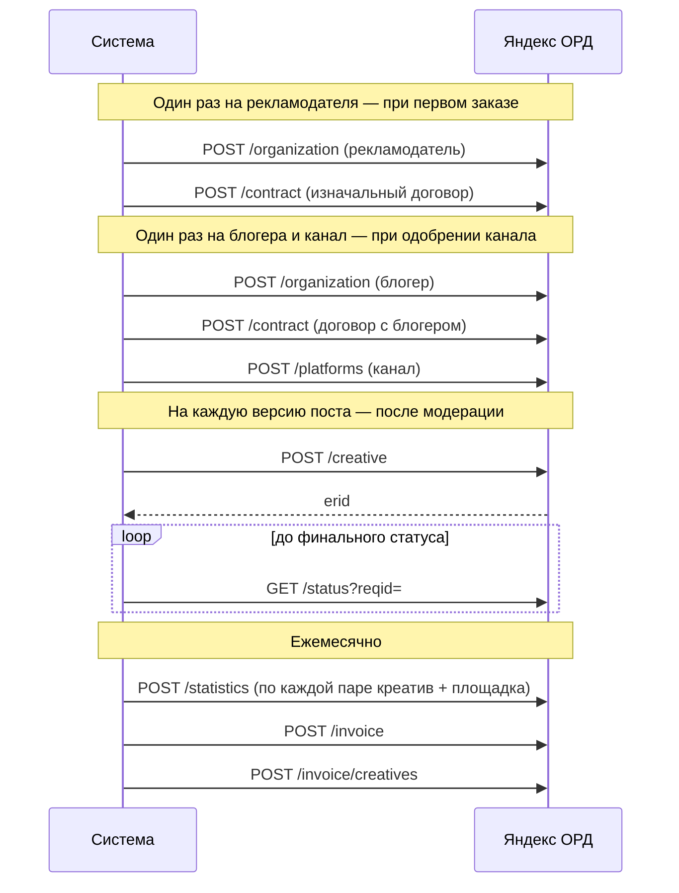

# 05. Интеграции

**Назначение.** Как система работает с внешними сервисами: что вызывает, что получает, как переживает ошибки. По документу пишутся адаптеры.

**Связанные документы.** [03-placement.md](03-placement.md) — какие переходы запускают вызовы; [04-domain-model.md](04-domain-model.md) — где хранятся внешние идентификаторы; [07-non-functional.md](07-non-functional.md) — планировщик и журналирование.

**Затронутые записи реестра.** D-01, D-03, D-05, D-06, D-07, D-08, D-10, D-14, D-18, D-19, D-22, D-23, D-25, D-27, A-01, A-02, A-04, A-05, A-17, A-21, A-23, A-27, A-28, A-31, A-32, A-33, A-35, A-36, A-38, A-41, A-42, Q-01, Q-03, Q-04, Q-05, Q-06, Q-07, Q-08, Q-09, Q-10, Q-11, Q-12, Q-13, Q-14, Q-15, Q-16, Q-26, Q-30, Q-31, Q-32, Q-35, Q-36, Q-38, Q-39.

Источник фактов — исследование. Всё, что там не подтверждено документацией или живой проверкой, помечено вопросом реестра и собрано в подразделах «Не подтверждено». Имена методов и полей, которых нет в исследовании, в документе не приводятся: адаптер пишется по актуальной документации сервиса.

## 1. Общие правила

Действуют для всех внешних систем.

**Адаптер.** Каждая система закрыта интерфейсом на языке предметной области (`PublishPost`, `RegisterCreative`, `CreatePayout`). Остальной код не знает адресов, форматов и кодов ошибок внешней системы (A-28). У каждого интерфейса есть поддельная реализация для тестов и локального запуска.

**Где вызывать.** Только из задания планировщика, никогда — внутри транзакции перехода состояния (I-13) и никогда — в обработчике запроса пользователя. Сведения о канале и права бота при подключении тоже читает задание (`refresh_channel_info`, §2.4): событие `bot_added` приходит Webhook, ответ на него не ждёт MAX.

**Таймауты.** Соединение — 5 с; запрос целиком — 30 с; загрузка файла — 120 с.

**Повторы.** Повторяются сетевые ошибки, таймауты, ответы `5xx` и `429`. Ответы `4xx`, кроме `429`, не повторяются: это ошибка данных, объект переводится в состояние ошибки. Внутри одного запуска задания — до 3 попыток с задержками 1, 2, 4 с. Дальше — повтор задания по правилам планировщика (07 §2). При `429` задержка берётся из ответа, если он её сообщает.

**Неизвестный исход.** Если запрос на создание завершился таймаутом, перед повтором адаптер проверяет, не создан ли объект (03 §11). Если система принимает ключ идемпотентности — он передаётся всегда.

**Успех проверяется по телу.** Ответ `200` может означать отказ: MAX возвращает `success=false` при удалении. Адаптер разбирает тело и превращает такой ответ в ошибку.

**Предохранитель.** После 10 ошибок подряд по одной системе вызовы к ней приостанавливаются на 60 с; задания откладываются. Событие — уровень ERROR и оповещение администратору.

**Сохранение запросов.** Каждый вызов записывается в `outbound_request`: система, операция, попытка, запрос без секретов, код и тело ответа, длительность, связанный объект.

**Секреты.** Токены хранятся в хранилище секретов окружения, в базе — только зашифрованными (07 §4). В журнал и в `outbound_request` не попадают.

**Журналирование.**

| Событие | Уровень | Поля |
|---|---|---|
| Вызов начат и завершён | DEBUG | система, операция, идентификатор запроса, попытка, длительность, код ответа |
| Операция выполнена (объект создан, пост опубликован, выплата отправлена) | INFO | система, операция, наш объект, внешний идентификатор |
| Попытка не удалась, будет повтор | WARN | то же и текст ошибки |
| Повторы исчерпаны или получен отказ `4xx` | ERROR | то же и тело ответа без персональных данных |
| Сработал предохранитель | ERROR | система, число ошибок |

## 2. MAX Bot API

Единственная площадка размещения (D-01).

### 2.1. Доступ

| Параметр | Значение |
|---|---|
| Адрес | `https://platform-api2.max.ru` |
| Авторизация | Токен бота в заголовке `Authorization` |
| Сертификат | Сервер использует сертификат Минцифры: корневой сертификат добавляется в доверенные в образе приложения |
| Получение событий | В продакшене — только Webhook по HTTPS с доверенным сертификатом. Long Polling — только в разработке |
| Лимиты | До 30 запросов в секунду на платформу; до 2 сообщений в секунду в один канал |
| Клиент | Собственный тонкий HTTP-клиент по OpenAPI-схеме внутри адаптера. Официальный клиент для Go `max-messenger/max-bot-api-client-go` не используется: каждая попытка записывается в `outbound_request`, а повторы и предохранитель общие для всех систем (§1) |
| Описание API | OpenAPI-схема `max-messenger/api-schema` |

Бота создаёт верифицированная организация; модерация бота — до двух рабочих дней; не более 5 ботов на компанию. Можно ли создать бота на ИП — не подтверждено (Q-01). Нужно два бота: продакшен и тестовый.

### 2.2. Webhook и события

Приём события:

1. Проверить подлинность запроса (Q-35): секретная часть пути `/webhooks/max/{secret}` и секрет подписки в заголовке `X-Max-Bot-Api-Secret`, оба за постоянное время. Не прошло — ответ `401`, запись уровня WARN; пять отказов за 10 минут — оповещение. Приём — отдельный обработчик с сырым телом, а не сгенерированный по спецификации: ключ события считается от тела как есть.
2. Сохранить тело в `inbound_event` с уникальным ключом. Ключ — идентификатор события, если MAX его передаёт; иначе SHA-256 от тела.
3. Если ключ уже есть — ответить `200` и больше ничего не делать.
4. Создать задание обработки и ответить `200`. Обработка в самом запросе не выполняется.

Реакция на события:

| Событие | Условие | Реакция | Сценарий |
|---|---|---|---|
| `bot_added` | Это канал | Создать или восстановить канал, сохранить `added_by_max_user_id`, запросить сведения и права. Новый канал — `unclaimed` до кода подключения (A-41) | S-12 |
| `bot_added` | Это не канал | Бот покидает чат | — |
| `bot_removed` | Канал известен | Канал `disconnected`; обработать размещения | S-25 |
| `bot_admin_permissions_changed` | Канал известен | Обновить права; сменить состояние канала; обработать размещения | S-12, S-25 |
| `message_created` | Диалог с ботом | Ответить инструкцией: как зарегистрироваться и подключить канал. Привязки аккаунта MAX нет (D-25) | — |
| `message_created` | Канал `unclaimed`, текст — действующий код подключения | Связать канал с организацией кода, удалить сообщение, погасить код (A-41) | S-12 |
| `message_created` | Канал, автор — не наш бот | Проверить «часы в топе» по размещениям канала | S-27 |
| `message_created` | Канал, автор — наш бот | Ничего | — |
| `message_edited` | Сообщение — наша публикация | Сравнить с версией поста | S-26 |
| `message_removed` | Сообщение — наша публикация и удаляли не мы | Зафиксировать досрочное снятие | S-26 |
| `chat_title_changed` | Канал известен | Обновить название | — |
| `user_added`, `user_removed`, `message_callback`, события комментариев | — | Сохранить как `ignored` | — |

Событие `bot_admin_permissions_changed` приходит только через Webhook. Чтобы отличить собственное удаление от чужого, задание снятия записывает `publication.removed_at` до вызова удаления.

### 2.3. Используемые методы

| Метод | Назначение | Что передаём | Что берём из ответа |
|---|---|---|---|
| `POST /messages?chat_id=` | Публикация поста в канал |
| `POST /messages?user_id=` | Сообщение блогеру по `channel.added_by_max_user_id` (A-41). Доставка не гарантирована, если блогер не писал боту, — Q-38 | `text`, `format` | Идентификатор сообщения | `text` до 4000 символов, `attachments`, `format`, `disable_link_preview` | `Message`: идентификатор, `url` — публичная ссылка, `stat` (только для каналов) |
| `DELETE /messages?message_id=` | Снятие поста | Идентификатор сообщения | `success` в теле — проверять обязательно |
| `GET /messages/{id}` | Проверка наличия и содержания публикации, просмотры | — | Текст, вложения, `stat.views` |
| `GET /messages?chat_id=` | Сверка «часов в топе», метрики каталога, поиск публикации после неизвестного исхода | `from` — верхняя граница времени, `to` — нижняя, обе в миллисекундах Unix; `count` 1…100 | Список сообщений, новые первыми. Бот должен быть администратором, иначе `403` |
| `GET /chats/{chatId}` | Сведения о канале | — | `participants_count`, `messages_count`, `title`, `icon`, `description`, `is_public`, `link`, `owner_id` |
| `GET /chats/{chatId}/members/me` | Права бота | — | `permissions` |
| `POST /uploads` | Загрузка изображения | Файл | Токен вложения |
| `DELETE /chats/{chatId}/members/me` | Бот покидает чат: не канал или канал не подключён за 7 суток (A-41) | — | `success` в теле |
| `GET /subscriptions`, `POST /subscriptions` | Подписка бота на Webhook при запуске `worker` в продакшене, если нашего адреса нет | Адрес, виды событий, секрет | Список подписок, `success` |

Не используются: `PUT /messages` — рекламный пост после публикации не редактируется (D-03); `GET /chats` — отключён, список каналов ведётся по событиям `bot_added` и `bot_removed`.

Права из `permissions`: `write` — публикация, `delete` — удаление, `edit`, `read_all_messages`, `pin_message`, `change_chat_info`, `add_admins`, `add_remove_members`, `view_stats`. Обязательны `write` и `delete` (A-01). `view_stats` боты не получают.

### 2.4. Подключение канала

Привязки аккаунта MAX нет (D-25). Канал связывается с организацией блогера одноразовым кодом подключения, который блогер получает в кабинете и отправляет в канал (A-41, Q-38).

1. Событие `bot_added` с признаком канала. Из него: идентификатор чата и пользователь MAX, добавивший бота; он записывается в `channel.added_by_max_user_id`.
2. Канала с таким `max_chat_id` нет — создать в состоянии `unclaimed`. Если канал уже принадлежит другой организации — не менять владельца, записать в журнал действий, уведомить администратора.
3. Событие `message_created` в канале `unclaimed` с текстом, равным действующему коду `auth_code` (`purpose = channel_link`): записать `channel.organization_id` из кода, удалить сообщение с кодом (`DELETE /messages`), погасить код. Сообщения с неверным или просроченным кодом не обрабатываются.
4. `GET /chats/{chatId}` — сохранить название, описание, значок, ссылку, признак публичности, число подписчиков.
5. `GET /chats/{chatId}/members/me` — сохранить права.
6. Состояние: есть `write` и `delete` и канал публичный → `moderation`; иначе `pending_rights` с причиной.
7. При `bot_admin_permissions_changed` шаги 5–6 повторяются. Канал, уже прошедший модерацию, при возврате прав возвращается в `active` без повторной проверки.
8. При `bot_removed` — канал `disconnected`, состояние до отключения сохраняется в `channel.status_before_disconnect`. Повторное добавление бота возвращает канал в прежнее состояние, если он был `active` или `suspended` (через `suspended` до чтения прав), и в `moderation` (через `pending_rights`) в остальных случаях. Организация канала не меняется, `added_by_max_user_id` обновляется.

Правила состояния канала после чтения прав (одна функция в `channel/domain`):

| Состояние | Права и публичность в порядке | Нет `write` или `delete`, или канал закрытый |
|---|---|---|
| `unclaimed` | `unclaimed` | `unclaimed` |
| `pending_rights` | `moderation` | `pending_rights` |
| `moderation` | `moderation` | `pending_rights` |
| `active` | `active` | `suspended` |
| `suspended` (из-за прав) | `active` без модерации | `suspended` |
| `rejected`, `blocked`, `disconnected` | без изменений | без изменений |

Причина (`status_reason`): `missing_rights` — не хватает прав (перечень — `missing_permissions` в кабинете), `not_public` — канал закрытый.

Порядок событий и отклонения:

- События разбираются заданиями параллельно, каждый обработчик блокирует строку канала. Код в канале, о котором ещё нет `bot_added`, разбирается повторно раз в минуту в течение 5 минут, затем событие получает `ignored`.
- Код — 8 символов из алфавита `23456789ABCDEFGHJKLMNPQRSTUVWXYZ`, регистр и пробелы по краям не важны. В базе — HMAC-SHA256 с секретом окружения. У организации один живой код: новый гасит прежний; не больше 10 кодов в час.
- Код другой организации в подключённом канале: владелец не меняется, код остаётся живым, сообщение удаляется, запись в журнал действий `channel.link_rejected` и оповещение администратору. Код своей организации в своём канале просто гасится.
- Канал в `unclaimed` дольше 7 суток (`CHANNEL_UNCLAIMED_TTL`) получает `disconnected` с причиной `unclaimed_expired`, бот покидает канал. Повторное добавление бота снова даёт `unclaimed`.
- Все вызовы MAX выполняют задания `refresh_channel_info`, `delete_max_message`, `leave_max_chat`, `reply_bot_dialog` (07 §2) вне транзакции; обработчик события только меняет базу и ставит задания.
- При потере канала (`active` → другое) и при возврате (`suspended` → `active`) модуль каналов в той же транзакции вызывает порт размещений: последствия для размещений (S-25 шаг 2) реализует модуль размещений.

Владение каналом подтверждается тем, что код из кабинета появился в канале: добавить бота администратором и писать в канал может только тот, у кого есть на это право (A-41). Шаги 4–6 выполняются после `bot_added`, а переход в `moderation` — только когда канал связан с организацией.

### 2.5. Форматирование и сериализация

Редактор хранит документ в собственной схеме (`post_version.content_doc`), сериализатор превращает его в текст для API (D-05). Формат API — `html`: в нём однозначно выражаются подчёркивание и выделение.

| Элемент редактора | Тип | В MAX |
|---|---|---|
| `bold` | метка | Жирный |
| `italic` | метка | Курсив |
| `underline` | метка | Подчёркнутый |
| `strike` | метка | Зачёркнутый |
| `code` | метка | Моноширинный |
| `link` | метка с адресом | Ссылка |
| `highlight` | метка | Выделение (`<mark>`) |
| `heading` | блок | Заголовок. Уровень один: в MAX все уровни выглядят одинаково |
| `blockquote` | блок | Цитата |
| `paragraph` | блок | Абзац |

Чего в схеме нет и что редактор отбрасывает при вставке: списки, спойлеры, таблицы, упоминания пользователей, изображения внутри текста.

Правила сериализатора:

- Точные теги каждого элемента берутся со страницы документации MAX о форматировании; сериализатор покрывается тестами, которые публикуют каждый элемент в тестовый канал и читают его обратно.
- Спецсимволы HTML в пользовательском тексте экранируются.
- Вложенность меток допускается, порядок вложения фиксирован: `link` снаружи, затем `bold`, `italic`, `underline`, `strike`, `highlight`, `code`. Поддержка вложенности — Q-06.
- Длина считается по сериализованной строке вместе с разметкой: это не мягче любого способа подсчёта на стороне MAX. Предел для `body` — 3800, для `final_text` — 4000 (A-38).
- Адреса ссылок — только `https://`. К адресу добавляются UTM-метки, если их нет: `utm_source=max`, `utm_medium=channel_ad`, `utm_campaign=order_{номер заказа}` (A-21).
- Адреса в тексте распознаются автоматически (D-22): фрагмент от `https://` до пробела или конца строки становится ссылкой — так же, как ссылка, добавленная кнопкой «Ссылка». Знаки препинания в конце фрагмента в адрес не входят. Распознанные и добавленные вручную ссылки обрабатываются одинаково: UTM-метки (A-21) и параметр `erid`, если erid в ссылке (A-38).

Сборка `final_text` при переходе версии в `ready` зависит от места токена (D-18, A-38):

```
{строка маркировки, если erid над постом}
{body}

{строка маркировки, если erid под постом или в ссылке}
```

Строка маркировки собирается из частей: `Реклама. {advertiser_name}, ИНН {advertiser_inn}.` — если пометка в тексте (`token_carrier = text`); `erid: {erid}` — если erid над или под постом. При erid в ссылке к каждой ссылке поста добавляется параметр `erid={erid}`, а в строке остаётся только пометка. Если пометка на плашке, а erid в ссылке, строки маркировки нет. Строка маркировки — обычный текст без разметки. Состав сведений — рабочий (Q-30).

### 2.6. Вложения, публикация, снятие

Публикация (S-21):

1. Для каждой строки `post_version_media` по порядку: загрузить файл производной через `POST /uploads`, получить токен вложения. Токены не переиспользуются между публикациями.
2. Собрать `attachments`: изображения по порядку. Кнопок под постом нет (D-22).
3. `POST /messages?chat_id=` с `text = final_text`, `format = html`, `disable_link_preview = true`.
4. Ответ с ошибкой `attachment.not.ready` — вложение ещё обрабатывается: повторять отправку с задержками 1, 2, 4, 8, 15, 30 с. Это не считается неудачной попыткой в смысле §1.
5. При успехе сохранить идентификатор сообщения, `url`, время, хеш содержимого.

Ограничения MAX: изображение до 50 МБ и до 7680×7680; посты в канале всегда выходят с уведомлением подписчиков — отключить его нельзя. Альбом входит в первую версию (D-10). Число изображений в посте схемой не ограничено; рабочий предел 10 (A-23, Q-05).

Снятие (S-22):

1. `GET /messages/{id}` — считать `stat.views`, сохранить как итоговые. Сообщение не найдено — это досрочное удаление (S-26).
2. Записать намерение: `publication.removed_at`, `removal_reason`.
3. `DELETE /messages?message_id=`. Проверить `success` в теле.
4. При ошибке — откатить запись шага 2, выставить `removal_overdue`, повторять по T-10.

Срок давности на удаление в документации не указан (Q-07).

### 2.7. Просмотры и метрики каталога

Просмотры публикации — `stat.views` из `Message`. Наличие поля подтверждено схемой API; получение его ботом при чтении — Q-08.

Метрики канала считаются заданием раз в сутки (S-32):

| Метрика | Расчёт |
|---|---|
| `subscribers_count` | `participants_count` из `GET /chats/{chatId}` |
| `avg_views` | Среднее `stat.views` по сообщениям канала за последние 30 суток, которым больше 24 часов; не более 100 последних |
| `engagement_bp` | `avg_views × 10000 / subscribers_count` |
| `posts_per_week` | Число сообщений за последние 28 суток, делённое на 4 |

Флаги аномалий: `subscribers_spike` — рост подписчиков больше чем на 20% за сутки; `views_disproportion` — `avg_views` больше числа подписчиков или меньше 1% от него. Пороги — параметры конфигурации `METRICS_SUBSCRIBERS_SPIKE_BP` (2000) и `METRICS_VIEWS_MIN_BP` (100). Без снимка прошлых суток `subscribers_spike` не ставится.

Сообщения читаются за 30 суток страницами по 100, не больше 5 страниц. Если окно не уместилось, частота считается по найденным сообщениям и пишется предупреждение. Сообщения бота платформы входят в расчёт. Текст сообщений не читается и не хранится.

Если `GET /messages` не возвращает посты людей (Q-04) или ни у одного сообщения нет `stat.views` (Q-08), `avg_views`, `engagement_bp` и `posts_per_week` остаются пустыми, а каталог показывает только подписчиков.

### 2.8. Очередь, лимиты, сверка

Все вызовы MAX проходят через общий ограничитель:

- 25 запросов в секунду на все экземпляры приложения — запас от лимита 30;
- 1 сообщение в секунду на канал — запас от лимита 2.

Приоритеты, от высшего: публикация и снятие; ответы блогерам и уведомления; сверка; метрики. Задание низкого приоритета не может задержать публикацию больше чем на 5 секунд.

Ограничитель — корзины токенов в базе (`rate_limit_bucket`, 04 §8), общие для всех экземпляров. Приоритет ниже публикации берёт токен, только если в общей корзине после этого остаётся резерв: ответам и уведомлениям — 12 % ёмкости (3 токена из 25), сверке — 24 % (6), метрикам — 40 % (10). Публикация ждёт токен без предела, остальные приоритеты — до 30 секунд, затем задание откладывается. В корзине канала (ёмкость 1) резерва нет.

Сверка (T-09, A-27) — запасной путь к событиям (A-17). Для каждой живой публикации:

1. `GET /messages/{id}`. Не найдено → S-26, досрочное удаление.
2. Сравнить хеш текста и вложений с `publication.content_hash`. Отличается → S-26, изменение.
3. Если идут «часы в топе»: `GET /messages?chat_id=` за интервал от `published_at` до текущего момента. Есть сообщение не от нашего бота → S-27.
4. Обновить `views`, если с прошлого чтения прошло больше часа.
5. Для каждого размещения в `scheduled`, у которого `publish_at` прошёл больше 5 минут назад, а публикации нет, — проверить, что задание публикации существует и выполняется; иначе создать и записать ERROR.

Публикации распределяются по времени равномерно, чтобы уложиться в лимиты.

### 2.9. Не подтверждено

| Вопрос | Что зависит | Если ответ отрицательный |
|---|---|---|
| Q-01. Бот на ИП | Вся интеграция | Нужно юрлицо |
| Q-03. События о постах людей | Контроль топа и содержания по событиям | Контроль только сверкой |
| Q-04. `GET /messages` видит посты людей | Сверка топа, метрики | Контроль топа невозможен; метрики — только подписчики |
| Q-05. Предел вложений | Размер альбома | Изменить предел в редакторе |
| Q-06. Вложенность стилей | Сериализатор | Запретить вложенность в схеме редактора |
| Q-07. Срок давности удаления | Формат `3/72` — самый длинный после D-19 | Сократить срок |
| Q-08. `stat.views` при чтении ботом | Отчёт, метрики, статистика ОРД | Отчёт без просмотров; статистика ОРД — по другому основанию, решать с юристом |
| Q-16. Правила MAX о рекламе | Что можно рекламировать | Ужесточить правила модерации постов (S-17) |
| Q-35. Подлинность Webhook: передаёт ли MAX секрет подписки в заголовке `X-Max-Bot-Api-Secret` | Безопасность | Только секретный путь и список адресов; `MAX_WEBHOOK_SECRET` не задаётся |

## 3. Яндекс ОРД

### 3.1. Подключение

| Параметр | Значение |
|---|---|
| Версия API | v8, все методы под `/api/v8` (D-06) |
| Продакшен | `https://ord.yandex.net` |
| Тестовый контур | `https://ord-prestable.yandex.net` |
| Авторизация | OAuth-токен, привязанный к Яндекс ID пользователя кабинета |
| Описание API | `ord.yandex.ru/api/openapi.json` |

Кабинет регистрируется на ИП через Яндекс ID; требуется верификационный платёж 10 ₽ с реквизитов организации; проверка — 1–2 рабочих дня. Доступ к API открывает пользователь с ролью «Главный представитель» или «Администратор». Один пользователь работает с API только одного кабинета, поэтому для тестового контура и продакшена заводятся разные учётные записи.

Локальная разработка и автоматические тесты работают с поддельным адаптером; тестовое окружение — с тестовым контуром.

### 3.2. Последовательность



Порядок обязателен: креатив нельзя зарегистрировать без изначального договора, договор — без обоих контрагентов. Задание регистрации проверяет зависимости и, если их нет, сначала создаёт их.

Договоры рамочные: один изначальный на рекламодателя и один на блогера (A-31).

### 3.3. Сопоставление объектов

| Наш объект | Объект ОРД | Метод | Основные поля |
|---|---|---|---|
| `organization` → `ord_organization` | Контрагент | `POST /organization` | Тип: `ul` для `legal_entity`, `ip` для `sole_proprietor`, `fl` для `self_employed` (ИНН 12 цифр обязателен); ИНН; наименование; флаги `isRr` — рекламораспространитель (у блогера), `isOrs` |
| `ord_contract` (`initial`) | Договор | `POST /contract` | `type = intermediary-contract` (A-33); `clientId` — рекламодатель; `contractorId` — платформа; `date`; `subjectType`; `actionType`; `isRegReport`; `agentActingForPublisher = false` |
| `ord_contract` (`publisher`) | Договор | `POST /contract` | `clientId` — платформа; `contractorId` — блогер; `date`; `subjectType`; остальное — Q-14 |
| `channel` → `ord_platform` | Площадка | `POST /platforms` | `type = site` (A-32); `name` — название канала; `url` — ссылка на канал; `isOwned = false` |
| `post_version` → `creative` | Креатив | `POST /creative` | См. §3.4 |
| `ord_statistics` | Статистика | `POST /statistics` | Креатив, площадка, показы, даты, сумма |
| `ord_invoice`, `ord_invoice_item` | Акт и его разбивка | `POST /invoice`, `POST /invoice/creatives` | Тип акта, договор, период, сумма, креативы |

Сама платформа — тоже контрагент: строка `organization` с `is_platform = true` регистрируется первой, один раз.

Значения `subjectType`, `actionType`, `isRegReport` и тип договора с блогером не выбраны (Q-14). До ответа они задаются конфигурацией, а не константами в коде.

### 3.4. Креатив и erid

Креатив регистрируется после одобрения версии поста модерацией (S-17), один раз на версию (D-07).

| Поле ОРД | Откуда |
|---|---|
| `contractIds` | Изначальный договор рекламодателя |
| `form` | `text-graphic-block` |
| `textData` | `body` версии без разметки, плюс текст кнопки |
| `mediaData` | Публичные ссылки `media_derivative.public_url` всех изображений версии |
| `urls` | Все адреса ссылок из текста и адрес кнопки, уже с UTM-метками |
| `kktuCodes` | Один код из конфигурации для всех креативов: категорий рекламы нет (D-27, A-42, Q-39) |
| `description` | Название поста и номер заказа |

Правила ОРД, на которых держится модель:

- Один креатив — один токен. Составной креатив (текст и несколько изображений) — тоже один токен.
- Токен возвращается сразу в ответе, и им можно пользоваться, не дожидаясь проверки ЕРИР. Но наличие токена не гарантирует регистрацию: нужно дождаться финального статуса (§3.5).
- До первого показа креатив можно обновить. После первого показа — нельзя изменить или удалить; исправление — новый креатив и новый токен. Система не использует обновление вовсе: любая правка — новая версия (D-03).
- Креатив регистрируется только на договор с конечным рекламодателем.
- Токен размещается в ссылке или на видном месте; нужны пометка «Реклама» и сведения о рекламодателе. Место токена выбирает рекламодатель: в ссылке, над постом или под постом (D-18, §2.5); достаточно ли этого — Q-30.

После получения токена: записать `creative.erid`, собрать `final_text`, перевести версию в `ready`, выполнить P-02 для размещений версии.

Файлы по ссылкам из `mediaData` должны оставаться доступными: производные, вошедшие в версию поста, из хранилища не удаляются.

### 3.5. Статусы

`GET /status?reqid=` возвращает ход обработки: от «Request accepted by ORD» до «ERIR async success». Точный перечень значений берётся из спецификации API.

- Опрос после каждого создающего запроса: каждую минуту первые 10 минут, затем каждые 10 минут до 24 часов.
- Финальный успех → `sync_status = synced`; для креатива `erir_status = success`.
- Финальная ошибка → `sync_status = error`, запись в списке ошибок (S-20); для креатива — S-28.
- Нет финального статуса 24 часа → `error` с причиной `status_timeout`.

### 3.6. Статистика

Подаётся по паре «креатив + площадка» за календарный месяц. Подаёт тот, кто регистрировал креатив, — платформа (A-02).

| Поле | Откуда |
|---|---|
| Показы | Просмотры публикации за месяц. Если публикация целиком внутри месяца — `placement.final_views`. Если переходит через границу месяца — значение `views` на конец месяца за первый месяц и разница с итоговым за второй |
| Даты показа | От `published_at` до `removed_at`, обрезанные границами месяца |
| Сумма | `total_amount − refund_amount` размещения; при переходе через границу месяца — целиком в месяце снятия (Q-14) |

Чтобы посчитать показы на границе месяца, задание в 00:00 МСК первого числа считывает просмотры всех живых публикаций.

### 3.7. Акты и ежемесячный цикл

| Когда | Что |
|---|---|
| 1-е число, 00:00 МСК | Снимок просмотров живых публикаций |
| 1-е число | Формирование `ord_statistics` и `ord_invoice` за прошедший месяц в состоянии `pending` |
| 1–5-е число | Автоматическая отправка; ошибки — в список S-20 |
| До 20-го числа | Администратор обязан закрыть все ошибки. С 20-го — ежедневное оповещение уровня ERROR |
| До 30-го числа | Крайний срок ОРД: статистика и акты подаются в течение 30 дней после окончания месяца (проверить с юристом) |

Акты:

- По каждому изначальному договору — акт между рекламодателем и платформой на сумму, списанную с рекламодателя за месяц, с разбивкой по креативам и площадкам (`POST /invoice/creatives`).
- По каждому договору с блогером — акт на сумму, начисленную блогеру.
- Акт подаётся один раз одной стороной. Отчитывается платформа (A-33); это закрепляется в офертах (Q-31).

Тип акта (`invoice`, `intermediary-report`, `commission-invoice`) зависит от схемы договоров (Q-14) и задаётся конфигурацией.

Данные в ОРД можно править в течение 30 дней после конца месяца — исправления после решения спора подаются в этот срок.

### 3.8. Смена версий API

Версии API ОРД меняются регулярно (v8.0 — от 01.07.2026). Требования:

- Версия — часть конфигурации адаптера; все обращения собраны в одном пакете.
- Раз в сутки на тестовом окружении выполняется проверочный прогон против тестового контура: контрагент, договор, площадка, креатив, статус. Сбой — оповещение.
- За страницей изменений API следит ответственный; смена версии — отдельная задача.

### 3.9. Не подтверждено

| Вопрос | Что зависит | Рабочее значение |
|---|---|---|
| Q-13. Тип площадки для канала MAX | Поле `type` площадки | `site` |
| Q-14. Типы договоров, роли, кто отчитывается | Параметры договоров, тип акта, сумма в статистике | A-33 |
| Q-15. Стоимость и лимиты запросов | Ограничитель | Бесплатно; 5 запросов в секунду |

## 4. Рокет Ворк

### 4.1. Роль

Сервис расчётов с внештатными исполнителями: самозанятыми, ИП и физлицами по договорам ГПХ. Юрлиц-исполнителей не обслуживает. Используется только для выплат блогерам — самозанятым и ИП (D-08). Блогерам-юрлицам (D-14) платформа платит банковским переводом вне сервиса (A-36, Q-36).

Что сервис делает сам, по его описанию: проверяет статус самозанятого в ФНС перед каждой выплатой, регистрирует доход, формирует чек, уплачивает налог самозанятого, оформляет договор и акт с электронной подписью, переводит деньги в любой банк РФ.

Схема денег (A-04): платформа как заказчик заранее перечисляет деньги на счёт в Рокет Ворк (депозит); после приёмки размещения даёт команду на выплату конкретному исполнителю. Комиссию сервиса за выплату платит платформа.

Исполнитель проходит регистрацию на стороне Рокет Ворк: паспорт, ИНН, селфи; самозанятый даёт разрешение в приложении «Мой налог». Для блогера это отдельный шаг онбординга (S-11).

### 4.2. Требуемый контракт

Документация API при исследовании была недоступна. Ниже — операции, которые нужны системе. Это интерфейс нашего адаптера, а не описание API Рокет Ворк; сопоставление с реальными методами делается на этапе «Проверки и доступы».

| Операция адаптера | Вход | Выход | Нужна для |
|---|---|---|---|
| `EnsureContractor` | ИНН, тип лица, ФИО, телефон | Внешний идентификатор, ссылка на онбординг, статус | S-11 |
| `GetContractor` | Внешний идентификатор | Статус, признак готовности к выплатам, причина блокировки | S-11, S-14, S-15 |
| `GetDepositBalance` | — | Остаток депозита в копейках | Контроль достаточности |
| `CreatePayout` | Ключ идемпотентности, исполнитель, сумма, назначение (номер заказа, канал, период размещения) | Внешний идентификатор выплаты, статус | S-15 |
| `GetPayout` | Внешний идентификатор | Статус, комиссия сервиса, ссылка на чек, код и текст ошибки | S-15 |
| Вебхук «статус исполнителя изменён» | — | Внешний идентификатор, новый статус | S-11 |
| Вебхук «статус выплаты изменён» | — | Внешний идентификатор, новый статус | S-15 |

Если вебхуков нет, адаптер опрашивает `GetContractor` и `GetPayout`: каждые 5 минут первый час, затем раз в час.

Обязательные свойства, без которых схема A-04 не работает:

1. Выплата адресуется конкретному исполнителю, а не распределяется сервисом (Q-10).
2. Деньги на депозите не уходят исполнителю без нашей команды; неиспользованный остаток можно вернуть (Q-11).
3. Заказчиком может быть ИП (Q-12).
4. Создание выплаты идемпотентно по нашему ключу либо позволяет найти выплату по нашей ссылке.

### 4.3. Выплата

1. P-12, P-13 или P-15 создают `payout` в состоянии `created` и задание `send_payout`.
2. Задание проверяет: исполнитель `active`; остаток депозита не меньше суммы. Затем `CreatePayout` → `payout.status = sent`.
3. По вебхуку или опросу: успех → `succeeded`, сохранить комиссию сервиса и ссылку на чек, выполнить P-16 и проводки (06 §2.3). Отказ → `failed` с кодом.

| Код ошибки | Причина | Действие |
|---|---|---|
| `contractor_not_active` | Исполнитель не завершил онбординг или заблокирован | Уведомить блогера; повтор вручную (`retry_payout`) |
| `tax_status_lost` | Утрачен статус самозанятого | Уведомить блогера и администратора; повтор после восстановления |
| `income_limit_exceeded` | Превышен годовой лимит дохода самозанятого | Уведомить администратора; решение вручную |
| `insufficient_deposit` | Не хватает депозита | Оповещение администратору уровня ERROR; автоматический повтор каждый час |
| `provider_error` | Иная ошибка сервиса | Повтор по общим правилам; после исчерпания — администратору |

Коды — наши; адаптер приводит к ним ответы сервиса.

Контроль депозита: раз в час сравнивается остаток с суммой счёта учёта `blogger_payable` плюс суммой `blogger_amount` всех размещений в `published` и `removed`. Остаток меньше — оповещение администратору пополнить депозит. Пополнение — банковский перевод, который администратор отражает проводкой (06 §2.3).

### 4.4. Вопросы менеджеру

| № | Вопрос |
|---|---|
| Q-10 | Создание задания и выплаты конкретному исполнителю через API, без откликов и ротации |
| Q-11 | Удержание денег на депозите до нашей команды; возврат остатка; доступность механики «Безопасной сделки» через API или White Label |
| Q-12 | Тариф и комиссия за выплату; лимиты суммы и числа выплат; вебхуки и перечень статусов; тестовая среда; свой шаблон договора и акта; онбординг исполнителя по ссылке без установки приложения; работа с заказчиком-ИП |

Дополнительно выяснить: может ли исполнитель-ИП получать выплаты на расчётный счёт; в какой срок деньги доходят; как выглядит отчёт агента и выгрузка для бухгалтерии.

## 5. Приём оплаты

Оплата — только банковским переводом по счёту на расчётный счёт ИП (A-05). Платёжного провайдера нет.

**Счёт.** Формируется системой в PDF: номер, дата, реквизиты ИП, плательщик, сумма, назначение «Пополнение баланса по счёту № {номер}». Номер — `MX-` и шесть цифр из последовательности; он должен попасть в назначение платежа.

**Выписка.** Администратор загружает файл выписки из банка (A-35). Формат файла — обменный формат «1С:Клиент-банк», который выгружают банки; подтвердить после выбора банка (Q-26). Разбор файла — отдельный адаптер за интерфейсом «список поступлений», чтобы заменить его на API банка.

**Сопоставление** (S-30), для каждого поступления:

1. Если `external_id` операции уже есть в `bank_transaction` — пропустить.
2. Найти в назначении платежа номер счёта по шаблону `MX-\d{6}`. Найден счёт в состоянии `issued` или `expired` — сопоставлено.
3. Иначе найти единственный счёт в состоянии `issued` с ИНН плательщика, равным ИНН организации, и той же суммой. Найден ровно один — сопоставлено.
4. Иначе — `unmatched`, решает администратор.

Сопоставленное поступление зачисляется на баланс на фактическую сумму одной транзакцией: `bank_transaction`, проводка, смена состояния счёта.

**Не подтверждено.** Банк и наличие API выписки (Q-26); нужна ли онлайн-касса при такой схеме (Q-32).

Журналирование: загрузка выписки и каждое зачисление — INFO с суммой и организацией; ручное сопоставление — WARN и запись в журнал действий; поступление без сопоставления — WARN.
