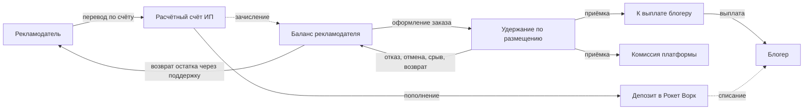
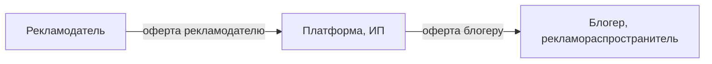

# 06. Финансы и право

**Назначение.** Как движутся деньги и как это учитывается; на каких договорах держится схема; что требуется для маркировки; что можно рекламировать; какие данные о людях хранятся.

**Связанные документы.** [03-placement.md](03-placement.md) — переходы, вызывающие проводки; [04-domain-model.md](04-domain-model.md) §6, §7 — таблицы; [05-integrations.md](05-integrations.md) — ОРД, Рокет Ворк, приём оплаты.

**Затронутые записи реестра.** D-04, D-07, D-08, D-11, D-14, D-18, D-23, D-24, D-26, D-27, D-30, A-02, A-03, A-04, A-05, A-06, A-08, A-16, A-20, A-24, A-25, A-30, A-31, A-33, A-35, A-36, A-38, A-42, Q-02, Q-11, Q-14, Q-16, Q-17, Q-18, Q-20, Q-22, Q-24, Q-27, Q-28, Q-29, Q-30, Q-31, Q-32, Q-33, Q-34, Q-36, Q-39.

> Всё, что в этом документе сказано о законах, налогах, штрафах и обязательных текстах, взято из отраслевых публикаций или записано по памяти. Первоисточники не сверялись. Каждое такое место помечено «проверить с юристом». Система строится так, чтобы изменение ответа меняло данные справочников и конфигурацию, а не код.

## 1. Денежный поток



Сплошные стрелки от и к рекламодателю, блогеру, банку и депозиту — реальные переводы. Остальное — движения во внутреннем учёте.

Ключевые положения:

- Рекламодатель платит заранее: пополняет баланс по счёту, заказы оплачиваются с баланса (A-06, Q-17). Платят юрлица, ИП и самозанятые банковским переводом (A-05, D-24). Вывода остатка из кабинета нет: свободный остаток возвращается по обращению в поддержку проводкой `balance_return` (D-26).
- При оформлении заказа сумма каждого размещения блокируется удержанием. Удержанные деньги остаются деньгами рекламодателя, пока размещение не принято.
- Исход удержания — выплата блогеру и комиссия платформе, возврат на баланс или их сочетание (03 §7).
- Удержание ведёт платформа в своём учёте; физически деньги лежат на расчётном счёте ИП и на депозите в Рокет Ворк (A-04).
- Платформа — агент: её доход — комиссия, а не оборот (A-03, Q-02; проверить с юристом).

## 2. Журнал проводок

### 2.1. Счета учёта

| Вид (`ledger_account.kind`) | Тип | Разрез | Что отражает |
|---|---|---|---|
| `bank` | актив | один | Деньги на расчётном счёте ИП, прошедшие через платформу |
| `rocketwork_deposit` | актив | один | Деньги на депозите в Рокет Ворк |
| `payout_fees` | актив (расход) | один | Комиссии Рокет Ворк за выплаты |
| `advertiser_balance` | пассив | организация | Свободные деньги рекламодателя |
| `placement_hold` | пассив | размещение | Удержание по размещению |
| `blogger_payable` | пассив | организация | Начислено блогеру, ещё не выплачено |
| `platform_revenue` | пассив | один | Заработанная комиссия платформы |

Счёт создаётся при первом обращении. Это внутренний учёт платформы, а не бухгалтерский план счетов; соответствие бухгалтерскому учёту ИП — проверить с бухгалтером.

### 2.2. Правила

1. Каждое движение денег — одна `ledger_transaction` с одной или несколькими `ledger_entry`. Проводка: дебет одного счёта, кредит другого, сумма больше нуля.
2. Остаток актива = сумма дебетов − сумма кредитов. Остаток пассива = сумма кредитов − сумма дебетов.
3. **Сходимость.** Сумма остатков всех активов равна сумме остатков всех пассивов. Проверяется заданием раз в час; расхождение — ERROR и оповещение.
4. Остаток пассивного счёта не может стать отрицательным. Проводка, которая к этому приводит, отклоняется — так обеспечивается «не хватает баланса».
5. Журнал — только на добавление. Ошибка исправляется обратной проводкой вида `manual` с основанием, а не изменением записи.
6. `ledger_account.balance` — кеш, обновляется в одной транзакции с проводкой при блокировке строки счёта. Задание сходимости заодно сверяет кеш с суммой проводок.
7. У каждой транзакции уникальный ключ идемпотентности, составленный из вида и основания: например, `settlement:{placement_id}`. Повторный вызов с тем же ключом ничего не делает.
8. Проводки, вызванные переходом размещения, выполняются в одной транзакции базы данных с переходом (I-10).

### 2.3. События и проводки

Суммы — из размещения (03 §7).

| Вид (`ledger_transaction.kind`) | Событие | Дебет | Кредит | Сумма |
|---|---|---|---|---|
| `deposit` | Поступление по счёту сопоставлено (S-30, A-35) | `bank` | `advertiser_balance` рекламодателя | Фактическая сумма поступления |
| `hold` | P-01; повторное удержание при новой версии поста после отклонения | `advertiser_balance` | `placement_hold` размещения | `total_amount` |
| `hold_release` | P-04, P-05, P-06, P-09, P-18; P-15 с решением `full_refund`; отклонение версии поста модерацией | `placement_hold` | `advertiser_balance` | `total_amount` |
| `settlement` | P-12, P-13; P-15 с решением `full_payout` или `proportional` | `placement_hold` | `blogger_payable` блогера | `payout_amount` |
| | | `placement_hold` | `platform_revenue` | `fee_charged` |
| | | `placement_hold` | `advertiser_balance` | `refund_amount`, если больше нуля |
| `payout` | P-16 | `blogger_payable` | `rocketwork_deposit` | `payout_amount` |
| | | `payout_fees` | `rocketwork_deposit` | `payout.provider_fee`, если больше нуля |
| `deposit_topup` | Администратор отразил перевод на депозит Рокет Ворк | `rocketwork_deposit` | `bank` | Сумма перевода |
| `balance_return` | Администратор вернул свободный остаток рекламодателю переводом по обращению в поддержку (D-26) | `advertiser_balance` | `bank` | Сумма перевода, не больше остатка; основание обязательно |
| `manual` | Ручная корректировка (S-19) | Любой | Любой | Любая; основание обязательно |

Переходы, которые денег не затрагивают: P-02, P-03, P-07, P-08, P-10, P-11, P-14, P-17.

После `hold_release` и `settlement` остаток счёта `placement_hold` размещения равен нулю, а `hold.status` становится `released` или `distributed`. Это проверяется в той же транзакции (I-12).

Пример, продолжающий 03 §7: цена блогера 10 000,00 ₽, комиссия 1 500,00 ₽, доля исполнения 7500, комиссия Рокет Ворк за выплату 75,00 ₽.

| Шаг | Проводки |
|---|---|
| Оформление | Дт `advertiser_balance` — Кт `placement_hold`: 11 500,00 |
| Решение спора | Дт `placement_hold` — Кт `blogger_payable`: 7 500,00; Дт `placement_hold` — Кт `platform_revenue`: 1 125,00; Дт `placement_hold` — Кт `advertiser_balance`: 2 875,00 |
| Выплата | Дт `blogger_payable` — Кт `rocketwork_deposit`: 7 500,00; Дт `payout_fees` — Кт `rocketwork_deposit`: 75,00 |

### 2.4. Реестр выплат и сверка

Администратору доступны:

- **Реестр выплат** — список `payout` с фильтрами по периоду, блогеру, состоянию: размещение, сумма, комиссия сервиса, состояние, чек, ошибка. Выгрузка в CSV.
- **Журнал денег** — список `ledger_transaction` с проводками и основаниями.
- **Сверка с банком** — остаток счёта `bank` против остатка по последней загруженной выписке. Расхождение показывается; его объясняют операции, не относящиеся к платформе, и поступления без сопоставления.
- **Сверка с Рокет Ворк** — остаток `rocketwork_deposit` против остатка, полученного через API (05 §4.2). Расхождение больше 1 ₽ — оповещение.
- **Обязательства перед рекламодателями** — сумма `advertiser_balance` и `placement_hold`. Эта сумма должна быть обеспечена деньгами на `bank` и `rocketwork_deposit`.

### 2.5. Документы рекламодателю

| Документ | Когда | Из чего |
|---|---|---|
| Счёт на оплату (`invoice`) | По запросу рекламодателя (S-06) | Сумма пополнения, реквизиты ИП; наименование, ИНН и банковские реквизиты рекламодателя как плательщика (D-26) |
| Отчёт агента | До 5-го числа за прошедший месяц | Все размещения рекламодателя с `settlement` в этом месяце: канал, период показа, выплачено блогеру (`payout_amount`), вознаграждение платформы (`fee_charged`) |
| Акт на вознаграждение | Вместе с отчётом агента | Сумма `fee_charged` за месяц |

Отчёт и акт формируются в PDF и хранятся в `closing_act` (A-20). ЭДО нет. Состав и форма закрывающих документов зависят от того, агент платформа или перепродавец (Q-02; проверить с юристом и бухгалтером).

Блогеру — самозанятому или ИП — документы формирует Рокет Ворк: договор, акт, чек. Блогер-юрлицо оформляет закрывающие документы сам (A-36, Q-36).

## 3. Комиссия и расчёт сумм

Ставка комиссии — параметр `platform.fee_rate_bp`, базисные пункты; рабочее значение 1500 (A-30, Q-22). Ставка фиксируется в размещении при создании (`placement.fee_rate_bp`); её изменение не затрагивает оформленные заказы.

```
blogger_amount = channel_price.amount
fee_amount     = floor(blogger_amount × fee_rate_bp / 10000)
total_amount   = blogger_amount + fee_amount
```

- Блогер видит и задаёт `blogger_amount`.
- Рекламодатель в каталоге, корзине и заказе видит `total_amount`. Разбивка на цену блогера и комиссию показывается в заказе и в отчёте агента.
- Распределение при приёмке и решении спора — формулы 03 §7. При частичном исполнении комиссия уменьшается в той же доле, что и выплата блогеру.
- Комиссию Рокет Ворк за выплату платит платформа из своей комиссии (A-04); на суммы размещения она не влияет.

## 4. Выплаты блогерам

**Кому.** Самозанятым и ИП — через Рокет Ворк (D-08). Юрлицам — банковским переводом с расчётного счёта, вне Рокет Ворк: сервис их не обслуживает (D-14, A-36). Денежных штрафов и удержаний из выплат нет (A-08, Q-18). Физлицам без статуса — нет: платформа стала бы налоговым агентом (проверить с юристом).

**Когда.** Сразу после перехода размещения в `accepted`. Накопления до порога и выплат по расписанию нет.

**Сколько.** `payout_amount` размещения. Одно размещение — одна выплата.

**Условия.** Блогер прошёл онбординг в Рокет Ворк (S-11) — это проверяется ещё при принятии размещения (P-03), чтобы не возникало принятых размещений, которые нельзя оплатить. К блогеру-юрлицу условие не относится (A-36).

**Что делает Рокет Ворк** (по его описанию): проверяет статус самозанятого перед выплатой, регистрирует доход в ФНС, формирует чек, уплачивает налог.

**Что делает система:**

- хранит по каждому самозанятому сумму выплат за календарный год и предупреждает администратора при достижении 90% годового лимита дохода самозанятого. Значение лимита — параметр конфигурации (проверить с юристом);
- при отказе в выплате оставляет размещение в `accepted`, а начисление — на `blogger_payable`, пока причина не устранена (05 §4.3);
- показывает блогеру историю выплат и ссылку на чек.

**Юрлица.** Порядок выплаты блогеру-юрлицу — рабочее допущение A-36: администратор переводит `payout_amount` с расчётного счёта и отмечает выплату выполненной. Проводки, состояния выплаты и экран администратора для этого пути не описаны до ответа на Q-36.

**Открыто.** База налога самозанятого — с комиссией платформы или без: рабочее допущение — доход блогера равен `payout_amount` (Q-28). Самозанятый может продавать услуги через агента; доход признаётся при получении денег посредником — проверить с юристом.

## 5. Договорная схема

### 5.1. Цепочка



| Договор | Стороны | Как заключается | В ОРД |
|---|---|---|---|
| Оферта рекламодателю | Рекламодатель и платформа | Принятие кликом при регистрации (S-01) | Изначальный договор, `ord_contract` вида `initial` |
| Оферта блогеру | Платформа и блогер | Принятие кликом при регистрации (S-10) | Договор с блогером, `ord_contract` вида `publisher` |
| Договор с Рокет Ворк | Платформа и Рокет Ворк | Вне системы | — |
| Договор блогера с Рокет Ворк | Блогер и Рокет Ворк | При онбординге на стороне сервиса | — |

Договоры рамочные: один на рекламодателя и один на блогера, а не на каждый заказ (A-31).

### 5.2. Роли

- Платформа — агент рекламодателя: по его поручению организует размещение и расчёты, получает вознаграждение (A-03).
- Маркирует платформа: регистрирует контрагентов, договоры, креативы, подаёт статистику и акты (A-02, A-33). erid выдаётся на версию поста (D-07). Рекламодатель и блогер в ОРД ничего не делают. Это закрепляется в офертах, иначе по умолчанию каждый отчитывается за свой доходный договор (проверить с юристом, Q-31).
- Блогер — рекламораспространитель.

### 5.3. Риски, которые учитывает устройство системы

| Риск | Как система его снижает |
|---|---|
| Ответственность посредника за пост без erid. В отраслевой публикации описан штраф посреднику, от которого не спасла оговорка в договоре (проверить с юристом) | Публикует только бот; текст собирает система; I-01 запрещает публикацию без строки маркировки |
| Деньги рекламодателей на счёте ИП: налоговые и регуляторные вопросы (проверить с юристом) | Агентская модель; отдельный учёт обязательств (§2.4); целевая схема с удержанием вне счёта ИП — Q-11 |
| Пороги НДС на упрощённой системе для ИП. По записи исследования: 20 млн ₽ за 2025 год, 15 млн за 2026, 10 млн за 2027 — точные значения проверить с юристом (Q-32) | У агента в доход идёт только вознаграждение; система даёт отчёт по `platform_revenue` за период |
| ИП отвечает личным имуществом | Вне системы |
| Сбор 3% с рекламы: кто плательщик в цепочке — не установлено (Q-27) | Система хранит всё нужное для расчёта: суммы по договорам и периодам |
| Блогер утратил статус самозанятого | Проверка перед выплатой на стороне Рокет Ворк; выплата не проходит, начисление сохраняется |

## 6. Маркировка

### 6.1. Сведения в посте

Каждая публикация содержит (состав — проверить с юристом, Q-30):

| Что | Где | Кто добавляет |
|---|---|---|
| Пометка «Реклама» | Плашка или строка маркировки — по выбору рекламодателя (D-18, A-38) | Система |
| Наименование и ИНН рекламодателя | Там же, где пометка «Реклама» | Система, из `post_version.advertiser_name`, `advertiser_inn` |
| erid | Над постом, под постом или в ссылках — по выбору рекламодателя (D-18) | Система, из `creative.erid` |

По умолчанию пометка — на плашке в медиафайле, erid — под постом; если в посте нет изображений, пометка — в тексте (D-30).

Формат строки маркировки и порядок сборки текста — 05 §2.5. Рекламодатель не может удалить или изменить эти части: они не входят в редактируемый документ.

### 6.2. Плашка

Плашка — производная картинка, которую строит сервер (D-04).

| Свойство | Значение |
|---|---|
| Текст | `Реклама. {advertiser_name}, ИНН {advertiser_inn}` |
| Положение | Полоса во всю ширину по нижнему краю изображения |
| Высота | 8% высоты изображения, не меньше 40 пикселей |
| Вид | Тёмная полупрозрачная подложка, белый текст; размер шрифта подбирается под высоту полосы |
| Длинный текст | Шрифт уменьшается до 60% исходного; если не помещается — наименование обрезается с многоточием, ИНН остаётся целиком |
| Изображения | На каждом изображении альбома (A-38, Q-24) |
| Формат результата | Тот же, что у оригинала; JPEG — качество 90 |
| Версия шаблона | Входит в `media_derivative.params_hash`; смена шаблона не перестраивает производные уже зафиксированных версий поста |

erid на плашке нет: производная строится до регистрации креатива, а её ссылка передаётся в ОРД как образец.

Плашка строится, когда рекламодатель выбрал пометку в медиафайле. Иначе в канал уходит производная вида `plain` — копия оригинала без изменений. Отдельного выключателя плашки нет (A-38).

### 6.3. Реестр РКН

По данным исследования, MAX с 18.03.2026 имеет статус социальной сети, и каналы от 10 000 подписчиков обязаны быть в реестре Роскомнадзора, иначе реклама в них запрещена (проверить с юристом).

Правила системы (D-11):

- `subscribers_count < 10000` → `rkn_status = not_required`.
- `subscribers_count >= 10000` → блогер обязан ввести номер; `rkn_status = pending` до проверки администратором, затем `confirmed` или `rejected`.
- Канал от 10 000 подписчиков может быть `active` только при `confirmed`.
- Если канал перерос порог (S-32) — он становится `suspended` с причиной `rkn_required`; уже запланированные размещения срываются при публикации (I-08), опубликованные продолжаются. Правило применяется и в суточных метриках, и при чтении сведений о канале по событиям бота.
- Причина `rkn_required` снимается сама: если подписчиков стало меньше порога или администратор подтвердил номер, канал возвращается в `active` без повторной модерации. `rejected` оставляет канал приостановленным. Причину `missing_rights` подтверждение номера не снимает.
- Номер проверяется вручную (Q-34): операция администратора `setChannelRknCheck` (`confirmed` или `rejected`) пишет `rkn_checked_at`, `rkn_checked_by`. Повторная проверка — раз в 90 суток (`RKN_RECHECK_INTERVAL`): отдельного состояния нет, признак `rkn_recheck_due` виден администратору и в фильтре очереди, канал продолжает работать.
- Порог — параметр конфигурации.

## 7. Ограничения рекламы

Категорий рекламы в первой версии нет (D-27): рекламодатель не выбирает категорию, система не добавляет тексты категории и не запрашивает дополнительные поля. Что можно рекламировать, решает модератор при проверке поста (S-17) по перечню ниже. Код ККТУ для ОРД — один из конфигурации (A-42, Q-39).

Перечень — из исследования, записан по памяти. Перед запуском сверить с юристом целиком (Q-29).

### 7.1. Запрещено

Пост отклоняется. Наркотики; табак, никотин, вейпы, кальяны; алкоголь, включая пиво; азартные игры, онлайн-казино, букмекеры; оружие; криптовалюта как средство платежа и финансовые пирамиды; средства обхода блокировок; ресурсы нежелательных и экстремистских организаций; иноагенты и их ресурсы; рецептурные лекарства; прерывание беременности; написание дипломов и курсовых; товары без обязательной регистрации, лицензии или сертификата.

### 7.2. С документами и предупреждениями

На старте пост с такой рекламой отклоняется: проверки документов и предупреждений установленного размера в первой версии нет.

| Что рекламируется | Требование по исследованию |
|---|---|
| Безрецептурные лекарства, медизделия, медуслуги | Лицензия или регистрация; предупреждение о противопоказаниях |
| БАД | Регистрация; надпись «не является лекарственным средством» |
| Кредиты, займы, вклады, инвестиции, страхование, ломбарды | Лицензия ЦБ, полное наименование, существенные условия, предупреждения о рисках |
| Долевое строительство | Ссылка на проектную декларацию |
| Детское питание | Возрастные ограничения и предупреждение |

Размеры предупреждений в исследовании записаны по памяти и в документ не переносятся.

### 7.3. Сведения, которые рекламодатель пишет сам

Отдельных полей нет. Если закон требует сведений для рекламируемого товара, рекламодатель пишет их в тексте поста, а модератор проверяет их наличие. Без них пост отклоняется.

| Что рекламируется | Что должно быть в тексте |
|---|---|
| Фильмы, игры, мероприятия, книги, приложения | Возрастная метка: `0+`, `6+`, `12+`, `16+` или `18+` |
| Дистанционная продажа товаров | Наименование, адрес, ОГРН продавца |
| Розыгрыши и акции | Срок проведения и ссылка на правила |

### 7.4. Не определено

Энергетические напитки, эзотерические услуги, инфопродукты о заработке — в исследовании отмечены как спорные. До ответа юриста модератор такие посты отклоняет.

Правила MAX для каналов и ботов могут быть строже закона (Q-16) — тогда правила модерации ужесточаются.

## 8. Персональные данные

Состав — 04 §10. Принципы (A-24):

- Хранится минимум, необходимый для договора, маркировки и выплат: ФИО, ИНН, статус, контакты.
- Паспортные данные, фотографии документов, реквизиты карт блогеров система не получает и не хранит: личность проверяет Рокет Ворк.
- Серверы и резервные копии находятся в России.
- Данные передаются третьим сторонам в объёме, нужном для услуги: в Яндекс ОРД — наименование и ИНН; в Рокет Ворк — ФИО, ИНН, телефон.
- В журнале приложения и сохранённых внешних запросах ИНН, телефон и почта маскируются (07 §5).
- До запуска: уведомление Роскомнадзора об обработке, политика обработки, согласия в формах регистрации — проверить с юристом (Q-33).
- Удаление по запросу: учётная запись блокируется, контактные данные обезличиваются; данные, нужные для учёта и отчётности (ИНН, наименование, договоры, проводки), сохраняются на срок, который определит юрист.

## 9. Юридические документы площадки

| Документ (`legal_document.kind`) | Кто принимает | Когда |
|---|---|---|
| `advertiser_offer` — оферта рекламодателю | Рекламодатель | Регистрация (S-01) |
| `blogger_offer` — оферта блогеру | Блогер | Регистрация (S-10) |
| `platform_rules` — правила площадки | Оба | Регистрация |
| `privacy_policy` — политика обработки персональных данных | Оба | Регистрация |

- Принятие — кликом; сохраняются пользователь, организация, версия документа, время, IP-адрес (A-25).
- Тексты пишет юрист (Q-31); система хранит версии файлов.
- При выходе новой версии оформление заказа и принятие размещений блокируются до принятия. Уже оформленные заказы идут по версии, действовавшей при оформлении.
- В правилах площадки закрепляются значения, которые система исполняет: таймеры (03 §5), формула пропорционального возврата (03 §7), основания споров (03 §6), ставка комиссии (§3).

## 10. Вопросы юристу

| № | Вопрос | Что в системе зависит от ответа |
|---|---|---|
| Q-02 | Агент или перепродавец | Закрывающие документы (§2.5), роли в ОРД, налоговая база |
| Q-14 | Типы договоров и роли в ОРД, кто отчитывается | Параметры договоров и актов (05 §3.3, §3.7) |
| Q-27 | Кто платит сбор 3% | Нужен ли расчёт сбора в системе |
| Q-28 | База налога самозанятого | Сумма выплаты и дохода блогера |
| Q-29 | Запрещённые и условно разрешённые виды рекламы, тексты и размеры предупреждений | Правила модерации постов (§7) |
| Q-30 | Обязательные сведения в посте и на плашке; erid в тексте или в ссылке; можно ли выключать плашку | Строка маркировки, плашка (§6.1, §6.2) |
| Q-31 | Тексты оферт, распределение ответственности за маркировку | Документы (§9) |
| Q-32 | Пороги НДС, необходимость онлайн-кассы | Способы оплаты (A-05) |
| Q-33 | Персональные данные: состав, уведомление РКН, сроки хранения | §8 |

Дополнительно: статус MAX как социальной сети и порог 10 000 подписчиков (§6.3); срок подачи статистики и актов в ОРД (05 §3.7); годовой лимит дохода самозанятого (§4); возможность самозанятого работать через агента (§4).

## 11. Журналирование

- Каждая `ledger_transaction` пишется в журнал приложения: вид, основание, суммы, счета — уровень INFO.
- Проводка вида `manual`, ручное сопоставление поступления, `retry_payout`, изменение ставки комиссии — уровень WARN и запись в `audit_log` с автором и основанием.
- Отклонённая проводка (отрицательный остаток, повтор ключа с другими суммами) — WARN.
- Расхождение сходимости (§2.2), расхождение с депозитом Рокет Ворк (§2.4), нехватка депозита — ERROR и оповещение.
- Выставление счёта, зачисление, создание и исход выплаты, формирование закрывающих документов — INFO.
- Суммы в журнале — в копейках; ИНН и наименования маскируются.
