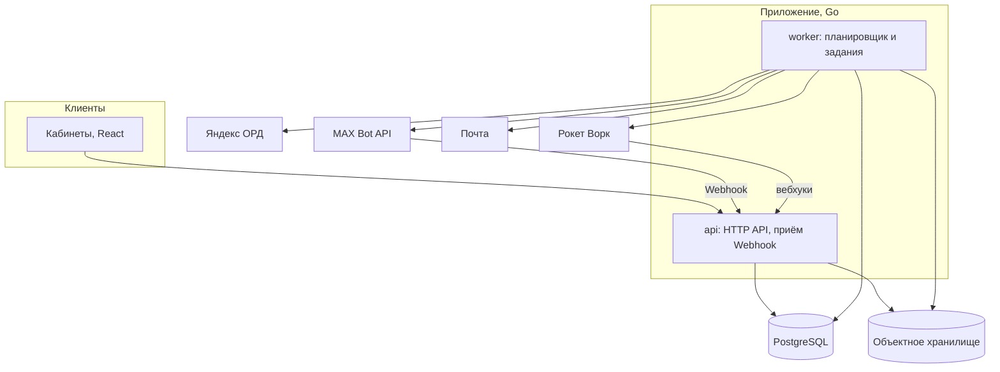

# 07. Нефункциональные требования

**Назначение.** Из чего собрана система и какими свойствами она обязана обладать: планировщик, надёжность, безопасность, журналирование, эксплуатация. Единый источник требований к журналированию для всех ТЗ.

**Связанные документы.** [03-placement.md](03-placement.md) §5, §11 — таймеры и идемпотентность; [04-domain-model.md](04-domain-model.md) §8 — служебные таблицы; [05-integrations.md](05-integrations.md) §1 — правила внешних вызовов.

**Затронутые записи реестра.** D-04, D-05, D-09, D-21, D-25, A-10, A-12, A-13, A-19, A-24, A-26, A-27, A-34, A-41, Q-03, Q-12, Q-32, Q-35, Q-38.

## 1. Стек и состав

Утверждено: бэкенд на Go, кабинеты на React (D-09). Остальное — допущения (A-26); выбор конкретных библиотек делается на этапе «Каркас бэкенда и аккаунты» и фиксируется в архитектурном документе проекта.

| Часть | Решение | Основание |
|---|---|---|
| Бэкенд | Go, один репозиторий, один исполняемый файл с режимами `api` и `worker` | D-09 |
| Кабинеты | React, одностраничное приложение; три раздела с общей оболочкой: рекламодатель, блогер, администратор | D-09 |
| Данные | PostgreSQL — единственное хранилище | A-26 |
| Очередь заданий | Таблица `job` в PostgreSQL; отдельного брокера нет | A-26 |
| Файлы | S3-совместимое объектное хранилище: закрытая область для оригиналов и документов, публичная — для производных | A-26 |
| Обработка изображений | Библиотека на стороне бэкенда: плашка, превью | D-04 |
| Почта | Внешний почтовый сервис по SMTP или API | A-13, A-19 |
| Редактор | Библиотека WYSIWYG с настраиваемой схемой документа | D-05 |

Правила состава:

- `api` не обращается к внешним системам, кроме объектного хранилища (05 §1). Всё остальное, включая чтение сведений о канале при подключении, — через задание.
- `api` и `worker` запускаются в нескольких экземплярах; общее состояние — только в базе.
- Модули бэкенда соответствуют группам модели данных (04 §2–§8): аккаунты, каналы, посты, заказы и размещения, маркировка, деньги, уведомления. Модуль размещений не вызывает адаптеры напрямую — только создаёт задания.

## 2. Планировщик

Все отложенные и фоновые действия — задания в таблице `job` (04 §8).

**Гарантия.** Каждое задание выполняется не менее одного раза. Поэтому любой обработчик идемпотентен: проверяет состояние перед действием (03 §11).

**Взятие в работу.** Экземпляр `worker` выбирает задания с `status = pending` и `run_at <= now()` с блокировкой строк и пропуском заблокированных, помечает `running`, записывает себя в `locked_by`. Задание в `running` дольше 10 минут без отметки считается брошенным и возвращается в `pending`.

**Создание.** Задание, порождённое переходом состояния, создаётся в той же транзакции, что и переход (I-10). Так задание не теряется и не появляется без перехода.

**Повторы.** При ошибке — `attempts + 1`, следующий запуск через `min(30 с × 2^attempts, 1 ч)`. После `max_attempts` — `failed` и оповещение. Значения по видам:

| Вид задания (`job.kind`) | Когда | `max_attempts` | Особенности |
|---|---|---|---|
| `process_inbound_event` | Сразу | 10 | — |
| `placement_timer` | По таблице 03 §5 | 5 | Полезная нагрузка: размещение, номер таймера, ожидаемое состояние. Таймеры T-01, T-13, T-14, T-05 (до этапа приёмки повторяется раз в час, без предела попыток) и T-06 (оповещение); `dedupe_key` `timer:{placement_id}:{номер}`. Размещение не в ожидаемом состоянии — таймер устарел, без изменений |
| `publish_placement` | `publish_at` | — | Повторяется каждые 30 с до T-03, затем P-09; отказ `4xx` — P-09 сразу. Ставит P-17, переносит P-07 и P-08 (снятие), отменяют P-06, P-09 и P-11. Взятое позже T-03 после простоя — P-09 без вызова MAX |
| `remove_placement` | `remove_at` | — | Повторяется с задержкой `min(30 с × 2^попытка, 1 ч)` до T-10, затем без повторов и оповещение. Ставится и отменяется вместе с `publish_placement`; отменяется при досрочном удалении (S-26) |
| `reconcile_publications` | Каждые 5 мин | 1 | Следующий запуск создаётся независимо от исхода |
| `check_publication` | Внутри интервала сверки | 3 | Проверка одной живой публикации (05 §2.8): `dedupe_key` `check_publication:{publication_id}`, время — смещение по идентификатору публикации; приоритет ограничителя — сверка |
| `sync_ord_object` | Сразу | 10 | `dedupe_key` `ord_sync:{вид}:{id}`. Ожидание зависимости или изображений (05 §3.2) откладывает задание без счёта попытки. Отказ ОРД `4xx`/`422` — `error` сразу; после 10 попыток — `error` с причиной `attempts_exceeded` и оповещение |
| `poll_ord_status` | По расписанию 05 §3.5 | — | Одно на объект, `dedupe_key` `ord_status:{вид}:{id}`, ставится с переходом в `sent`; следующий опрос задаёт обработчик, попытки не считаются. До финального статуса или 24 ч (`status_timeout`). После простоя — немедленно, один раз |
| `ord_monthly_report` | 1-е число | 3 | 05 §3.7 |
| `send_payout` | Сразу | 10 | 05 §4.3 |
| `poll_payout`, `poll_contractor` | По расписанию 05 §4.2 | — | Если нет вебхуков |
| `schedule_channel_metrics` | Раз в сутки, 00:05 МСК | 1 | Ставит `refresh_channel_metrics` каналам в `moderation`, `active`, `suspended`: `run_at` — начало суток плюс смещение по `channel_id` в окне 24 ч, `dedupe_key` `channel_metrics:{id}:{date}` |
| `refresh_channel_metrics` | Раз в сутки на канал | 3 | Запуски распределены по суткам; приоритет ограничителя — метрики. Канала нет в MAX (`404`) — без повторов, WARN: канал отключат события бота |
| `build_media_derivative` | Сразу | 5 | Превью при загрузке; копия или копия с плашкой — при каждом сохранении черновика. Идемпотентно по `(media_file_id, kind, params_hash)`, `dedupe_key` `media:{id}:{kind}:{hash}`. Плашка с устаревшими реквизитами не строится. Изображение не декодируется или больше 50 МБ — без повторов, ERROR. Одновременно на экземпляр — не больше `MEDIA_BUILD_CONCURRENCY` построений, остальные ждут |
| `publish_media_derivative` | Сразу | 10 | Копия производной, вошедшей в версию поста, в публичной области (§4 «Файлы»). `dedupe_key` `media_publish:{derivative_id}`; опубликованная — без действий |
| `purge_media` | Раз в сутки, 04:30 МСК | 1 | Удаляет из хранилища оригиналы, удалённые больше `MEDIA_RETENTION_DELETED` назад, и производные старше того же срока, если они не входят ни в одну версию поста. Превью неудалённого файла остаётся. Объект, которого уже нет, считается удалённым. Удаление из хранилища — внешний вызов, поэтому это отдельное задание, а не часть `cleanup` |
| `send_notification` | Сразу | 5 | — |
| `send_login_code` | Сразу | 5 | Письмо с кодом входа. Почта и код в полезной нагрузке — только зашифрованными (§4, «Секреты»); после завершения полезная нагрузка затирается. Код, просроченный к моменту отправки, не отправляется |
| `expire_invoices` | Каждые `INVOICE_EXPIRE_INTERVAL` (1 ч) | 1 | Счета в `issued` с прошедшим `expires_at` — `expired` (S-06). Следующий запуск создаётся независимо от исхода |
| `check_ledger_balance` | Каждые `LEDGER_CHECK_INTERVAL` (1 ч) | 1 | Проверки журнала 06 §2.4 (R-15): `sides`, `cache`, `holds`, `negative`. Следующий запуск создаётся независимо от исхода |
| `check_rocketwork_deposit` | Каждый час | 1 | 05 §4.3 |
| `generate_closing_acts` | `CLOSING_ACTS_DAY` числа (1-го) в `CLOSING_ACTS_TIME` (03:00 МСК) | 1 | Отчёт агента и акт за прошедший месяц по Москве (06 §2.5, R-16). Одна попытка, как у всех периодических заданий; у каждой организации своя транзакция, сбой одной — ERROR `closing act failed`, её документы сформирует следующий запуск или `maxim admin money closing-acts --period YYYY-MM` |
| `cleanup` | Раз в сутки, 04:00 МСК | 1 | Удаление устаревших записей служебных таблиц, кодов, сессий; сроки — 04 §8 |
| `send_alert` | Сразу | 5 | Оповещение администратору (§3): одно задание на канал и адресата, поэтому повтор не дублирует доставленное. Исчерпание попыток нового оповещения не поднимает |
| `check_stuck_objects` | Каждый час | 1 | Поиск зависших объектов (§3). Следующий запуск создаётся независимо от исхода |
| `refresh_channel_info` | Сразу | 5 | Сведения о канале и права бота из MAX после `bot_added` и `bot_admin_permissions_changed` (05 §2.4). Ключ — канал и входящее событие: повтор разбора события второе задание не ставит |
| `delete_max_message` | Сразу | 5 | Удаление сообщения с кодом подключения (05 §2.4). Без права `delete` — ошибка без повторов |
| `leave_max_chat` | Сразу | 5 | Бот покидает чат, который не канал, и канал, не подключённый за 7 суток (A-41) |
| `reply_bot_dialog` | Через 5 с | 3 | Ответ инструкцией на сообщение боту в личном диалоге (05 §2.2). Пока ответ не отправлен, новые сообщения второй не ставят. Исчерпание попыток оповещения не поднимает |
| `release_unclaimed_channels` | Раз в сутки, 05:00 МСК | 1 | Каналы в `unclaimed` дольше `CHANNEL_UNCLAIMED_TTL` — `disconnected` с причиной `unclaimed_expired` и `leave_max_chat` |

Виды с пределом «—» повторяются, пока обработчик сам не завершит задание: он задаёт задержку следующей попытки или завершает задание ошибкой без повторов (например, после ответа `4xx` или по истечении срока T-03, T-10).

Обработчик может отложить задание, не засчитывая попытку (`job.Postpone`): он ждёт внешнего условия, а не повторяет сбой — зависимость объекта ОРД ещё не готова, следующий опрос статуса ОРД. Предел попыток на такие ожидания не тратится; запись в журнал — DEBUG.

**Приоритет.** Публикация, снятие и таймеры размещений берутся в работу первыми; два из восьми мест обработчика всегда свободны для них, чтобы очередь низкоприоритетных заданий не нарушила точность.

**Точность.** Публикация и снятие начинаются не позже чем через 10 секунд после назначенного времени при работающей системе. Опрос таблицы заданий — не реже раза в секунду.

**После простоя.** При запуске `worker` обрабатывает просроченные задания по правилам:

| Задание | Просрочено | Действие |
|---|---|---|
| `publish_placement` | Не больше 30 мин (T-03) | Выполнить немедленно |
| `publish_placement` | Больше 30 мин | P-09 с причиной `publish_error`; оповещение |
| `remove_placement` | Любое время | Выполнить немедленно; `removed_at` — фактическое время |
| `placement_timer` | Любое время | Выполнить немедленно |
| Периодические | Любое время | Один запуск, без «догоняющих» повторов |

Простой дольше 30 минут — оповещение уровня ERROR со списком затронутых размещений. Задержка снятия не является нарушением со стороны блогера и основанием для спора.

**Простой.** Каждый экземпляр `worker` отмечается в `worker_heartbeat` раз в 30 секунд (04 §8). При запуске простой — разрыв между последней отметкой любого экземпляра и текущим временем больше 30 минут (параметр `DOWNTIME_THRESHOLD`).

**Уникальность.** `dedupe_key` не даёт создать два живых задания одного назначения: `publish:{placement_id}`, `remove:{placement_id}`, `timer:{placement_id}:{номер}`, `payout:{payout_id}`, `periodic:{kind}` для периодических заданий. Ожидающее задание можно отменить или перенести по его `dedupe_key`.

## 3. Надёжность

**Сверка.** Задание `reconcile_publications` каждые 5 минут сравнивает ожидаемое состояние публикаций с фактическим в MAX (A-27); алгоритм — 05 §2.8. Сверка — запасной путь на случай потерянных событий, поэтому работает независимо от Webhook.

**Потеря событий.** Система не полагается на то, что событие придёт. Каждое решение, зависящее от события, имеет запасную проверку: сверка публикаций, суточная проверка прав бота, опрос статусов ОРД и выплат.

**Сходимость денег.** Раз в час — проверка журнала проводок (06 §2.4) и депозита Рокет Ворк (06 §2.4). Оповещения проверки журнала: `ledger_imbalance`, `ledger_cache_mismatch:{account_id}`, `ledger_hold_mismatch:{placement_id}`, `ledger_negative_liability:{account_id}` — ERROR; закрываются, когда следующий запуск нарушения не находит.

**Поступления без сопоставления.** Каждое такое поступление из выписки — WARN и оповещение `bank_transaction_unmatched:{id}`; закрывается, когда администратор сопоставил операцию или пометил её `ignored` (05 §5, R-13).

**Зависшие объекты.** Раз в час ищутся и поднимаются оповещением:

| Что | Порог |
|---|---|
| Версия поста в `approved` без erid (креатив без erid) | 1 ч (T-11, `ORD_ERID_WAIT`), WARN `post_version_erid_overdue` |
| Размещение в `scheduled` с прошедшим `publish_at` | 35 мин |
| Публикация с `removal_overdue` | 1 ч |
| Размещение в `accepted` без выплаты `succeeded` | 72 ч (T-12) |
| Объект ОРД в `sent` | 24 ч (`STUCK_ORD_SENT_AGE`), WARN `ord_object_sent_overdue` |
| Входящее событие в `received` | 10 мин |
| Задание в `failed` | Сразу |

**Оповещения администратору.** Канал — почта (`ALERT_EMAILS`) и чат дежурных в MAX, куда пишет бот платформы (`ALERT_MAX_CHAT_ID`); в продакшене обязателен хотя бы один адресат. Уровни WARN и ERROR; повторное оповещение по той же причине и тому же объекту — не чаще раза в час (таблица `alert`, 04 §8). Зависший объект оповещается один раз; когда он перестаёт находиться, оповещение закрывается. Перечень причин — столбец «Оповещение» в §5.3 и таблицы выше.

**Отказ внешней системы.** Поведение — 01 §6 и 05 §1. Недоступность ОРД, Рокет Ворк или почты не останавливает публикацию и снятие.

**Отказ базы данных.** Приложение не работает; после восстановления — правила «после простоя» (§2).

## 4. Безопасность

**Вход.** По почте с одноразовым кодом (A-13): 6 цифр, срок 10 минут, 5 попыток ввода, не больше 5 кодов на адрес в час и 20 на IP-адрес в час. Код хранится хешем HMAC-SHA256 с секретом из окружения (`AUTH_CODE_PEPPER`); почта входит в хешируемое сообщение, поэтому по утёкшей базе без секрета код не перебрать. Новый код гасит прежние коды адреса. Ответ на запрос кода одинаков для существующего и нового адреса. Письмо отправляет задание `send_login_code` (§2): `api` во внешние системы не обращается (§1).

**Сессии.** Случайный токен не короче 256 бит; в базе — хеш. Передаётся в cookie с признаками `HttpOnly`, `Secure`, `SameSite=Lax`. Срок — 30 суток от последнего использования. Меняющие запросы защищены от межсайтовой подделки двойной отправкой: при входе выдаётся cookie `csrf_token` (без `HttpOnly`), меняющий запрос с сессией (`POST`, `PUT`, `PATCH`, `DELETE`, кроме запроса кода и входа) повторяет её значение в заголовке `X-CSRF-Token`; без совпадения — `403` с `details.reason = csrf`. Вход администратора — отдельный срок сессии 12 часов.

**Доступ.**

- Каждый запрос кабинета проверяет, что пользователь — участник организации, которой принадлежит объект. Проверка делается в слое доступа к данным: выборки всегда ограничены организацией.
- Роли администратора: `moderator` — модерация каналов и постов, споры; `senior` — дополнительно ручные операции с деньгами, справочники, блокировки. Без нужной роли — `403` с `details.reason = admin_required`. Операции администратора для каналов (тег `admin-channels`: очередь, карточка, одобрение, отказ, проверка номера РКН) доступны обеим ролям; ИНН владельца в ответе маскируется. До API администратора роль выдаёт команда `maxim admin grant --email <почта> --role moderator|senior` (`maxim admin revoke --email <почта>` снимает); она создаёт пользователя, если его нет, и пишет `audit_log` с актором `system`.
- Блогер видит пост только после P-02 и только по своим размещениям. Рекламодатель не видит реквизиты блогера, блогер — баланс рекламодателя.

**Webhook.** Входящие запросы MAX и Рокет Ворк проверяются на подлинность до сохранения. Способ для MAX — Q-35; до ответа: секретная часть пути адреса (`MAX_WEBHOOK_PATH_SECRET`) и секрет подписки в заголовке `X-Max-Bot-Api-Secret` (`MAX_WEBHOOK_SECRET`), оба сравниваются за постоянное время. Отказ — `401` и WARN; пять отказов за 10 минут — оповещение `webhook_auth_failed:max`. Тело ограничено 1 МБ. Секретная часть пути не пишется в журнал и метрики.

**Секреты.** Токен бота MAX, OAuth-токен ОРД, ключи Рокет Ворк, ключи хранилища и почты — в переменных окружения из хранилища секретов. Если секрет хранится в базе — только зашифрованным, ключ шифрования — вне базы: AES-256-GCM с ключом `APP_SECRETS_KEY` из окружения (например, код входа в полезной нагрузке задания `send_login_code`). Секреты не попадают в журнал, `outbound_request`, сообщения об ошибках и репозиторий.

**Файлы.**

- Изображения: только JPEG, PNG, WebP; тип по содержимому должен совпасть с форматом заголовка. Анимированные PNG и WebP не принимаются. Документ о режиме налогообложения: PDF, JPEG или PNG до 10 МБ. Тип определяется по содержимому, а не по расширению.
- Пределы изображения: 50 МБ (`MEDIA_MAX_BYTES`); каждая сторона — от 160 (`MEDIA_MIN_SIDE`) до 7680 пикселей с учётом поворота EXIF. Тело `POST /media` — не больше 51 МБ; больше предела — `422` с причиной `too_large`. Загрузок — не больше `MEDIA_UPLOADS_PER_HOUR` в час на пользователя и `MEDIA_UPLOAD_CONCURRENCY` одновременно на экземпляр `api`, сверх — `429`.
- `api` изображение полностью не декодирует: читает только заголовок и ориентацию EXIF. Оригинал хранится байт в байт. Производные строятся после поворота, метаданные удаляются.
- Имя в хранилище генерируется системой; имя от пользователя очищается и в журнал не пишется. Оригиналы недоступны по публичным ссылкам; выдаются через кратковременные подписанные ссылки (`MEDIA_URL_TTL`).
- Публичны только производные `labeled` и `plain`, вошедшие в версию поста: они копируются в отдельную корзину `S3_BUCKET_PUBLIC` с анонимным чтением без перечисления, ключ — `pub/<uuidv7>-<32 hex случайных>.<ext>`, адрес — `S3_PUBLIC_BASE_URL` и ключ. Опубликованное не удаляется: это образец для ОРД.

**Ввод.** Все входные данные проверяются на сервере. Текст поста хранится как документ редактора и сериализуется сервером; HTML от клиента не принимается. Адреса ссылок — только `https://`.

**Деньги.**

- Суммы считаются только на сервере; клиент передаёт идентификаторы, а не суммы.
- Любая денежная операция имеет ключ идемпотентности (06 §2.2).
- Ручные операции администратора (`maxim admin money`) требуют роли `senior`, почты администратора (`--email`) и основания (`--reason`); проводка `manual` свыше порога `LEDGER_MANUAL_SECOND_APPROVAL_THRESHOLD` (10 000 000 копеек = 100 000 ₽) требует подтверждения другим администратором `senior` (`--approver-email`, R-14). Возврат остатка не больше свободного остатка.
- Роль базы данных приложения не имеет прав `update` и `delete` на неизменяемые таблицы (04 §1).

**Ограничение частоты.** На запрос кода, вход, создание счёта, загрузку файлов, подачу претензии — по пользователю и по IP-адресу. Счета считаются по записям `invoice.issued` в `audit_log` за последний час (общий счёт для всех экземпляров `api`): не больше `INVOICE_RATE_PER_USER` (10) на пользователя и `INVOICE_RATE_PER_IP` (30) на IP-адрес, сверх — `429` с причиной `rate_limited` (R-11).

**Транспорт.** Только HTTPS; заголовки безопасности для кабинетов.

## 5. Журналирование и наблюдаемость

Раздел обязателен для каждого ТЗ. Требования документов 03 §12, 05 §1, 06 §11 сведены здесь.

### 5.1. Правила

- Формат — структурированный, JSON, одна запись — одна строка, вывод в стандартный поток.
- Уровень задаётся переменной окружения `LOG_LEVEL`: `debug`, `info`, `warn`, `error`. Значение по умолчанию в продакшене — `info`, в разработке — `debug`. Смена уровня не требует изменения кода.
- Обязательные поля записи: время (UTC), уровень, сообщение, компонент (`api` или `worker`), модуль, операция в виде `Модуль.Операция`, сквозной идентификатор.
- **Сквозной идентификатор.** Создаётся на входе запроса или при запуске задания и передаётся во все вызовы, включая исходящие запросы и порождённые задания. Задание, созданное при обработке запроса, наследует его идентификатор.
- Поля предметной области добавляются, когда известны: `organization_id`, `user_id`, `order_id`, `placement_id`, `channel_id`, `job_id`, `inbound_event_id`.
- Сообщение — короткая постоянная строка на английском без подставленных значений; значения — в полях.

### 5.2. Уровни

| Уровень | Что пишется |
|---|---|
| DEBUG | Вход и выход значимых функций; каждый внешний вызов с длительностью; решения ветвлений; проигнорированные повторные события |
| INFO | Событие предметной области произошло: переход состояния, проводка, публикация, снятие, выплата, регистрация в ОРД, вход пользователя, запуск и завершение задания |
| WARN | Отклонение, с которым система справилась: отклонённый переход, повтор внешнего вызова, нарушение, найденное контролем, ручная операция администратора, поступление без сопоставления |
| ERROR | Требуется человек: исчерпаны повторы, расхождение денег, нарушение инварианта, сбой задания, простой |

### 5.3. Обязательные события

| Событие | Уровень | Оповещение |
|---|---|---|
| Переход размещения выполнен | INFO | — |
| Переход размещения отклонён | WARN | — |
| Попытка нарушить инвариант I-01 … I-13 | ERROR | да |
| Сработал таймер | INFO | — |
| Истёк срок T-06, T-07, T-10, T-11, T-12 | WARN | да |
| Срочный пост поступил на модерацию (D-21) | WARN | да |
| Обнаружено нарушение размещения | WARN | — |
| Внешний вызов: начало и результат | DEBUG | — |
| Внешняя операция выполнена | INFO | — |
| Внешний вызов: повтор | WARN | — |
| Внешний вызов: повторы исчерпаны или отказ | ERROR | да |
| Сработал предохранитель | ERROR | да |
| Входящее событие принято, обработано | INFO | — |
| Входящее событие не прошло проверку подлинности | WARN | при повторении |
| Проводка создана | INFO | — |
| Проводка отклонена | WARN | — |
| Ручная денежная операция | WARN | — |
| Расхождение сходимости или депозита, нарушение проверки журнала | ERROR | да |
| Поступление из выписки без сопоставления | WARN | да |
| Сбой формирования закрывающих документов организации | ERROR | да — задание `generate_closing_acts` в `failed` (§3) |
| Задание запущено, завершено | INFO | — |
| Задание завершилось ошибкой, будет повтор | WARN | — |
| Задание исчерпало попытки | ERROR | да |
| Запуск после простоя, список затронутых размещений | ERROR | да |
| Вход, выход, неудачная попытка входа | INFO, INFO, WARN | при всплеске |
| Отказ в доступе (`403`) | WARN | при всплеске |
| Действие администратора | INFO или WARN по S-19 | — |

### 5.4. Запрещено писать в журнал

- Токены, ключи, коды входа и подключения канала, cookie, заголовок `Authorization`.
- Почту, телефон, ИНН, ФИО — только в маскированном виде: `i***@example.ru`, `77******1234`.
- Текст поста и тело файлов. Идентификаторы — можно.
- Полное тело ответа внешней системы на уровне выше DEBUG; на DEBUG — после маскирования.

### 5.5. Метрики

Приложение отдаёт метрики в формате, пригодном для сбора системой мониторинга:

- число и длительность HTTP-запросов по маршруту и коду;
- число, длительность и исходы внешних вызовов по системе и операции;
- задания: в очереди, в работе, просроченные, сбойные — по виду;
- задержка публикации и снятия относительно плана: `maxim_placement_publish_delay_seconds`, `maxim_placement_remove_delay_seconds`; число нарушений `maxim_placement_violations_total{kind,source}`;
- число размещений по состояниям;
- остатки счетов учёта по видам `maxim_ledger_balance_kopecks{kind}`; число проводок `maxim_ledger_transactions_total{kind}`; нарушения проверки журнала `maxim_ledger_check_failures_total{check}`; операции выписок по сопоставлению `maxim_bank_transactions{match_status}`; счета по состояниям `maxim_invoices{status}`; остаток депозита Рокет Ворк;
- число объектов ОРД по виду и состоянию `maxim_ord_objects{type,sync_status}` (в том числе в `error`); время от одобрения версии до erid `maxim_ord_erid_wait_seconds`;
- возраст самого старого необработанного входящего события.

Проверки готовности: отдельные адреса для «процесс жив» и «готов принимать запросы» (есть связь с базой).

## 6. Уведомления

Каналы доставки (A-19):

| Получатель | Основной | Дополнительный |
|---|---|---|
| Блогер | Бот MAX, личное сообщение по `channel.added_by_max_user_id` (A-41, Q-38) | Почта |
| Рекламодатель | Почта | Кабинет |
| Администратор | Почта и чат дежурных | Кабинет |

- Уведомление создаётся записью `notification` в транзакции события и отправляется заданием `send_notification`.
- Сбой доставки не влияет на событие. Если бот не может написать блогеру, остаётся почта.
- Сообщения боту блогеру идут через общий ограничитель MAX (05 §2.8) с приоритетом ниже публикаций.
- Шаблон определяется кодом; тексты хранятся в репозитории.

Обязательные уведомления:

| Событие | Рекламодателю | Блогеру |
|---|---|---|
| Баланс пополнен | да | — |
| Пост одобрен, отклонён | да | — |
| Новый запрос на размещение (P-02) | — | да |
| До конца T-01 осталось 3 часа | — | да |
| Принято в работу, время назначено или перенесено (P-03, P-17, P-07) | да | — |
| Отказ, таймаут, отмена (P-04, P-05, P-06, P-18) | да | да |
| Размещение вернулось в подготовку (P-11) | — | да |
| Опубликовано (P-08) | да, со ссылкой | да |
| Публикация сорвана (P-09) | да | да |
| Снято (P-10) | да, с просмотрами и кнопками приёмки | да |
| Открыт спор (P-14) | да | да |
| Решение по спору (P-15) | да | да |
| Принято, выплата отправлена | — | да |
| Выплачено (P-16) | — | да, со ссылкой на чек |
| Выплата не прошла | — | да |
| Канал одобрен, отклонён, приостановлен, отключён | — | да |
| Сформированы закрывающие документы | да | — |

## 7. Производительность и объёмы

Целевые значения первой версии (A-34):

| Показатель | Значение |
|---|---|
| Каналов в каталоге | до 2 000 |
| Размещений в сутки | до 500 |
| Одновременных пользователей кабинетов | до 50 |
| Ответ API кабинета, 95-й процентиль | до 500 мс; каталог с фильтрами — до 1 с |
| Приём Webhook, 95-й процентиль | до 200 мс |
| Задержка публикации и снятия | до 10 с от назначенного времени |
| Построение производной для изображения 4000×4000 | до 5 с |

Проверка лимита MAX: 2 000 каналов × суточные метрики (2 запроса) и до 100 живых публикаций × сверка каждые 5 минут (до 2 запросов) дают в среднем меньше одного запроса в секунду при лимите 30. Узкое место — пики публикаций в круглое время; `publish_at` кратно 5 минутам, а запуски в пределах одного интервала распределяются ограничителем.

## 8. Размещение и эксплуатация

**Площадка.** Серверы, база данных, объектное хранилище и резервные копии — в России (A-24).

**Окружения.**

| Окружение | Назначение | Внешние системы |
|---|---|---|
| Разработка | Локальный запуск | Поддельные адаптеры; для MAX допускается тестовый бот в режиме Long Polling |
| Тестовое | Проверка перед выпуском | Тестовый бот MAX и тестовый канал; тестовый контур Яндекс ОРД; тестовая среда Рокет Ворк, если есть (Q-12) |
| Продакшен | Работа | Боевые |

Данные продакшена в другие окружения не переносятся.

**Конфигурация.** Только через переменные окружения. Группы: адреса и учётные данные базы, хранилища, почты; токены внешних систем; `LOG_LEVEL`; параметры предметной области. Параметры предметной области — все таймеры 03 §5, ставка комиссии, порог РКН, пределы редактора, пороги аномалий, лимиты ограничителей — имеют значения по умолчанию из документов и переопределяются без изменения кода. Приложение при запуске проверяет конфигурацию и не стартует при ошибке. Параметры планировщика и интеграций: `MAX_API_URL`, `MAX_BOT_TOKEN`, `MAX_CA_CERT_FILE`, `MAX_RATE_GLOBAL` (25), `MAX_RATE_PER_CHAT` (1), `MAX_BOT_NAME`, `MAX_WEBHOOK_PATH_SECRET` и `MAX_WEBHOOK_SECRET` (не короче 32 символов, в продакшене обязательны), `MAX_WEBHOOK_URL` (https, по нему `worker` подписывает бота), `ALERT_EMAILS`, `ALERT_MAX_CHAT_ID`, `DOWNTIME_THRESHOLD` (30 мин), `STUCK_INBOUND_EVENT_AGE` (10 мин), `STUCK_SCHEDULED_PLACEMENT_AGE` (35 мин), сроки хранения `RETENTION_*` (04 §8). Параметры подключения каналов: `CHANNEL_LINK_CODE_TTL` (60 мин), `CHANNEL_LINK_CODES_PER_HOUR` (10 на организацию), `CHANNEL_UNCLAIMED_TTL` (7 суток), `RKN_SUBSCRIBERS_THRESHOLD` (10 000, D-11). Параметры каталога: `PLATFORM_FEE_RATE_BP` (1500, 0…10 000, A-30), `RKN_RECHECK_INTERVAL` (90 суток), `METRICS_SUBSCRIBERS_SPIKE_BP` (2000), `METRICS_VIEWS_MIN_BP` (100), `CHANNEL_UNAVAILABILITY_MAX_DAYS` (90), `CHANNEL_UNAVAILABILITY_HORIZON_DAYS` (365), `CHANNEL_UNAVAILABILITY_MAX_COUNT` (50), `RETENTION_CHANNEL_UNAVAILABILITY` (30 суток после окончания интервала). Параметры медиатеки и поста: `S3_BUCKET_PUBLIC`, `S3_PUBLIC_BASE_URL` (https в продакшене), `S3_PRESIGN_ENDPOINT` (адрес хранилища в подписанных ссылках, если браузер видит его иначе, чем сервер; в разработке `localhost:9000`), `MEDIA_MAX_BYTES` (52 428 800, не больше предела MAX), `MEDIA_MIN_SIDE` (160), `MEDIA_PREVIEW_SIDE` (640), `MEDIA_UPLOADS_PER_HOUR` (60), `MEDIA_UPLOAD_CONCURRENCY` (4), `MEDIA_BUILD_CONCURRENCY` (2), `MEDIA_ALBUM_LIMIT` (10, не больше 10 до ответа на Q-05), `MEDIA_URL_TTL` (1 ч), `MEDIA_RETENTION_DELETED` (30 суток), `POST_BODY_LIMIT` (3800) и `POST_FINAL_TEXT_LIMIT` (4000, не больше 4000; `POST_BODY_LIMIT` меньше него). Хранилище нужно и `worker`: он строит и публикует производные. Параметры заказа и размещений (03 §5, A-10): `PLACEMENT_ACCEPT_TIMEOUT` (24 ч, T-01), `PLACEMENT_SCHEDULE_TIMEOUT` (24 ч, T-13), `PLACEMENT_WINDOW_GUARD` (1 ч, не больше `PLACEMENT_ACCEPT_TIMEOUT`), `PLACEMENT_MIN_LEAD` (1 ч), `PLACEMENT_SLOT_STEP` (5 мин, целое число минут, делящее час), `PLACEMENT_REEDIT_GUARD` (24 ч), `CART_MAX_ITEMS` (50, от 1 до 200). Параметры автопостинга и контроля: `PUBLISH_RETRY_WINDOW` (30 мин, T-03), `PUBLISH_RETRY_INTERVAL` (30 с, меньше `PUBLISH_RETRY_WINDOW`), `PUBLISH_FIND_LOOKBACK` (40 мин, больше `PUBLISH_RETRY_WINDOW`), `PUBLISH_MAX_IMAGES` (10, от 1 до 10), `REMOVE_RETRY_WINDOW` (24 ч, T-10), `PLACEMENT_CLAIM_WINDOW` (24 ч, T-05), `DISPUTE_DEADLINE` (72 ч, T-06), `DISPUTE_TOP_VIOLATION_SHARE` (5000, 0…10 000), `RECONCILE_INTERVAL` (5 мин, T-09), `RECONCILE_SCHEDULED_GRACE` (5 мин), `PUBLICATION_VIEWS_REFRESH` (1 ч), `STUCK_REMOVAL_OVERDUE_AGE` (1 ч), `MAX_BOT_USER_ID` (пусто — `GET /me`). Параметры маркировки (05 §3): `ORD_ENABLED` (true; в продакшене выключить нельзя, `false` — только локальная разработка без маркировки), `ORD_API_URL` (в разработке и тестах по умолчанию тестовый контур, в продакшене обязателен, https), `ORD_API_VERSION` (v8), `ORD_OAUTH_TOKEN` (секрет; пусто в разработке и тестах — поддельный адаптер), `ORD_RATE` (5, Q-15), `ORD_KKTU_CODE` (обязателен при настоящем адаптере, вид `30.15.1`, A-42), `ORD_PLATFORM_INN`, `ORD_PLATFORM_NAME`, `ORD_PLATFORM_LEGAL_TYPE` (`sole_proprietor`; ИНН проверяется по типу лица), `ORD_PLATFORM_TYPE` (`site`, A-32), `ORD_INITIAL_CONTRACT_TYPE`, `ORD_INITIAL_SUBJECT_TYPE`, `ORD_INITIAL_ACTION_TYPE` (`intermediary-contract`, `mediation`, `conclude`), `ORD_PUBLISHER_CONTRACT_TYPE`, `ORD_PUBLISHER_SUBJECT_TYPE`, `ORD_PUBLISHER_ACTION_TYPE` (`contract`, `distribution`, `distribution`; значения — из перечислений спецификации v8, Q-14), `ORD_CONTRACT_NUMBER_PREFIX` (пусто — номер не передаётся), `ORD_POLL_FAST_INTERVAL` (1 мин), `ORD_POLL_FAST_PERIOD` (10 мин), `ORD_POLL_SLOW_INTERVAL` (10 мин), `ORD_STATUS_TIMEOUT` (24 ч; интервалы опроса меньше него), `ORD_DEPENDENCY_WAIT` (30 с), `ORD_DEPENDENCY_WAIT_FAILED` (10 мин), `ORD_ERID_WAIT` (1 ч, T-11), `STUCK_ORD_SENT_AGE` (24 ч). Параметры денег (06 §2, R-10…R-16): `PLATFORM_OGRNIP`, `PLATFORM_ADDRESS`, `PLATFORM_BANK_ACCOUNT`, `PLATFORM_BANK_NAME`, `PLATFORM_BANK_BIK`, `PLATFORM_BANK_CORR_ACCOUNT` (реквизиты в счёте и закрывающих документах; в продакшене обязательны; БИК — 9 цифр, счета — 20 цифр с контрольным ключом по БИК), `INVOICE_TTL` (336 ч), `INVOICE_VAT_NOTE` («Без НДС», Q-32), `INVOICE_RATE_PER_USER` (10 в час), `INVOICE_RATE_PER_IP` (30 в час), `INVOICE_EXPIRE_INTERVAL` (1 ч), `STATEMENT_MAX_BYTES` (10 485 760), `LEDGER_CHECK_INTERVAL` (1 ч), `LEDGER_MANUAL_SECOND_APPROVAL_THRESHOLD` (10 000 000 копеек), `CLOSING_ACTS_DAY` (1, от 1 до 28), `CLOSING_ACTS_TIME` (03:00 МСК, `ЧЧ:ММ`).

**Миграции.** Схема базы меняется только миграциями в репозитории; миграции выполняются до запуска новой версии приложения и совместимы с предыдущей версией кода.

**Резервные копии.** Полная копия базы — ежедневно, хранение 30 суток; непрерывное сохранение журнала изменений для восстановления на момент времени в пределах 7 суток. Объектное хранилище — с версионированием. Восстановление проверяется раз в квартал на тестовом окружении. Целевые значения: потеря данных — не больше 5 минут, восстановление — не больше 4 часов.

**Выпуск.** Сборка и тесты — автоматически на каждое изменение. Выпуск без простоя: экземпляры `api` и `worker` заменяются по одному; `worker` перед остановкой заканчивает текущие задания или возвращает их в очередь.

**Время.** Серверы синхронизированы по времени; приложение работает в UTC (A-12).

## 9. Требования к коду

Для агентов, которые пишут код по ТЗ этапов.

- **Источник названий** — глоссарий. Имена таблиц, полей, значений перечислений, кодов переходов и причин берутся из документов без изменений.
- **Машина состояний** — одна таблица переходов в коде, соответствующая 03 §4. Смена состояния размещения возможна только через неё; прямое обновление `placement.status` из другого места запрещено.
- **Проводки** — только через один модуль, реализующий 06 §2.2. Прямая запись в `ledger_entry` запрещена.
- **Внешние вызовы** — только через адаптеры (05 §1) и только из заданий.
- **Обязательные тесты:**
  - каждый переход P-01 … P-16 — успешный путь и отклонение из каждого недопустимого состояния;
  - каждый инвариант I-01 … I-13;
  - каждая строка таблицы проводок 06 §2.3 и сходимость после неё;
  - формулы 03 §7 и 06 §3 на граничных значениях: доля 0, 1, 9999, 10000; суммы, дающие остаток при округлении;
  - идемпотентность: повтор каждого задания и каждого входящего события;
  - сериализатор редактора — на каждый элемент схемы (05 §2.5);
  - сопоставление поступлений (05 §5).
- **Тесты без внешних систем**: используются поддельные адаптеры; база — настоящая PostgreSQL.
- **Метки реестра в коде.** Место, реализующее допущение или рабочий ответ на открытый вопрос, помечается комментарием с номером: `// A-10`, `// Q-03`. По номеру находится всё, что нужно править при смене ответа.
- **Журналирование** — по §5; отсутствие обязательного события из §5.3 считается дефектом.
- **Время и деньги** — по соглашениям README: `timestamptz` в UTC, `bigint` в копейках. Текущее время берётся через подменяемый источник, чтобы таймеры проверялись тестами.
