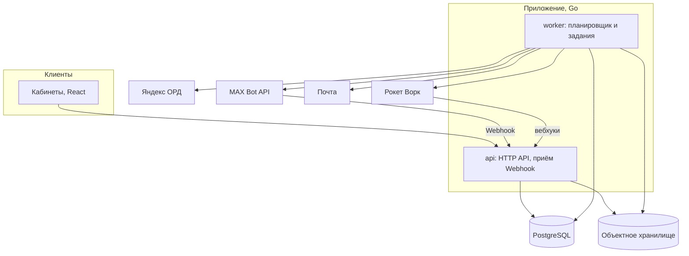

# 07. Нефункциональные требования

**Назначение.** Из чего собрана система и какими свойствами она обязана обладать: планировщик, надёжность, безопасность, журналирование, эксплуатация. Единый источник требований к журналированию для всех ТЗ.

**Связанные документы.** [03-placement.md](03-placement.md) §5, §11 — таймеры и идемпотентность; [04-domain-model.md](04-domain-model.md) §8 — служебные таблицы; [05-integrations.md](05-integrations.md) §1 — правила внешних вызовов.

**Затронутые записи реестра.** D-04, D-05, D-09, A-10, A-12, A-13, A-19, A-24, A-26, A-27, A-34, Q-03, Q-12, Q-35.

## 1. Стек и состав

Утверждено: бэкенд на Go, кабинеты на React (D-09). Остальное — допущения (A-26); выбор конкретных библиотек делается на этапе «Каркас и аккаунты» и фиксируется в архитектурном документе проекта.

| Часть | Решение | Основание |
|---|---|---|
| Бэкенд | Go, один репозиторий, один исполняемый файл с режимами `api` и `worker` | D-09 |
| Кабинеты | React, одностраничное приложение; три раздела с общей оболочкой: рекламодатель, блогер, администратор | D-09 |
| Данные | PostgreSQL — единственное хранилище | A-26 |
| Очередь заданий | Таблица `job` в PostgreSQL; отдельного брокера нет | A-26 |
| Файлы | S3-совместимое объектное хранилище: закрытая область для оригиналов и документов, публичная — для производных | A-26 |
| Обработка изображений | Библиотека на стороне бэкенда: плашка, превью | D-04 |
| Почта | Внешний почтовый сервис по SMTP или API | A-13, A-19 |
| Редактор | Библиотека WYSIWYG с настраиваемой схемой документа | D-05 |

Правила состава:

- `api` не обращается к внешним системам, кроме объектного хранилища и чтения сведений о канале при подключении (05 §1). Всё остальное — через задание.
- `api` и `worker` запускаются в нескольких экземплярах; общее состояние — только в базе.
- Модули бэкенда соответствуют группам модели данных (04 §2–§8): аккаунты, каналы, посты, заказы и размещения, маркировка, деньги, уведомления. Модуль размещений не вызывает адаптеры напрямую — только создаёт задания.

## 2. Планировщик

Все отложенные и фоновые действия — задания в таблице `job` (04 §8).

**Гарантия.** Каждое задание выполняется не менее одного раза. Поэтому любой обработчик идемпотентен: проверяет состояние перед действием (03 §11).

**Взятие в работу.** Экземпляр `worker` выбирает задания с `status = pending` и `run_at <= now()` с блокировкой строк и пропуском заблокированных, помечает `running`, записывает себя в `locked_by`. Задание в `running` дольше 10 минут без отметки считается брошенным и возвращается в `pending`.

**Создание.** Задание, порождённое переходом состояния, создаётся в той же транзакции, что и переход (I-10). Так задание не теряется и не появляется без перехода.

**Повторы.** При ошибке — `attempts + 1`, следующий запуск через `min(30 с × 2^attempts, 1 ч)`. После `max_attempts` — `failed` и оповещение. Значения по видам:

| Вид задания (`job.kind`) | Когда | `max_attempts` | Особенности |
|---|---|---|---|
| `process_inbound_event` | Сразу | 10 | — |
| `placement_timer` | По таблице 03 §5 | 5 | Полезная нагрузка: размещение, номер таймера, ожидаемое состояние |
| `publish_placement` | `publish_at` | — | Повторяется каждые 30 с до T-03, затем P-09 |
| `remove_placement` | `remove_at` | — | Повторяется с нарастающей задержкой до T-10 |
| `reconcile_publications` | Каждые 5 мин | 1 | Следующий запуск создаётся независимо от исхода |
| `sync_ord_object` | Сразу | 10 | Объект ОРД и операция; затем `sync_status = error` |
| `poll_ord_status` | По расписанию 05 §3.5 | — | До финального статуса или 24 ч |
| `ord_monthly_report` | 1-е число | 3 | 05 §3.7 |
| `send_payout` | Сразу | 10 | 05 §4.3 |
| `poll_payout`, `poll_contractor` | По расписанию 05 §4.2 | — | Если нет вебхуков |
| `refresh_channel_metrics` | Раз в сутки на канал | 3 | Запуски распределены по суткам |
| `build_media_derivative` | Сразу | 5 | — |
| `send_notification` | Сразу | 5 | — |
| `check_ledger_balance` | Каждый час | 1 | 06 §2.2 |
| `check_rocketwork_deposit` | Каждый час | 1 | 05 §4.3 |
| `generate_closing_acts` | 1-е число | 3 | 06 §2.5 |
| `cleanup` | Раз в сутки | 1 | Удаление устаревших `outbound_request`, кодов, сессий |

**Точность.** Публикация и снятие начинаются не позже чем через 10 секунд после назначенного времени при работающей системе. Опрос таблицы заданий — не реже раза в секунду.

**После простоя.** При запуске `worker` обрабатывает просроченные задания по правилам:

| Задание | Просрочено | Действие |
|---|---|---|
| `publish_placement` | Не больше 30 мин (T-03) | Выполнить немедленно |
| `publish_placement` | Больше 30 мин | P-09 с причиной `publish_error`; оповещение |
| `remove_placement` | Любое время | Выполнить немедленно; `removed_at` — фактическое время |
| `placement_timer` | Любое время | Выполнить немедленно |
| Периодические | Любое время | Один запуск, без «догоняющих» повторов |

Простой дольше 30 минут — оповещение уровня ERROR со списком затронутых размещений. Задержка снятия не является нарушением со стороны блогера и основанием для спора.

**Уникальность.** `dedupe_key` не даёт создать два живых задания одного назначения: `publish:{placement_id}`, `remove:{placement_id}`, `timer:{placement_id}:{номер}`, `payout:{payout_id}`.

## 3. Надёжность

**Сверка.** Задание `reconcile_publications` каждые 5 минут сравнивает ожидаемое состояние публикаций с фактическим в MAX (A-27); алгоритм — 05 §2.8. Сверка — запасной путь на случай потерянных событий, поэтому работает независимо от Webhook.

**Потеря событий.** Система не полагается на то, что событие придёт. Каждое решение, зависящее от события, имеет запасную проверку: сверка публикаций, суточная проверка прав бота, опрос статусов ОРД и выплат.

**Сходимость денег.** Раз в час — проверка журнала проводок (06 §2.2) и депозита Рокет Ворк (06 §2.4).

**Зависшие объекты.** Раз в час ищутся и поднимаются оповещением:

| Что | Порог |
|---|---|
| Версия поста в `approved` без erid | 1 ч (T-11) |
| Размещение в `scheduled` с прошедшим `publish_at` | 35 мин |
| Публикация с `removal_overdue` | 1 ч |
| Размещение в `accepted` без выплаты `succeeded` | 72 ч (T-12) |
| Объект ОРД в `sent` | 24 ч |
| Входящее событие в `received` | 10 мин |
| Задание в `failed` | Сразу |

**Оповещения администратору.** Канал — почта и чат дежурных; уровни WARN и ERROR; повторное оповещение по той же причине — не чаще раза в час. Перечень причин — столбец «Оповещение» в §5.3 и таблицы выше.

**Отказ внешней системы.** Поведение — 01 §6 и 05 §1. Недоступность ОРД, Рокет Ворк или почты не останавливает публикацию и снятие.

**Отказ базы данных.** Приложение не работает; после восстановления — правила «после простоя» (§2).

## 4. Безопасность

**Вход.** По почте с одноразовым кодом (A-13): 6 цифр, срок 10 минут, 5 попыток ввода, не больше 5 кодов на адрес в час и 20 на IP-адрес в час. Код хранится хешем. Ответ на запрос кода одинаков для существующего и нового адреса.

**Сессии.** Случайный токен не короче 256 бит; в базе — хеш. Передаётся в cookie с признаками `HttpOnly`, `Secure`, `SameSite=Lax`. Срок — 30 суток от последнего использования. Меняющие запросы защищены от межсайтовой подделки. Вход администратора — отдельный срок сессии 12 часов.

**Доступ.**

- Каждый запрос кабинета проверяет, что пользователь — участник организации, которой принадлежит объект. Проверка делается в слое доступа к данным: выборки всегда ограничены организацией.
- Роли администратора: `moderator` — модерация каналов и постов, споры; `senior` — дополнительно ручные операции с деньгами, справочники, блокировки.
- Блогер видит пост только после P-02 и только по своим размещениям. Рекламодатель не видит реквизиты блогера, блогер — баланс рекламодателя.

**Webhook.** Входящие запросы MAX и Рокет Ворк проверяются на подлинность до сохранения. Способ для MAX — Q-35; до ответа: секретный токен, заданный при подписке, плюс секретная часть пути адреса. Тело ограничено 1 МБ.

**Секреты.** Токен бота MAX, OAuth-токен ОРД, ключи Рокет Ворк, ключи хранилища и почты — в переменных окружения из хранилища секретов. Если секрет хранится в базе — только зашифрованным, ключ шифрования — вне базы. Секреты не попадают в журнал, `outbound_request`, сообщения об ошибках и репозиторий.

**Файлы.**

- Принимаются только JPEG, PNG, WebP; тип определяется по содержимому, а не по расширению.
- Пределы: 50 МБ, 7680×7680.
- Метаданные изображения удаляются при построении производных.
- Имя в хранилище генерируется системой. Оригиналы недоступны по публичным ссылкам; выдаются через кратковременные подписанные ссылки.
- Публичны только производные `labeled` и `plain`, вошедшие в версию поста; их адрес не перечисляем.

**Ввод.** Все входные данные проверяются на сервере. Текст поста хранится как документ редактора и сериализуется сервером; HTML от клиента не принимается. Адреса ссылок — только `https://`.

**Деньги.**

- Суммы считаются только на сервере; клиент передаёт идентификаторы, а не суммы.
- Любая денежная операция имеет ключ идемпотентности (06 §2.2).
- Ручные операции администратора требуют роли `senior` и основания; проводка `manual` свыше порога (параметр, рабочее значение 100 000 ₽) требует подтверждения вторым администратором.
- Роль базы данных приложения не имеет прав `update` и `delete` на неизменяемые таблицы (04 §1).

**Ограничение частоты.** На запрос кода, вход, создание счёта, загрузку файлов, подачу претензии — по пользователю и по IP-адресу.

**Транспорт.** Только HTTPS; заголовки безопасности для кабинетов.

## 5. Журналирование и наблюдаемость

Раздел обязателен для каждого ТЗ. Требования документов 03 §12, 05 §1, 06 §11 сведены здесь.

### 5.1. Правила

- Формат — структурированный, JSON, одна запись — одна строка, вывод в стандартный поток.
- Уровень задаётся переменной окружения `LOG_LEVEL`: `debug`, `info`, `warn`, `error`. Значение по умолчанию в продакшене — `info`, в разработке — `debug`. Смена уровня не требует изменения кода.
- Обязательные поля записи: время (UTC), уровень, сообщение, компонент (`api` или `worker`), модуль, операция в виде `Модуль.Операция`, сквозной идентификатор.
- **Сквозной идентификатор.** Создаётся на входе запроса или при запуске задания и передаётся во все вызовы, включая исходящие запросы и порождённые задания. Задание, созданное при обработке запроса, наследует его идентификатор.
- Поля предметной области добавляются, когда известны: `organization_id`, `user_id`, `order_id`, `placement_id`, `channel_id`, `job_id`, `inbound_event_id`.
- Сообщение — короткая постоянная строка на английском без подставленных значений; значения — в полях.

### 5.2. Уровни

| Уровень | Что пишется |
|---|---|
| DEBUG | Вход и выход значимых функций; каждый внешний вызов с длительностью; решения ветвлений; проигнорированные повторные события |
| INFO | Событие предметной области произошло: переход состояния, проводка, публикация, снятие, выплата, регистрация в ОРД, вход пользователя, запуск и завершение задания |
| WARN | Отклонение, с которым система справилась: отклонённый переход, повтор внешнего вызова, нарушение, найденное контролем, ручная операция администратора, поступление без сопоставления |
| ERROR | Требуется человек: исчерпаны повторы, расхождение денег, нарушение инварианта, сбой задания, простой |

### 5.3. Обязательные события

| Событие | Уровень | Оповещение |
|---|---|---|
| Переход размещения выполнен | INFO | — |
| Переход размещения отклонён | WARN | — |
| Попытка нарушить инвариант I-01 … I-13 | ERROR | да |
| Сработал таймер | INFO | — |
| Истёк срок T-06, T-07, T-10, T-11, T-12 | WARN | да |
| Обнаружено нарушение размещения | WARN | — |
| Внешний вызов: начало и результат | DEBUG | — |
| Внешняя операция выполнена | INFO | — |
| Внешний вызов: повтор | WARN | — |
| Внешний вызов: повторы исчерпаны или отказ | ERROR | да |
| Сработал предохранитель | ERROR | да |
| Входящее событие принято, обработано | INFO | — |
| Входящее событие не прошло проверку подлинности | WARN | при повторении |
| Проводка создана | INFO | — |
| Проводка отклонена | WARN | — |
| Ручная денежная операция | WARN | — |
| Расхождение сходимости или депозита | ERROR | да |
| Задание запущено, завершено | INFO | — |
| Задание завершилось ошибкой, будет повтор | WARN | — |
| Задание исчерпало попытки | ERROR | да |
| Запуск после простоя, список затронутых размещений | ERROR | да |
| Вход, выход, неудачная попытка входа | INFO, INFO, WARN | при всплеске |
| Отказ в доступе (`403`) | WARN | при всплеске |
| Действие администратора | INFO или WARN по S-19 | — |

### 5.4. Запрещено писать в журнал

- Токены, ключи, коды входа и привязки, cookie, заголовок `Authorization`.
- Почту, телефон, ИНН, ФИО — только в маскированном виде: `i***@example.ru`, `77******1234`.
- Текст поста и тело файлов. Идентификаторы — можно.
- Полное тело ответа внешней системы на уровне выше DEBUG; на DEBUG — после маскирования.

### 5.5. Метрики

Приложение отдаёт метрики в формате, пригодном для сбора системой мониторинга:

- число и длительность HTTP-запросов по маршруту и коду;
- число, длительность и исходы внешних вызовов по системе и операции;
- задания: в очереди, в работе, просроченные, сбойные — по виду;
- задержка публикации и снятия относительно плана;
- число размещений по состояниям;
- остатки счетов учёта по видам; остаток депозита Рокет Ворк;
- число объектов ОРД в состоянии `error`;
- возраст самого старого необработанного входящего события.

Проверки готовности: отдельные адреса для «процесс жив» и «готов принимать запросы» (есть связь с базой).

## 6. Уведомления

Каналы доставки (A-19):

| Получатель | Основной | Дополнительный |
|---|---|---|
| Блогер | Бот MAX, личное сообщение | Почта |
| Рекламодатель | Почта | Кабинет |
| Администратор | Почта и чат дежурных | Кабинет |

- Уведомление создаётся записью `notification` в транзакции события и отправляется заданием `send_notification`.
- Сбой доставки не влияет на событие. Если бот не может написать блогеру, остаётся почта.
- Сообщения боту блогеру идут через общий ограничитель MAX (05 §2.8) с приоритетом ниже публикаций.
- Шаблон определяется кодом; тексты хранятся в репозитории.

Обязательные уведомления:

| Событие | Рекламодателю | Блогеру |
|---|---|---|
| Баланс пополнен | да | — |
| Пост одобрен, отклонён | да | — |
| Новый запрос на размещение (P-02) | — | да |
| До конца T-01 осталось 3 часа | — | да |
| Принято, время назначено или перенесено (P-03, P-07) | да | — |
| Отказ, таймаут, отмена (P-04, P-05, P-06) | да | да |
| Размещение вернулось в подготовку (P-11) | — | да |
| Опубликовано (P-08) | да, со ссылкой | да |
| Публикация сорвана (P-09) | да | да |
| Снято (P-10) | да, с просмотрами и кнопками приёмки | да |
| Открыт спор (P-14) | да | да |
| Решение по спору (P-15) | да | да |
| Принято, выплата отправлена | — | да |
| Выплачено (P-16) | — | да, со ссылкой на чек |
| Выплата не прошла | — | да |
| Канал одобрен, отклонён, приостановлен, отключён | — | да |
| Сформированы закрывающие документы | да | — |

## 7. Производительность и объёмы

Целевые значения первой версии (A-34):

| Показатель | Значение |
|---|---|
| Каналов в каталоге | до 2 000 |
| Размещений в сутки | до 500 |
| Одновременных пользователей кабинетов | до 50 |
| Ответ API кабинета, 95-й процентиль | до 500 мс; каталог с фильтрами — до 1 с |
| Приём Webhook, 95-й процентиль | до 200 мс |
| Задержка публикации и снятия | до 10 с от назначенного времени |
| Построение производной для изображения 4000×4000 | до 5 с |

Проверка лимита MAX: 2 000 каналов × суточные метрики (2 запроса) и до 100 живых публикаций × сверка каждые 5 минут (до 2 запросов) дают в среднем меньше одного запроса в секунду при лимите 30. Узкое место — пики публикаций в круглое время; `publish_at` кратно 5 минутам, а запуски в пределах одного интервала распределяются ограничителем.

## 8. Размещение и эксплуатация

**Площадка.** Серверы, база данных, объектное хранилище и резервные копии — в России (A-24).

**Окружения.**

| Окружение | Назначение | Внешние системы |
|---|---|---|
| Разработка | Локальный запуск | Поддельные адаптеры; для MAX допускается тестовый бот в режиме Long Polling |
| Тестовое | Проверка перед выпуском | Тестовый бот MAX и тестовый канал; тестовый контур Яндекс ОРД; тестовая среда Рокет Ворк, если есть (Q-12) |
| Продакшен | Работа | Боевые |

Данные продакшена в другие окружения не переносятся.

**Конфигурация.** Только через переменные окружения. Группы: адреса и учётные данные базы, хранилища, почты; токены внешних систем; `LOG_LEVEL`; параметры предметной области. Параметры предметной области — все таймеры 03 §5, ставка комиссии, порог РКН, пределы редактора, пороги аномалий, лимиты ограничителей — имеют значения по умолчанию из документов и переопределяются без изменения кода. Приложение при запуске проверяет конфигурацию и не стартует при ошибке.

**Миграции.** Схема базы меняется только миграциями в репозитории; миграции выполняются до запуска новой версии приложения и совместимы с предыдущей версией кода.

**Резервные копии.** Полная копия базы — ежедневно, хранение 30 суток; непрерывное сохранение журнала изменений для восстановления на момент времени в пределах 7 суток. Объектное хранилище — с версионированием. Восстановление проверяется раз в квартал на тестовом окружении. Целевые значения: потеря данных — не больше 5 минут, восстановление — не больше 4 часов.

**Выпуск.** Сборка и тесты — автоматически на каждое изменение. Выпуск без простоя: экземпляры `api` и `worker` заменяются по одному; `worker` перед остановкой заканчивает текущие задания или возвращает их в очередь.

**Время.** Серверы синхронизированы по времени; приложение работает в UTC (A-12).

## 9. Требования к коду

Для агентов, которые пишут код по ТЗ этапов.

- **Источник названий** — глоссарий. Имена таблиц, полей, значений перечислений, кодов переходов и причин берутся из документов без изменений.
- **Машина состояний** — одна таблица переходов в коде, соответствующая 03 §4. Смена состояния размещения возможна только через неё; прямое обновление `placement.status` из другого места запрещено.
- **Проводки** — только через один модуль, реализующий 06 §2.2. Прямая запись в `ledger_entry` запрещена.
- **Внешние вызовы** — только через адаптеры (05 §1) и только из заданий.
- **Обязательные тесты:**
  - каждый переход P-01 … P-16 — успешный путь и отклонение из каждого недопустимого состояния;
  - каждый инвариант I-01 … I-13;
  - каждая строка таблицы проводок 06 §2.3 и сходимость после неё;
  - формулы 03 §7 и 06 §3 на граничных значениях: доля 0, 1, 9999, 10000; суммы, дающие остаток при округлении;
  - идемпотентность: повтор каждого задания и каждого входящего события;
  - сериализатор редактора — на каждый элемент схемы (05 §2.5);
  - сопоставление поступлений (05 §5).
- **Тесты без внешних систем**: используются поддельные адаптеры; база — настоящая PostgreSQL.
- **Метки реестра в коде.** Место, реализующее допущение или рабочий ответ на открытый вопрос, помечается комментарием с номером: `// A-10`, `// Q-03`. По номеру находится всё, что нужно править при смене ответа.
- **Журналирование** — по §5; отсутствие обязательного события из §5.3 считается дефектом.
- **Время и деньги** — по соглашениям README: `timestamptz` в UTC, `bigint` в копейках. Текущее время берётся через подменяемый источник, чтобы таймеры проверялись тестами.
