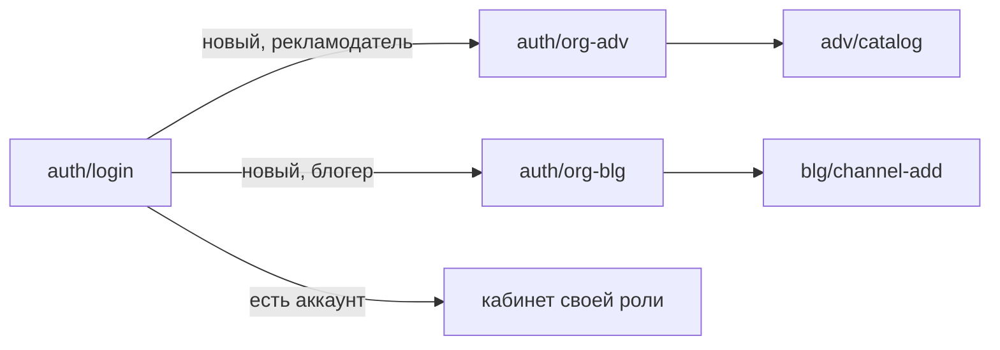
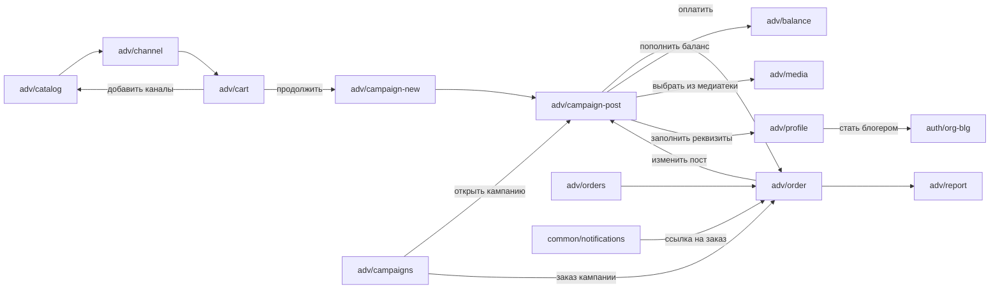
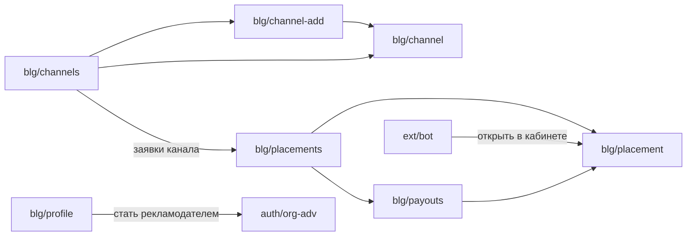
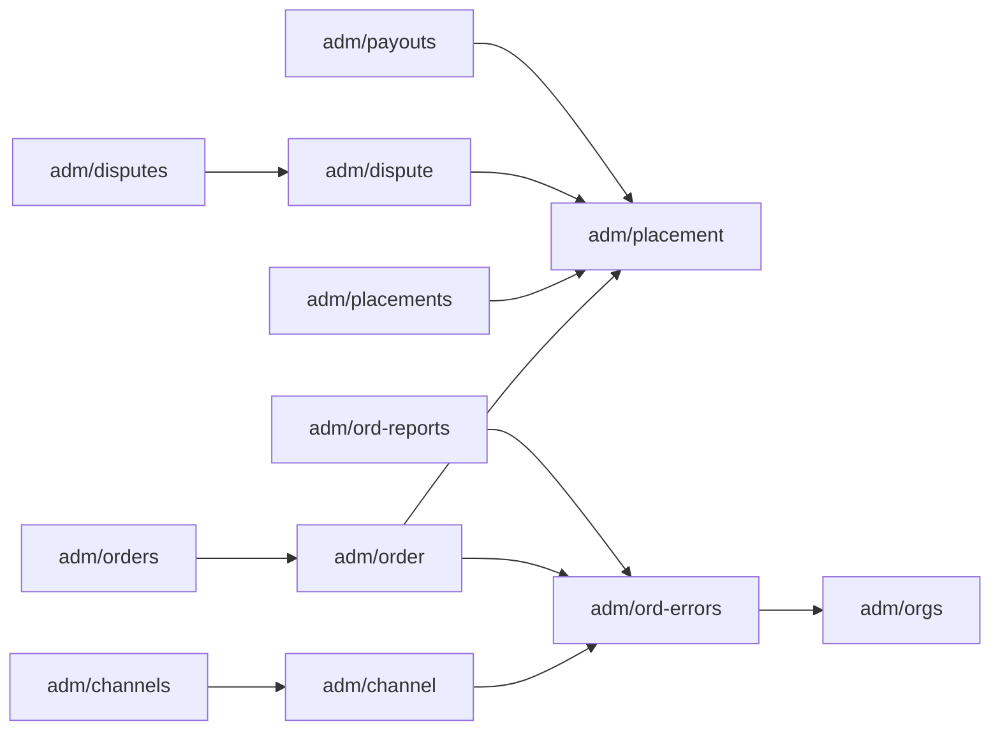

# 08. Схема экранов

**Назначение.** Какие страницы и формы есть в кабинетах и из каких элементов состоит каждая. Источник правды по составу экранов: по нему пишутся ТЗ этапов и вёрстка.

**Связанные документы.** [02-scenarios.md](02-scenarios.md) — сценарии, которые экран обслуживает; [03-placement.md](03-placement.md) — состояния; [04-domain-model.md](04-domain-model.md) — поля; [wireframe/index.html](wireframe/index.html) — кликабельный прототип, иллюстрация к этой схеме; [wireframe/screens.drawio](wireframe/screens.drawio) — макет в draw.io: карта переходов и по странице на экран, рабочий черновик для разбора.

**Затронутые записи реестра.** D-14, D-16, D-17, D-18, D-19, D-20, D-22, D-23, D-24, D-25, D-26, D-27, D-28, D-29, D-30, A-05, A-13, A-41, Q-37, Q-38.

## 1. Как читать

Схема экрана — дерево: экран → блок или форма → элемент. Экран разбирается с заказчиком по одному; согласованный состав фиксируется здесь, прототип приводится в соответствие. При расхождении прототипа со схемой права схема.

| Обозначение | Смысл |
|---|---|
| `[поле]` | Поле ввода. `*` — обязательное |
| `[выбор]` | Выбор одного значения из нескольких |
| `[флажок]` | Отметка да/нет |
| `[файл]` | Загрузка файла |
| `[кнопка]` | Действие. После `→` — куда ведёт или что происходит |
| `[ссылка]` | Переход без изменения данных |
| `[текст]` | Надпись или значение только для чтения |
| `[таблица]` | Список строк; вложенные пункты — колонки |
| `[ошибка]` | Сообщение, которое появляется при сбое проверки |
| `(если …)` | Условие, при котором элемент показывается |

Адрес экрана совпадает с адресом в прототипе и с предполагаемым маршрутом кабинета.

## 2. Порядок разбора

Статусы: «не разобран» — состав взят из прототипа и заказчиком не подтверждён; «на разборе»; «согласован» — схема экрана записана в §4.

| № | Адрес | Экран | Статус |
|---|---|---|---|
| 1 | `auth/login` | Вход по почте (3 шага: почта, код, роль) | согласован |
| 2 | `auth/org-adv` | Реквизиты рекламодателя | на разборе |
| 3 | `auth/org-blg` | Реквизиты блогера (шаг привязки MAX убран, D-25) | на разборе |
| 4 | `adv/catalog` | Каталог | на разборе |
| 5 | `adv/channel` | Карточка канала | не разобран |
| 6 | `adv/cart` | Корзина | на разборе |
| 7 | `adv/campaigns` | Кампании: библиотека кампаний (заменила «Посты», D-16) | на разборе |
| 8 | `adv/post-edit` | Редактор поста — убран, пост редактируется на `adv/campaign-post` (D-16) | убран |
| 9 | `adv/media` | Медиатека | не разобран |
| 10 | `adv/orders` | Заказы | не разобран |
| 11 | `adv/order` | Заказ и его размещения (с окнами «Претензия» и «Спор») | не разобран |
| 12 | `adv/report` | Отчёт по кампании | не разобран |
| 13 | `adv/balance` | Баланс | не разобран |
| 14 | `adv/profile` | Реквизиты рекламодателя в кабинете | не разобран |
| 15 | `blg/placements` | Запросы и размещения | не разобран |
| 16 | `blg/placement` | Запрос на размещение — панель справа на экране `blg/placements`, не отдельная страница | не разобран |
| 17 | `blg/channels` | Каналы | не разобран |
| 18 | `blg/channel-add` | Добавление канала | не разобран |
| 19 | `blg/channel` | Настройка канала: описание, цены, недоступность | не разобран |
| 20 | `blg/payouts` | Выплаты | не разобран |
| 21 | `blg/profile` | Реквизиты блогера в кабинете | не разобран |
| 22 | `adm/channels` | Каналы: очередь модерации | не разобран |
| 23 | `adm/channel` | Канал: модерация | не разобран |
| 24 | `adm/orders` | Заказы: очередь модерации постов | не разобран |
| 25 | `adm/order` | Заказ: модерация поста | не разобран |
| 26 | `adm/placements` | Размещения | не разобран |
| 27 | `adm/placement` | Размещение: история и ручные операции | не разобран |
| 28 | `adm/disputes` | Споры | не разобран |
| 29 | `adm/dispute` | Разбор спора | не разобран |
| 30 | `adm/payments` | Оплаты: выписка и счета | не разобран |
| 31 | `adm/withdrawals` | Заявки на вывод — убран: вывода остатка из кабинета нет (D-26) | убран |
| 32 | `adm/payouts` | Реестр выплат блогерам | не разобран |
| 33 | `adm/ledger` | Проводки | не разобран |
| 34 | `adm/ord-errors` | ОРД: ошибки синхронизации | не разобран |
| 35 | `adm/ord-reports` | ОРД: ежемесячная отчётность | не разобран |
| 36 | `adm/orgs` | Организации и пользователи | не разобран |
| 37 | `adm/audit` | Журнал действий | не разобран |
| 38 | `common/notifications` | Уведомления в кабинете | не разобран |
| 39 | `ext/bot` | Бот MAX: сообщения блогеру (не экран кабинета) | не разобран |
| 40 | `adv/campaign-new` | Единый пост для всех каналов: новая кампания | на разборе |
| 41 | `adv/campaign-post` | Пост кампании, общие требования, токен креатива, оплата | на разборе |

## 3. Карта переходов

Показаны основные переходы. Меню кабинета доступно с любого экрана своей роли и на схеме не рисуется.









## 4. Экраны

### 4.1. `auth/login` — Вход по почте

Сценарии: S-01, S-10. Этап: «Каркас бэкенда и аккаунты». Статус: согласован.

Один экран, три шага; виден один шаг. Оболочки кабинета (шапка, меню) нет.

```
auth/login
├─ Шаг 1. Форма «Почта»
│  ├─ [текст]   Заголовок и пояснение: «Введите почту — пришлём код. Пароль не нужен»
│  ├─ [поле]*   Почта
│  ├─ [кнопка]  Получить код → шаг 2, на почту уходит код
│  └─ [текст]   Вход и регистрация — одна форма
├─ Шаг 2. Форма «Код»
│  ├─ [текст]   На какую почту отправлен код, срок действия 10 минут
│  ├─ [поле]*   Код из письма, 6 цифр
│  ├─ [кнопка]  Войти → новый пользователь: шаг 3; существующий: кабинет своей роли
│  ├─ [кнопка]  Отправить ещё раз
│  ├─ [кнопка]  Изменить почту → шаг 1
│  ├─ [ошибка]  Код неверен, осталось попыток: N (всего 5)
│  └─ [ошибка]  Код просрочен, запросите новый
└─ Шаг 3. Форма «Роль» (если пользователь новый)
   ├─ [выбор]   Рекламодатель → auth/org-adv
   └─ [выбор]   Блогер → auth/org-blg
```

### 4.2. `auth/org-adv` — Реквизиты рекламодателя

Сценарии: S-01. Этап: «Каркас бэкенда и аккаунты». Статус: на разборе.

Открывается один раз, сразу после выбора роли «Рекламодатель». Оболочки кабинета нет.

```
auth/org-adv
├─ Форма «Организация»
│  ├─ [выбор]*  Тип лица: юрлицо / ИП / самозанятый
│  ├─ [поле]*   ИНН — 10 цифр для юрлица, 12 для ИП и самозанятого
│  ├─ [поле]*   Сокращённое наименование организации (если юрлицо)
│  ├─ [поле]*   ФИО (если ИП или самозанятый)
│  ├─ [поле]*   Адрес — юридический для юрлица, регистрации для ИП (если юрлицо или ИП)
│  ├─ [поле]*   Контактное лицо
│  ├─ [поле]*   Телефон
│  ├─ [ошибка]  ИНН не прошёл проверку
│  └─ [ошибка]  ИНН уже занят — обратитесь в поддержку
├─ Блок «Документы»
│  ├─ [флажок]* Принимаю оферту рекламодателя + [ссылка] на текст
│  ├─ [флажок]* Принимаю правила площадки + [ссылка] на текст
│  └─ [флажок]* Согласен с политикой персональных данных + [ссылка] на текст
└─ [кнопка]  Сохранить и перейти в каталог → adv/catalog
```

Самозанятый допускается как рекламодатель (D-24). КПП, режима налогообложения, ставки НДС, документа о режиме и данных подписанта у рекламодателя нет (D-24, 2026-10-15); эти поля остаются только у блогера (§4.3). Адрес самозанятого не запрашивается, как у блогера. Обязательность полей — рабочая.

### 4.3. `auth/org-blg` — Реквизиты блогера

Сценарии: S-10. Этап: «Каркас бэкенда и аккаунты». Статус: на разборе.

Открывается один раз, сразу после выбора роли «Блогер». Один экран, одна форма. Оболочки кабинета нет. Состав задан заказчиком 2026-10-13. Шага привязки аккаунта MAX нет (D-25, 2026-10-15): канал связывается с кабинетом кодом подключения на `blg/channel-add` (A-41, Q-38). Обязательность полей — рабочая.

```
auth/org-blg
└─ Форма «Реквизиты»
   ├─ [текст]   Заголовок и пояснение: «Реквизиты нужны для договора, маркировки и выплат»
   ├─ [выбор]*  Тип лица: самозанятый / ИП / юрлицо
   ├─ [поле]*   ИНН — 12 цифр для самозанятого и ИП, 10 для юрлица
   ├─ [поле]*   КПП — 9 цифр (если юрлицо)
   ├─ [поле]*   ФИО (если самозанятый или ИП)
   ├─ [поле]*   Сокращённое наименование организации (если юрлицо)
   ├─ [поле]*   Адрес — регистрации для ИП, юридический для юрлица (если ИП или юрлицо)
   ├─ [выбор]*  Режим налогообложения — список зависит от типа лица
   ├─ [выбор]*  Ставка НДС — список зависит от режима
   ├─ [файл]*   Документ, подтверждающий систему налогообложения
   ├─ [поле]*   Телефон
   ├─ Блок «Данные подписанта» (если юрлицо)
   │  ├─ [поле]*   Должность
   │  ├─ [поле]*   ФИО
   │  ├─ [поле]*   Документ, на основании которого действует: название
   │  └─ [поле]*   Документ, на основании которого действует: номер
   ├─ [флажок]* Принимаю оферту блогера + [ссылка] на текст
   ├─ [флажок]* Принимаю правила площадки + [ссылка] на текст
   ├─ [флажок]* Согласен с политикой персональных данных + [ссылка] на текст
   ├─ [кнопка]  Сохранить и добавить канал → blg/channel-add
   └─ [ошибка]  ИНН не прошёл проверку или уже занят
```

Какие режимы доступны типу лица и какие ставки НДС — режиму, записано в 04 §2 (рабочие таблицы, Q-37). Самозанятому режим и ставка подставляются без выбора: НПД, без НДС. Документ о режиме загружается отдельным запросом `PUT /organizations/current/tax-document` после сохранения реквизитов: PDF, JPEG или PNG до 10 МБ, тип определяется по содержимому (07 §4); новый файл заменяет прежний. Организация сохраняется и без файла, признак загрузки — `tax_document_uploaded`.
